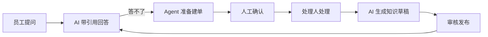
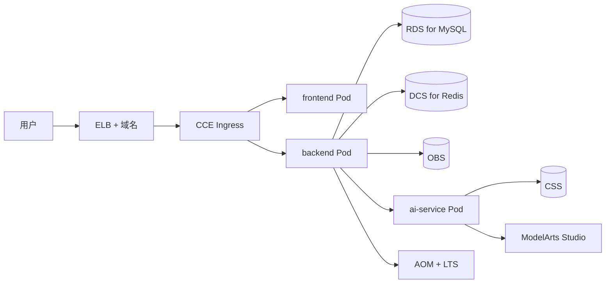
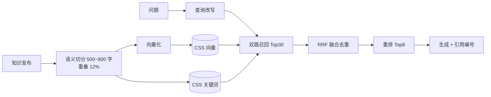
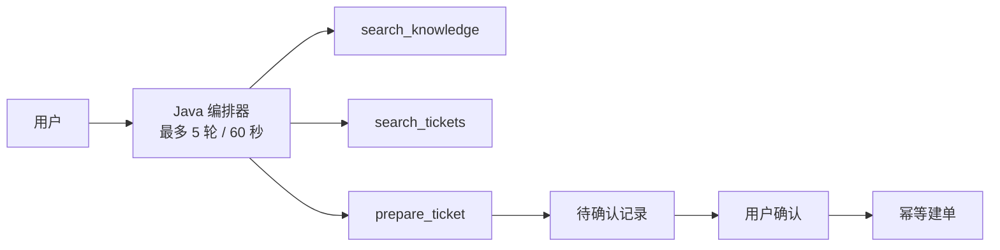

# Smart Work Order 竞赛版设计方案

> 企业服务智能体平台：员工用自然语言提问或报障，AI 基于知识库给出带引用的答案；答不了就由 Agent 准备工单，人工确认后落库；工单解决后自动沉淀为新知识。
> 业务系统是 Agent 的"手"和"记忆"，AI 是产品主线。

---

## 1. 角色与闭环

| 角色 | 代码 | 诉求 |
|---|---|---|
| 员工 | `EMPLOYEE` | 问知识、提工单、看进度、评价回答 |
| 处理人 | `HANDLER` | 接单、看 AI 摘要与草稿、解决、转知识 |
| 管理员 | `ADMIN` | 组织与分类管理、知识审核、AI 运营看板 |



---

## 2. 功能范围

### 2.1 对外接口（77 个）

| 分组 | 编号（看api.md） | 数量 | 权限 |
|---|---|---:|---|
| 账号与组织 | A01–A04、U01–U07、D01–D04、R01、C01–C04 | 20 | 登录 / `user:manage` / `system:manage` |
| 工单 | T01–T13 | 13 | `ticket:create` / `ticket:read` / `ticket:handle` / `ticket:assign` / `ticket:delete` |
| 知识文章 | K01–K09 | 9 | `knowledge:read` / `knowledge:maintain` / `knowledge:review` |
| 知识文档 | F01–F11 | 11 | 同上 |
| 知识索引 | I01–I04 | 4 | `knowledge:maintain` |
| 会话与反馈 | Q01–Q09 | 9 | `chat:use`，仅会话所有者 |
| 工单 AI 辅助 | H01–H04 | 4 | `ticket:create` / `ticket:handle` |
| Agent | G01–G04 | 4 | `chat:use`，仅操作所有者 |
| 统计 | S01–S03 | 3 | `ticket:read` / `stats:ai` |

**实现分档**：接口契约全量真实，答辩环境不允许 Mock。

| 档 | 数量 | 范围 | 要求 |
|---|---:|---|---|
| A 真实现 | 54 | A01–A04、T01–T13、C01、U01–U07、D01–D04、R01、C02–C04、K01–K09、F01–F11、S01 | 演示主路径必须真跑 |
| B 可降级 | 16 | I01–I04、Q01–Q08、H01–H04 | AI 不可用时 503 或规则结果 |
| C 最后做 | 7 | Q09、G01–G04、S02–S03 | 未完成时前端隐藏入口 |

### 2.2 内部接口（10 个）

只走内网，请求头 `X-Internal-Token`。

| 编号 | 路径 | 用途 |
|---|---|---|
| P01 | `POST /internal/index-jobs` | 接受索引任务 |
| P02 | `GET /internal/index-jobs/{jobId}` | 查询索引进度 |
| P03 | `DELETE /internal/indexes/{type}/{id}?version=` | 删除指定版本索引 |
| P04 | `POST /internal/knowledge/search` | 授权检索 |
| P05 | `POST /internal/chat/generate` | 流式生成 |
| P06 | `POST /internal/tickets/suggestions` | 分类与优先级建议 |
| P07 | `POST /internal/tickets/summary` | 工单摘要 |
| P08 | `POST /internal/tickets/reply-draft` | 回复草稿 |
| P09 | `POST /internal/agent/steps` | Agent 推理 |
| J01 | `GET /internal/knowledge/{type}/{id}/source?version=` | Java 侧提供知识原文与文件 |

### 2.3 状态机与事件

- 工单：`PENDING → PROCESSING → RESOLVED → CLOSED`，`RESOLVED → PROCESSING`（重开）。
- 知识：`DRAFT → PENDING_REVIEW → PUBLISHED → DRAFT`（撤回）。
- SSE：普通问答 `meta / delta / references / done / error`；Agent 额外 `tool / action`。
- 错误码：400 / 401 / 403 / 404 / 409 / 422 / 429 / 500 / 503。

---

## 3. 系统架构



三条链路：

- **同步业务**：Ingress → JWT 拦截器 → 权限拦截器 → Controller → Service → RDS。
- **SSE 问答**：校验会话归属 → 存 USER 消息与 GENERATING 回答 → 先发 `meta` → P04 检索 → P05 生成 → 逐块转发 → 落库正文与引用 → `done`。
- **异步索引**：发布知识 → 写 `index_task` → 调度器原子领取 → P01 → 拉取原文 → 切分、向量化 → 写 CSS → 回写状态。

原则：权限判断只在 Spring Boot；业务库是唯一事实来源；向量与关键词索引均可重建。

---

## 4. 华为云选型

| 层 | 云服务 | 说明 | 本地替代 |
|---|---|---|---|
| 计算 | CCE | 前端、后端、AI 三个无状态 Deployment | Docker Compose |
| 数据库 | RDS for MySQL | 8.0，utf8mb4，UTC | MySQL 容器 |
| 缓存 | DCS for Redis | 令牌黑名单、限流、会话锁、问答缓存 | Redis 容器 |
| 对象存储 | OBS | 存知识文档，数据库只存 `objectKey` | 本地目录 |
| 向量与关键词 | CSS | 向量 + 标量过滤；是否支持前置过滤与中文分词**待核实** | Milvus standalone |
| 对话与向量模型 | ModelArts Studio | OpenAI 兼容；embedding 是否上架**待核实** | 任意兼容服务 |
| 重排 | MaaS 或无 | 无标准接口，大概率不提供；不提供时回退 RRF | 本地 cross-encoder |
| 镜像 | SWR | 三个服务镜像 | 本地 Docker |
| CI/CD | CodeArts Build / Deploy / Pipeline | 构建 → 推 SWR → 部署 CCE | 本地脚本 |
| 可观测 | AOM + LTS | 指标与日志 | 本地日志 |
| 密钥 | DEW | 环境变量注入 | `.env` |
| 入口 | ELB + WAF | 只暴露 80/443 | Nginx |

**CSS 降级**：若前置过滤性能不可接受，放大 topK 后在应用层按可见集过滤，并记录召回损耗。权限过滤不允许取消。

**OBS 下载**：F06 保持后端流式代理（getObject → 输出流），不用 302 预签名，避免 CORS 与链接外泄。

**MaaS 降级**：对话换备用供应商；embedding 用本地 bge-m3（维度必须与索引一致）；rerank 回退 RRF；流式失败改非流式，事件名不变。健康接口返回实际生效能力。

---

## 5. AI 设计

### 5.1 能力矩阵

| 能力 | 输入 → 输出 | 接口 |
|---|---|---|
| 知识问答 | 问题 + 多轮历史 → 流式回答 + 引用 | Q07 |
| 工单受理 | 标题 + 描述 → 分类 / 优先级 / 理由 | H01 |
| 工单摘要 | 工单 + 评论 + 方案 → 三段式摘要 | H02 |
| 回复草稿 | 工单上下文 + 意图 → 可编辑草稿 | H03 |
| 相似推荐 | 未提交描述 → 相似知识 + 相似工单 | H04 |
| 知识沉淀 | 已解决工单 → 知识草稿 | T13 |
| Agent 助手 | 自然语言 → 查询结果 / 待确认操作 | G01–G04 |
| 运营看板 | 调用日志与反馈 → 成功率 / 延迟 / 成本 / 自助解决率 | S02–S03 |

### 5.2 RAG 流水线



### 5.3 Agent



三条铁律：

1. 写操作必须人工确认，模型不能直接调创建接口。
2. 参数以服务端为准，模型与前端传的用户、部门、角色一律忽略。
3. 同一确认请求只生成一张工单，用唯一约束兜底。

### 5.4 硬约束

- 权限先于检索：部门与范围条件下推到召回，越权片段不进入候选。
- 引用可溯源：块绑定内容 ID + 版本 + 块序号，打开时二次鉴权。
- 无依据不编造：上下文不足时明确回答"没有找到足够依据"。
- 上下文是数据不是指令：不执行其中的任何指令。

### 5.5 评测

| 指标 | 口径 | 目标 |
|---|---|---|
| 回答命中率 | 固定 30 条样本 | 记录真实值 |
| 引用正确率 | 引用块确实支撑结论 | ≥ 90% |
| 越权率 | 跨部门片段出现次数 | 0 |
| 延迟 | P50 / P95 首字与整答 | 记录 |
| 成本 | 每千次问答 token 与费用 | 记录 |
| 自助解决率 | "已解决"反馈 / 有效回答数 | 记录，另展示反馈覆盖率 |

---

## 6. 开发过程与证据

| 环节 | 码道 / 华为云 | 产出 |
|---|---|---|
| 需求理解 | 读设计与赛题，生成 PRD、接口草案 | `docs/prd.md` |
| 代码生成 | Controller / Service / Mapper / Vue / FastAPI | 三端代码 |
| 项目构建 | CodeArts Build：Maven + Node + Docker | `ci/pipeline.yml` |
| 问题修复 | 构建与运行日志喂给智能体定位 | `docs/fix-log.md` |
| 部署上线 | CodeArts Deploy → CCE，滚动更新 + 健康检查 | `docs/deployment.md` |

| 证据文件 | 必备内容 |
|---|---|
| `docs/cloud-value.md` | 五环节 × {服务、输入、产出、截图、人工修改点、耗时对比} |
| `docs/dev-log.md` | 日期、目标、调用能力、prompt 摘要、生成文件、采纳率、人工改动、验证 |
| `docs/codearts/agent-sessions.md` | 智能体/技能名、时间、任务、产出、是否采纳、导出链接 |
| `docs/fix-log.md` | 现象、日志、根因、建议、采纳理由、修复验证 |

**可信关键**：git 提交时间与开发日志日期一致；保留一次真实的"构建失败 → 定位 → 修复"；控制台截图带区域与时间。

| Skill | 作用 | 回滚 |
|---|---|---|
| `provision-rds` | 开通 RDS，建库建账号 | 删除实例 |
| `provision-dcs` | 开通 DCS，输出连接串 | 删除实例 |
| `create-obs-bucket` | 创建私有文档桶与最小权限策略 | 清空后删桶 |
| `init-schema` | 执行建表 SQL 与种子数据 | 重建库 |
| `deploy-cce` | 构建镜像推 SWR 并部署 CCE | 回滚上一 tag |

流水线：提交 → 代码检查 → 并行构建 → 单测 → 推 SWR → 部署 CCE → 健康检查 → 失败通知。

---

## 7. 部署

- **网络**：只暴露 ELB 的 80/443；RDS、DCS、CSS、OBS、FastAPI、`/internal/**` 全部内网。
- **密钥**：全部环境变量，来自 DEW；仓库只放 `.env.example`。
- **健康检查**：后端 `/actuator/health`；AI `/internal/health`（返回实际生效能力）；RDS/DCS 由控制台与连接探针确认。
- **SSE**：Ingress 关闭响应缓冲、延长读超时、使用 HTTP/1.1。
- **回滚**：CodeArts Deploy 一键回滚上一镜像 tag；索引类数据从 RDS 重建。
- **安全整改**：`application.yml` 里硬编码的数据库密码必须改为无默认值，缺失时启动失败。

关键环境变量：`DB_URL / DB_USERNAME / DB_PASSWORD`、`REDIS_HOST / REDIS_PORT / REDIS_PASSWORD`、`OBS_ENDPOINT / OBS_BUCKET / OBS_AK / OBS_SK`、`CSS_ENDPOINT / CSS_INDEX`、`LLM_BASE_URL / LLM_API_KEY / LLM_MODEL`、`EMBEDDING_* / EMBEDDING_DIM`、`JWT_SECRET`、`AI_INTERNAL_TOKEN`、`SEED_ENABLED`。

---

## 8. 计划

?


---

## 9. 演示脚本（5 分钟）

| 时间 | 内容 |
|---|---|
| 0:00 | 痛点与三个角色 |
| 0:30 | 架构图 + 云资源清单 |
| 1:00 | SSE 问答 + 引用 + 跨部门不可见 |
| 2:00 | 工单闭环 → 转知识 → 索引变绿 |
| 2:45 | Agent 一句话建单 + 确认卡片 |
| 3:30 | 码道全链路：prompt → 代码 → 构建失败 → 修复 → 部署 |
| 4:10 | 控制台指标 + SWR 镜像 + CCE 回滚 |
| 4:40 | 仓库、许可证、复现命令、评测 |

演示前 24 小时冻结变更；本地 Compose 作为兜底；未实现的 C 档接口隐藏入口。

---

## 10. 风险---???

| 风险 | 信号 | 应对 |
|---|---|---|
| MaaS 能力缺口 | 404 或维度不匹配 | 双适配器 + 本地兜底 |
| CSS 过滤或分词不达预期 | 过滤后召回骤降 | 应用层过滤，保留关键词通道 |
| 77 接口工期不够 | W3 末完成不到 40% | C 档冻结 |
| CCE 网络与配额 | 镜像拉取失败、跨服务超时 | 提前一周打通 |
| SSE 被缓冲 | 首字延迟接近总时长 | 关闭缓冲头，核实 ELB 超时 |
| 云成本超支 | 按需实例常开 | 演示前启动，设预算告警 |
| 密钥入库 | 扫描命中 | 删默认密码，补 `.env.example` |
| 证据不被信服 | 追问"哪行是 AI 生成" | 每日提交 + 会话导出 + 真实修复记录 |

---

## 11. 开源交付

```
README.md  LICENSE(Apache-2.0)  .env.example  docker-compose.yml
backend/  frontend/  ai-service/
skills/  ci/pipeline.yml  deploy/k8s/  deploy/nginx/
docs/prd.md  architecture.md  api.md  deployment.md
docs/cloud-value.md  dev-log.md  fix-log.md  ai-eval.md  demo-script.md
docs/screenshots/  demo.mp4
```

- Apache-2.0，Gitee 主仓、GitHub 镜像。
- 不含密钥、真实企业数据、个人隐私。
- README 首屏给出一键复现：`clone → cp .env.example .env → docker compose up -d → 执行建表 → 登录 → 验证 health`。
