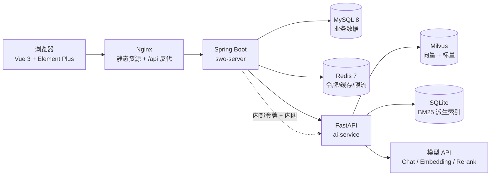
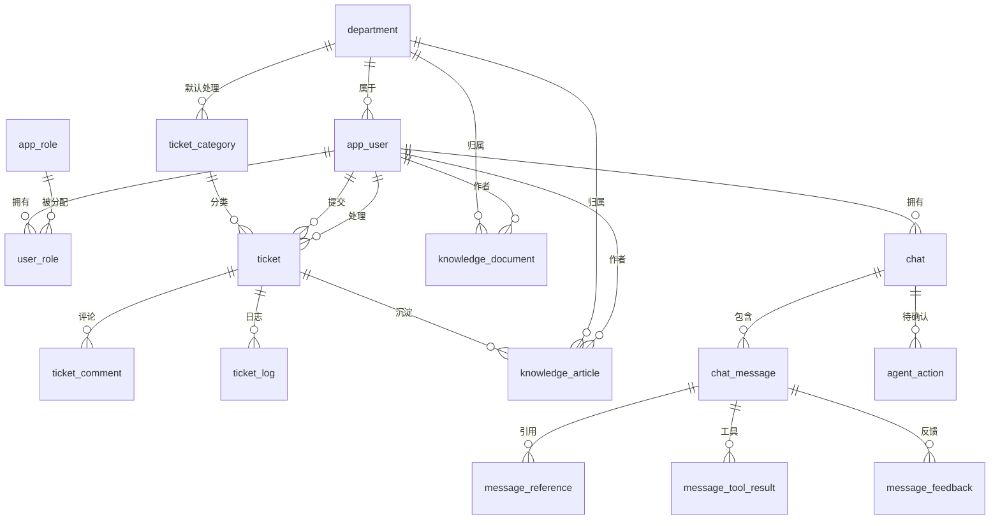
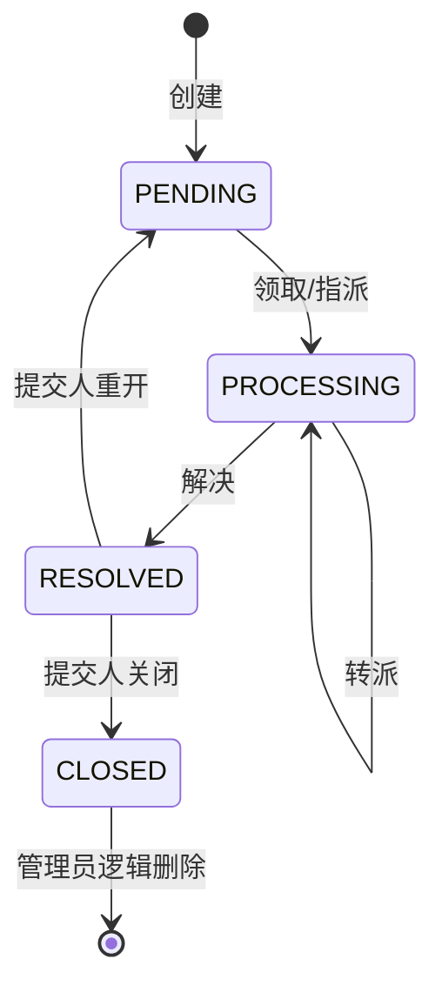
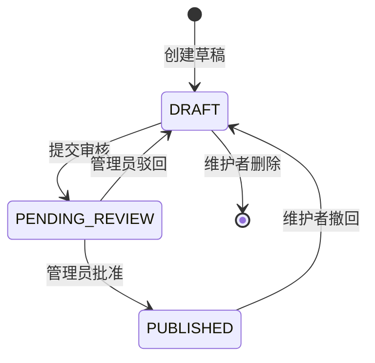

# Smart Work Order完整实施计划（V2.0）

> **本文件是项目唯一执行标准。**
> 从今天起，`plan.md`、`daily-plan.md`、`day1-3.md` 中与本文件冲突的技术选型、目录结构、接口编号和任务顺序全部作废；`api.md` 保留为字段细节参考，冲突处以本文件第 5 章为准。
>
> - 生成日期：2026-11-10
> - 目标工程：`D:\Project\Smart Work Order`
> - 参考工程：`D:\IntelliJ IDEA\IDEAProjects\cangqiong\sky-take-out`（苍穹外卖）
> - 计划周期：30 个开发日，每天按 4～6 小时设计；另设 D0 准备日与缓冲规则
> - 最终交付：可本机部署、可完整演示的企业智能工单与知识库助手（业务 + 知识库 + RAG 问答 + 工单 AI 辅助 + Agent + 统计 + 部署）

---

## 0. 先读这一章

### 0.1 这份计划解决什么问题

现有材料分成三层：

| 材料 | 现状 | 在本计划中的角色 |
|---|---|---|
| `SmartWorkOrder/frontend` | 页面、路由、状态管理、SSE 解析、Mock 数据均已写完，`VITE_DEMO=true` 时纯前端可演示 | 保留，D17 起切换为真实后端 |
| `SmartWorkOrder/backend` | 只有 `BackendApplication`、一个不完整的 `SecurityConfig`、两份 YAML | 推倒重来，按苍穹外卖三模块结构重建 |
| `api.md` | 77 个对外 API + 12 个内部 API 的字段契约 | 作为字段字典；方法与路径按第 5 章修订后执行 |
| `plan.md` / `daily-plan.md` / `day1-3.md` | 旧版 30 天方案，单模块、Spring Security Resource Server、record 风格 | 仅作历史参考，不再执行 |

### 0.2 最终目标

做成一套能讲清楚、能跑起来、能写进简历的系统：

1. **业务闭环**：员工提单 → 处理人员领取/管理员指派 → 评论沟通 → 解决 → 提交人关闭/重开 → 管理员逻辑删除 → 工单转知识草稿 → 审核发布。
2. **知识闭环**：文章与 TXT/Markdown 文档 → 草稿 → 提交审核 → 发布/驳回/撤回 → 权限范围内的阅读与下载 → 索引状态可查、可重建。
3. **AI 闭环**：已发布知识入库 → 授权检索 → 流式问答 + 引用 → 多轮追问 → 反馈；工单分类/优先级建议、摘要、回复草稿、相似推荐；Agent 查工单/查知识/准备建单，写操作必须人工确认。
4. **工程闭环**：本地一键启动、Docker Compose 部署、健康检查、数据持久化、每日可验收、里程碑可回滚。

### 0.3 本计划明确采用的关键决策

| 决策 | 选择 | 理由 |
|---|---|---|
| 后端结构 | `swo-common` / `swo-pojo` / `swo-server` 三模块 | 对齐苍穹外卖；公共类、数据模型、业务实现分离，后续 AI 客户端不污染业务层 |
| 后端分层 | Controller → Service 接口 + Impl → Mapper → MySQL | 苍穹外卖同款；每层职责单一，便于按天推进 |
| 认证 | 自写 JWT 工具 + `JwtTokenInterceptor` + `BaseContext` | 比 Spring Security Resource Server 更贴近苍穹外卖，代码量可控；保留 BCrypt 只用于密码哈希 |
| 响应体 | `Result<T>`：`code=0` 成功、`message`、`data` | 与现有前端、`api.md` 一致；只借苍穹外卖的类形状，不照搬 `code=1/msg` |
| 分页 | `PageResult<T>`：`records/total/page/pageSize` | 与前端 `Page<T>` 一致，比苍穹外卖的 `total/records` 多两个字段 |
| ID | 数据库 `BIGINT` 自增，Jackson 全局序列化为字符串 | 既保留数据库效率，又满足 `api.md` 的“所有 ID 为 string” |
| 时间 | 数据库存 UTC，Java 用 `Instant`，JSON 输出 ISO 8601 | 避免时区歧义；前端 `formatDate` 可直接解析 |
| 权限 | 固定三角色 + `@RequirePermission` + Service 数据范围 | 不引入动态权限设计器；权限标识与 `api.md` 一致 |
| 知识版本 | 一个 `version` 同时承担并发校验和索引内容版本 | 现有前端 `reindex` 传的是 `item.version`；合并后不会出现两个版本号打架 |
| AI 服务 | Python FastAPI + Milvus + OpenAI 兼容模型接口 | 业务与模型解耦；模型供应商可替换 |
| 关键词检索 | jieba + rank_bm25 + SQLite 派生索引 | 不引入 Elasticsearch；单机可跑，索引可重建 |
| 前端 | 保留现有 Vue 3 工程，D17 关闭 Mock | 页面已经按契约写完，重写收益低 |
| 部署 | Docker Compose + Nginx 单机 | 与旧方案一致，资源可控 |

### 0.4 每天怎么用这份计划

每天固定五步：

1. **开工前读当天“目标 + 前置”**，确认昨天验收项全部打勾；有未完成项先补，不带着缺口进入新功能。
2. **按“新增/修改文件”建文件**，先写接口和 DTO/VO，再写 Mapper，再写 Service，最后写 Controller。
3. **按“关键代码”落地公共逻辑**；当天没有给出的业务代码，按第 3 章规范和第 5 章契约自行展开。
4. **收工前跑“验收清单”**，至少完成：后端编译、相关接口用 PowerShell/curl 调通、前端对应页面点一遍。
5. **提交 Git**，提交信息格式 `D{N}: 一句话说明`；里程碑日打 tag。

> 如果某天实际耗时超过 6 小时，不要熬夜硬撑。把未完成项拆到第二天的“补做”里，第二天只做原任务 + 补做，不再加新功能。30 天是节奏，不是死线。

### 0.5 进度总表

把下表复制到你的笔记里，每天收工更新。状态只写：`未开始` / `进行中` / `已验收` / `阻塞`。

| 阶段 | 开发日 | 里程碑 | 完成后应达到 | 状态 |
|---|---|---|---|---|
| 准备 | D0 | M0 | 环境、版本、数据库、前端基线全部可用 | 未开始 |
| 工程与账号 | D1～D4 | M1 | 三模块可启动，三类账号可登录，退出/改密/越权拦截生效 | 未开始 |
| 工单闭环 | D5～D10 | M2 | 提单、列表、领取、指派、解决、关闭、重开、评论、删除全通 | 未开始 |
| 管理与知识 | D11～D16 | M3a | 用户/部门/分类可管理，知识可审核发布，统计可用 | 未开始 |
| 业务验收 | D17～D18 | M3 | 关闭 AI 也能完整演示，前端不再依赖 Mock | 未开始 |
| AI 基础 | D19～D22 | M4 | 知识可入库，流式问答带引用，可停止，会话隔离 | 未开始 |
| AI 优化与工单辅助 | D23～D26 | M5a | 混合检索、重排、多轮、分类/摘要/草稿/相似推荐可用 | 未开始 |
| Agent 与运行控制 | D27～D28 | M5 | 工具调用、确认建单、反馈、缓存、限流、统计可用 | 未开始 |
| 部署交付 | D29～D30 | M6 | 按说明从零部署，完整演示通过，遗留项如实记录 | 未开始 |

---

## 1. 技术栈与版本锁定

### 1.1 后端

| 组件 | 版本 | 说明 |
|---|---|---|
| JDK | 21 LTS | 与现有工程一致；使用 `record` 仅限内部值对象，DTO/VO 仍用 Lombok 类 |
| Maven | 3.9.x | 当前工程没有 `mvnw`，先安装 Maven 或用 IDEA 内置 Maven |
| Spring Boot | 4.0.9 | 现有 `pom.xml` 已使用；若依赖无法解析，整体降级到 3.5.x，不要混用 |
| Spring MVC | Boot 管理 | 依赖名在 Boot 4 为 `spring-boot-starter-webmvc` |
| MyBatis Starter | 4.0.1 | 与 Boot 4 配套；若降级 Boot，改用 MyBatis 3.0.x |
| MySQL | 8.0.16+ | 使用 `CHECK` 约束、`DATETIME(3)`、`utf8mb4` |
| Redis | 7.x | 登录态黑名单、限流、缓存、会话锁 |
| JWT | jjwt 0.12.6 | `jjwt-api` + `jjwt-impl` + `jjwt-jackson` |
| 密码哈希 | `spring-security-crypto` | 只用 `BCryptPasswordEncoder`，不启用 Spring Security 过滤器链 |
| 参数校验 | `spring-boot-starter-validation` | Jakarta Validation |
| 监控 | `spring-boot-starter-actuator` | 只暴露 `health` |
| HTTP 客户端 | `spring-boot-starter-webflux` 的 `WebClient` | 调 FastAPI、读取 SSE；应用仍是 MVC，不启动 reactive server |
| 测试 | `spring-boot-starter-test` | JUnit 5 + Mockito + AssertJ |

### 1.2 前端

| 组件 | 版本 | 说明 |
|---|---|---|
| Vue | 3.5.x | 现有工程 |
| TypeScript | 5.9.x | 现有工程 |
| Vite | 7.x | 现有工程 |
| Element Plus | 2.11.x | 现有工程 |
| Pinia | 3.x | 现有工程 |
| Axios | 1.13.x | 现有工程 |
| MSW | 2.12.x | 只用于 `VITE_DEMO=true`，D17 后不参与真实联调 |
| Vitest / Playwright | 现有版本 | 单元测试与端到端 |

### 1.3 AI 服务

| 组件 | 版本 | 说明 |
|---|---|---|
| Python | 3.11 或 3.12 | 不要用 3.13 测试第三方库兼容性 |
| FastAPI | 0.115+ | 内部 HTTP 服务 |
| Uvicorn | 0.30+ | ASGI server |
| Pydantic | 2.x | 请求/响应模型 |
| httpx | 0.27+ | 调模型 API、下载 Java 内部知识源 |
| pymilvus | 2.4.x | 与 Milvus 2.4.x 配套 |
| jieba | 0.42+ | 中文分词 |
| rank-bm25 | 0.2.2 | 关键词检索 |
| numpy | 1.26+ | 向量运算 |
| pytest | 8.x | 测试与固定样本回放 |

### 1.4 中间件与模型

| 组件 | 版本/形式 | 说明 |
|---|---|---|
| MySQL | 8.0 | 本机或 Docker |
| Redis | 7 | 本机或 Docker |
| Milvus | 2.4.x standalone | 必须同时启动 etcd + MinIO；不要只起一个 Milvus 容器 |
| 对话模型 | OpenAI 兼容接口 | 默认示例 `deepseek-chat`；也可换 `qwen-plus` 等 |
| 向量模型 | OpenAI 兼容 embeddings | 默认 `BAAI/bge-m3`，维度 1024；换模型必须同步改 `EMBEDDING_DIM` 并重建集合 |
| 重排模型 | 可选 | 默认关闭；配置 `RERANK_MODEL` 后启用，失败自动回退 RRF |
| Nginx | 1.20.2+ | 前端静态资源、`/api` 反代、SSE 关闭缓冲 |

### 1.5 版本风险与降级方案

| 风险 | 表现 | 处理 |
|---|---|---|
| Spring Boot 4.0.9 在本地仓库不可解析 | `mvn` 报 parent 找不到 | 先在 Maven Central 核对；不可用则整体降级 Boot 3.5.x + MyBatis 3.0.x，代码不变 |
| `spring-boot-starter-webmvc` 名称不识别 | 依赖爆红 | Boot 3.x 用 `spring-boot-starter-web`；Boot 4 用 `webmvc` |
| MyBatis 4.0.1 与 Boot 4 不兼容 | 启动时 `SqlSessionFactory` 失败 | 降级 MyBatis 3.0.4 或按官方兼容表调整 |
| jjwt 0.12.x API 不熟 | 编译报 `setSigningKey` 不存在 | 使用 `Jwts.builder().subject(...).signWith(key)` 与 `Jwts.parser().verifyWith(key)` |
| Milvus 资源不足 | 容器反复重启 | standalone 至少给 4 GB 内存；开发期可先只跑 MySQL/Redis，AI 阶段再起 Milvus |
| 模型 API 不可用 | 问答 503 | 保留“AI 不可用时业务可用”的降级路径；D18 前必须确认至少一个可用模型 |

---

## 2. 总体架构

### 2.1 系统边界



原则：

- 浏览器只访问 Nginx 暴露的 `/` 与 `/api`；`/internal`、FastAPI 端口、Milvus 端口一律不对外。
- 所有权限判断在 Spring Boot 完成；FastAPI 只接受 Java 传入的可信检索范围，不自行判断用户角色。
- 业务库是唯一事实来源；Milvus、SQLite 都是可重建的派生索引。
- AI 故障不能阻塞工单、知识、登录等核心业务。

### 2.2 端口约定

| 服务 | 本机端口 | 容器内端口 | 是否对外 |
|---|---:|---:|---|
| 前端 Vite | 5173 | — | 开发机 |
| Spring Boot | 8080 | 8080 | 经 Nginx |
| FastAPI | 8000 | 8000 | 否 |
| MySQL | 3306 | 3306 | 开发机/内网 |
| Redis | 6379 | 6379 | 开发机/内网 |
| Milvus | 19530 | 19530 | 否 |
| Milvus 健康端口 | 9091 | 9091 | 否 |
| Nginx | 80 | 80 | 是 |

### 2.3 目标目录结构

```text
SmartWorkOrder/
├─ backend/                                # Maven 父工程
│  ├─ pom.xml
│  ├─ swo-common/
│  │  ├─ pom.xml
│  │  └─ src/main/java/com/swo/common/
│  │     ├─ result/Result.java
│  │     ├─ result/PageResult.java
│  │     ├─ exception/BusinessException.java
│  │     ├─ constant/MessageConstant.java
│  │     ├─ constant/JwtClaimsConstant.java
│  │     ├─ constant/AutoFillConstant.java
│  │     ├─ context/BaseContext.java
│  │     ├─ context/LoginUser.java
│  │     ├─ enumeration/OperationType.java
│  │     ├─ properties/JwtProperties.java
│  │     ├─ properties/UploadProperties.java
│  │     ├─ properties/AiProperties.java
│  │     ├─ utils/JwtUtil.java
│  │     └─ json/JacksonObjectMapper.java
│  ├─ swo-pojo/
│  │  ├─ pom.xml
│  │  └─ src/main/java/com/swo/pojo/
│  │     ├─ entity/        # 与数据库表一一对应
│  │     ├─ dto/           # 请求参数
│  │     └─ vo/            # 响应视图
│  └─ swo-server/
│     ├─ pom.xml
│     ├─ Dockerfile
│     └─ src/main/
│        ├─ java/com/swo/
│        │  ├─ SwoApplication.java
│        │  ├─ annotation/RequirePermission.java
│        │  ├─ aspect/AutoFillAspect.java
│        │  ├─ config/WebMvcConfig.java
│        │  ├─ config/JacksonConfig.java
│        │  ├─ config/MyBatisConfig.java
│        │  ├─ config/RedisConfig.java
│        │  ├─ config/AsyncConfig.java
│        │  ├─ config/AiClientConfig.java
│        │  ├─ interceptor/JwtTokenInterceptor.java
│        │  ├─ interceptor/PermissionInterceptor.java
│        │  ├─ handler/GlobalExceptionHandler.java
│        │  ├─ controller/...
│        │  ├─ service/...
│        │  ├─ mapper/...
│        │  ├─ task/IndexTaskDispatcher.java
│        │  └─ ai/AiClient.java
│        └─ resources/
│           ├─ application.yml
│           ├─ application-dev.yml
│           ├─ application-prod.yml
│           ├─ db/schema.sql
│           ├─ db/data-dev.sql
│           └─ mapper/*.xml
├─ frontend/                               # 现有 Vue 工程
│  ├─ src/
│  │  ├─ api/index.ts
│  │  ├─ sse.ts
│  │  ├─ stores/auth.ts
│  │  ├─ stores/chats.ts
│  │  ├─ views/...
│  │  └─ types.ts
│  ├─ .env.development
│  ├─ .env.production
│  └─ Dockerfile
├─ ai-service/
│  ├─ requirements.txt
│  ├─ Dockerfile
│  ├─ .env.example
│  ├─ app/
│  │  ├─ main.py
│  │  ├─ config.py
│  │  ├─ deps.py
│  │  ├─ schemas.py
│  │  ├─ errors.py
│  │  ├─ routers/{health,index_jobs,search,chat,tickets,agent}.py
│  │  └─ services/{llm,embedding,milvus_store,keyword_index,splitter,indexer,retrieval,rerank,prompts,agent,source_client}.py
│  ├─ tests/
│  │  ├─ fixtures/questions.json
│  │  ├─ fixtures/tickets.json
│  │  ├─ test_splitter.py
│  │  ├─ test_retrieval.py
│  │  └─ eval.py
│  └─ scripts/init_milvus.py
├─ deploy/
│  ├─ docker-compose.yml
│  ├─ .env.example
│  ├─ nginx/nginx.conf
│  └─ mysql/init/01-schema.sql
├─ docs/
│  ├─ api.md
│  ├─ plan-v2.md
│  ├─ smoke/
│  └─ demo-script.md
└─ README.md
```

### 2.4 三条请求链路

**同步业务请求**

```text
浏览器 → Nginx /api → JwtTokenInterceptor（解析令牌、查用户、塞 BaseContext）
      → PermissionInterceptor（@RequirePermission）
      → Controller（参数校验、Result 包装）
      → Service（事务、数据范围、状态机、幂等）
      → Mapper → MySQL
      → 返回 Result<T>
```

**SSE 问答请求**

```text
浏览器 fetch(POST /api/chats/{id}/messages)
→ Spring Boot 校验会话归属、生成锁、限流
→ 保存 USER 消息 + 创建 ASSISTANT 消息（GENERATING）
→ 先返回 event: meta（messageId）
→ Java 调 FastAPI P04 检索，再调 P05 生成
→ FastAPI 流式返回 delta/done/error
→ Spring Boot 转成标准事件写回浏览器，同时持久化正文与引用
→ done 后释放生成锁、写 ai_call
```

**异步索引**

```text
发布知识 → 同一事务写 index_task(PENDING)
→ IndexTaskDispatcher 每 5 秒轮询
→ 原子领取任务：UPDATE ... SET status='PROCESSING' WHERE id=? AND status='PENDING'
→ 调 FastAPI P01，FastAPI 通过 J01 拉取指定版本正文/文件
→ 切分、向量化、写 Milvus + SQLite
→ 更新任务 SUCCESS/FAILED、重试次数、错误摘要
→ 撤回/删除时调 P03 清理向量
```

### 2.5 模块职责边界

| 模块 | 只负责 | 不负责 |
|---|---|---|
| `swo-common` | Result、异常、常量、JWT 工具、上下文、配置属性、通用 JSON | 任何业务表、任何 Controller |
| `swo-pojo` | Entity、DTO、VO | 业务逻辑、SQL |
| `swo-server` | Controller、Service、Mapper、拦截器、定时任务、AI 客户端 | 直接依赖模型 SDK；不把 Python 逻辑写进 Java |
| `ai-service` | 切分、向量化、检索、重排、生成、Agent 推理 | 用户权限判断、业务写库、JWT 签发 |
| `frontend` | 页面、交互、SSE 消费、错误展示 | 伪造角色、绕过权限、保存敏感密钥 |
| `deploy` | Compose、Nginx、初始化 SQL、环境变量 | 业务代码 |

---

## 3. 代码规范（苍穹外卖风格，按本项目调整）

### 3.1 分层与命名

| 层 | 包 | 命名 | 职责 |
|---|---|---|---|
| Controller | `com.swo.controller` | `XxxController` | 只做 HTTP：接参、`@Valid`、调 Service、包 `Result`；不写业务判断 |
| Service 接口 | `com.swo.service` | `XxxService` | 定义业务能力 |
| Service 实现 | `com.swo.service.impl` | `XxxServiceImpl` | 事务、权限数据范围、状态机、幂等、组装 VO |
| Mapper | `com.swo.mapper` | `XxxMapper` | 只写 SQL；简单查询用注解，动态 SQL 用 XML |
| Entity | `com.swo.pojo.entity` | `Xxx` | 与表字段一一对应，Lombok `@Data/@Builder` |
| DTO | `com.swo.pojo.dto` | `XxxDTO` / `XxxQueryDTO` | 请求参数，带 Jakarta Validation |
| VO | `com.swo.pojo.vo` | `XxxVO` | 响应视图，不暴露密码、存储路径、内部字段 |

命名规则：

- 方法名用动词：`createTicket`、`pageQuery`、`claim`、`assign`、`resolve`、`approve`。
- 布尔字段用 `isXxx` 或 `xxx`，数据库用 `TINYINT(1)`。
- 枚举值统一大写字符串：`PENDING`、`PROCESSING`、`PUBLISHED`。
- 一个业务对象只建一个 Controller；子资源动作放同一 Controller 的不同方法。
- 不在 Controller 里 `try/catch` 业务异常，统一交给 `GlobalExceptionHandler`。

### 3.2 统一响应：Result 与 PageResult

`swo-common/src/main/java/com/swo/common/result/Result.java`

```java
package com.swo.common.result;

import lombok.Data;

import java.io.Serializable;

/**
 * 统一响应体：code=0 表示成功，非 0 表示失败。
 */
@Data
public class Result<T> implements Serializable {

    private Integer code;
    private String message;
    private T data;

    public static <T> Result<T> success() {
        Result<T> result = new Result<>();
        result.code = 0;
        result.message = "操作成功";
        return result;
    }

    public static <T> Result<T> success(T data) {
        Result<T> result = success();
        result.data = data;
        return result;
    }

    public static <T> Result<T> error(String message) {
        return error(500, message);
    }

    public static <T> Result<T> error(int code, String message) {
        Result<T> result = new Result<>();
        result.code = code;
        result.message = message;
        return result;
    }
}
```

`swo-common/src/main/java/com/swo/common/result/PageResult.java`

```java
package com.swo.common.result;

import lombok.AllArgsConstructor;
import lombok.Data;
import lombok.NoArgsConstructor;

import java.io.Serializable;
import java.util.List;

@Data
@NoArgsConstructor
@AllArgsConstructor
public class PageResult<T> implements Serializable {

    private List<T> records;
    private long total;
    private int page;
    private int pageSize;

    public static <T> PageResult<T> of(List<T> records, long total, int page, int pageSize) {
        return new PageResult<>(records, total, page, pageSize);
    }
}
```

> 与苍穹外卖的区别：`Result` 用 `message` 而不是 `msg`，成功码用 `0` 而不是 `1`；`PageResult` 多返回 `page/pageSize`。这是为了直接兼容现有前端和 `api.md`，不再让前端做字段转换。

### 3.3 异常与全局处理

`swo-common/src/main/java/com/swo/common/exception/BusinessException.java`

```java
package com.swo.common.exception;

import lombok.Getter;
import org.springframework.http.HttpStatus;

@Getter
public class BusinessException extends RuntimeException {

    private final HttpStatus status;

    public BusinessException(HttpStatus status, String message) {
        super(message);
        this.status = status;
    }

    public static BusinessException badRequest(String message) {
        return new BusinessException(HttpStatus.BAD_REQUEST, message);
    }

    public static BusinessException unauthorized(String message) {
        return new BusinessException(HttpStatus.UNAUTHORIZED, message);
    }

    public static BusinessException forbidden(String message) {
        return new BusinessException(HttpStatus.FORBIDDEN, message);
    }

    public static BusinessException notFound(String message) {
        return new BusinessException(HttpStatus.NOT_FOUND, message);
    }

    public static BusinessException conflict(String message) {
        return new BusinessException(HttpStatus.CONFLICT, message);
    }

    public static BusinessException tooManyRequests(String message) {
        return new BusinessException(HttpStatus.TOO_MANY_REQUESTS, message);
    }

    public static BusinessException serviceUnavailable(String message) {
        return new BusinessException(HttpStatus.SERVICE_UNAVAILABLE, message);
    }
}
```

`swo-server/src/main/java/com/swo/handler/GlobalExceptionHandler.java`

```java
package com.swo.handler;

import com.swo.common.exception.BusinessException;
import com.swo.common.result.Result;
import lombok.extern.slf4j.Slf4j;
import org.springframework.dao.DuplicateKeyException;
import org.springframework.http.HttpStatus;
import org.springframework.http.ResponseEntity;
import org.springframework.http.converter.HttpMessageNotReadableException;
import org.springframework.validation.FieldError;
import org.springframework.web.bind.MethodArgumentNotValidException;
import org.springframework.web.bind.MissingServletRequestParameterException;
import org.springframework.web.bind.annotation.ExceptionHandler;
import org.springframework.web.bind.annotation.RestControllerAdvice;
import org.springframework.web.method.annotation.MethodArgumentTypeMismatchException;

import java.util.List;

@RestControllerAdvice
@Slf4j
public class GlobalExceptionHandler {

    @ExceptionHandler(BusinessException.class)
    public ResponseEntity<Result<Void>> handleBusiness(BusinessException exception) {
        return error(exception.getStatus(), exception.getMessage());
    }

    @ExceptionHandler(MethodArgumentNotValidException.class)
    public ResponseEntity<Result<Void>> handleValidation(MethodArgumentNotValidException exception) {
        List<FieldError> fieldErrors = exception.getBindingResult().getFieldErrors();
        String message = fieldErrors.isEmpty()
                ? "请求参数不合法"
                : fieldErrors.get(0).getDefaultMessage();
        return error(HttpStatus.BAD_REQUEST, message);
    }

    @ExceptionHandler({
            HttpMessageNotReadableException.class,
            MissingServletRequestParameterException.class,
            MethodArgumentTypeMismatchException.class
    })
    public ResponseEntity<Result<Void>> handleBadRequest(Exception exception) {
        return error(HttpStatus.BAD_REQUEST, "请求参数格式不正确");
    }

    @ExceptionHandler(DuplicateKeyException.class)
    public ResponseEntity<Result<Void>> handleDuplicate(DuplicateKeyException exception) {
        log.warn("唯一约束冲突: {}", exception.getMostSpecificCause().getMessage());
        return error(HttpStatus.CONFLICT, "数据已存在，请勿重复提交");
    }

    @ExceptionHandler(Exception.class)
    public ResponseEntity<Result<Void>> handleUnexpected(Exception exception) {
        log.error("请求处理失败", exception);
        return error(HttpStatus.INTERNAL_SERVER_ERROR, "服务暂时不可用，请稍后重试");
    }

    private ResponseEntity<Result<Void>> error(HttpStatus status, String message) {
        return ResponseEntity.status(status).body(Result.error(status.value(), message));
    }
}
```

> 认证失败和权限不足由拦截器直接写 401/403 JSON，不依赖 `@RestControllerAdvice`，因为拦截器发生在 Controller 之前。

### 3.4 JWT、登录态与拦截器

`swo-common/src/main/java/com/swo/common/properties/JwtProperties.java`

```java
package com.swo.common.properties;

import lombok.Data;
import org.springframework.boot.context.properties.ConfigurationProperties;
import org.springframework.stereotype.Component;

import java.time.Duration;

@Data
@Component
@ConfigurationProperties(prefix = "app.jwt")
public class JwtProperties {

    /** 至少 32 字节的随机字符串，生产环境用环境变量注入 */
    private String secret;
    private String issuer = "swo";
    private Duration ttl = Duration.ofHours(2);
    /** 前端请求头名称 */
    private String tokenName = "Authorization";
    private String tokenPrefix = "Bearer ";
}
```

`application.yml` 对应片段：

```yaml
app:
  jwt:
    secret: ${JWT_SECRET:dev-only-secret-change-me-0123456789abcdef}
    issuer: swo
    ttl: PT2H
    token-name: Authorization
    token-prefix: "Bearer "
```

`swo-common/src/main/java/com/swo/common/utils/JwtUtil.java`

```java
package com.swo.common.utils;

import io.jsonwebtoken.Claims;
import io.jsonwebtoken.Jwts;
import io.jsonwebtoken.security.Keys;

import javax.crypto.SecretKey;
import java.nio.charset.StandardCharsets;
import java.time.Duration;
import java.time.Instant;
import java.util.Date;
import java.util.Map;
import java.util.UUID;

public final class JwtUtil {

    private JwtUtil() {
    }

    public static String createJWT(String secret, Duration ttl, String issuer, Map<String, Object> claims) {
        if (secret == null || secret.getBytes(StandardCharsets.UTF_8).length < 32) {
            throw new IllegalArgumentException("JWT secret 至少需要 32 字节");
        }
        Instant now = Instant.now();
        SecretKey key = Keys.hmacShaKeyFor(secret.getBytes(StandardCharsets.UTF_8));
        return Jwts.builder()
                .issuer(issuer)
                .subject(String.valueOf(claims.get("userId")))
                .claims(claims)
                .id(UUID.randomUUID().toString())
                .issuedAt(Date.from(now))
                .expiration(Date.from(now.plus(ttl)))
                .signWith(key)
                .compact();
    }

    public static Claims parseJWT(String secret, String token) {
        SecretKey key = Keys.hmacShaKeyFor(secret.getBytes(StandardCharsets.UTF_8));
        return Jwts.parser()
                .verifyWith(key)
                .build()
                .parseSignedClaims(token)
                .getPayload();
    }
}
```

`swo-common/src/main/java/com/swo/common/context/LoginUser.java`

```java
package com.swo.common.context;

import lombok.Builder;
import lombok.Data;

import java.util.List;
import java.util.Set;

@Data
@Builder
public class LoginUser {

    private Long id;
    private String username;
    private String name;
    private Long departmentId;
    private String departmentName;
    private List<String> roles;
    private Set<String> permissions;
    private Integer tokenVersion;
}
```

`swo-common/src/main/java/com/swo/common/context/BaseContext.java`

```java
package com.swo.common.context;

public final class BaseContext {

    private static final ThreadLocal<LoginUser> HOLDER = new ThreadLocal<>();

    private BaseContext() {
    }

    public static void set(LoginUser user) {
        HOLDER.set(user);
    }

    public static LoginUser get() {
        return HOLDER.get();
    }

    public static Long getUserId() {
        LoginUser user = HOLDER.get();
        return user == null ? null : user.getId();
    }

    public static void remove() {
        HOLDER.remove();
    }
}
```

`swo-server/src/main/java/com/swo/interceptor/JwtTokenInterceptor.java`

```java
package com.swo.interceptor;

import com.swo.common.context.BaseContext;
import com.swo.common.context.LoginUser;
import com.swo.common.properties.JwtProperties;
import com.swo.common.utils.JwtUtil;
import com.swo.service.AccountService;
import com.swo.service.TokenBlacklistService;
import io.jsonwebtoken.Claims;
import jakarta.servlet.http.HttpServletRequest;
import jakarta.servlet.http.HttpServletResponse;
import lombok.RequiredArgsConstructor;
import lombok.extern.slf4j.Slf4j;
import org.springframework.http.MediaType;
import org.springframework.stereotype.Component;
import org.springframework.web.method.HandlerMethod;
import org.springframework.web.servlet.HandlerInterceptor;

import java.nio.charset.StandardCharsets;

@Component
@RequiredArgsConstructor
@Slf4j
public class JwtTokenInterceptor implements HandlerInterceptor {

    private final JwtProperties jwtProperties;
    private final AccountService accountService;
    private final TokenBlacklistService blacklistService;

    @Override
    public boolean preHandle(HttpServletRequest request, HttpServletResponse response, Object handler) throws Exception {
        if (!(handler instanceof HandlerMethod)) {
            return true;
        }
        String header = request.getHeader(jwtProperties.getTokenName());
        if (header == null || !header.startsWith(jwtProperties.getTokenPrefix())) {
            return writeError(response, 401, "未登录或登录状态无效");
        }
        String token = header.substring(jwtProperties.getTokenPrefix().length());
        try {
            Claims claims = JwtUtil.parseJWT(jwtProperties.getSecret(), token);
            String jti = claims.getId();
            if (jti != null && blacklistService.isBlacklisted(jti)) {
                return writeError(response, 401, "登录状态已退出，请重新登录");
            }
            Long userId = Long.valueOf(claims.getSubject());
            Integer tokenVersion = claims.get("tokenVersion", Integer.class);
            LoginUser loginUser = accountService.loadLoginUser(userId, tokenVersion);
            BaseContext.set(loginUser);
            return true;
        } catch (Exception exception) {
            log.debug("JWT 校验失败: {}", exception.getMessage());
            return writeError(response, 401, "登录状态无效，请重新登录");
        }
    }

    @Override
    public void afterCompletion(HttpServletRequest request, HttpServletResponse response, Object handler, Exception exception) {
        BaseContext.remove();
    }

    private boolean writeError(HttpServletResponse response, int status, String message) throws Exception {
        response.setStatus(status);
        response.setCharacterEncoding(StandardCharsets.UTF_8.name());
        response.setContentType(MediaType.APPLICATION_JSON_VALUE);
        response.getWriter().write("{\"code\":" + status + ",\"message\":\"" + message + "\",\"data\":null}");
        return false;
    }
}
```

> SSE 注意事项：`BaseContext` 是 `ThreadLocal`，只保证当前请求线程。SSE 异步生成前先 `LoginUser user = BaseContext.get()` 取出来，作为参数传给异步任务；不要在异步线程里再次 `BaseContext.get()`。`afterCompletion` 在异步场景可能提前执行，因此 SSE 控制器必须显式保存用户对象。

`TokenBlacklistService` 用 Redis 实现：

```java
@Service
@RequiredArgsConstructor
public class TokenBlacklistService {

    private static final String PREFIX = "auth:blacklist:";
    private final StringRedisTemplate redisTemplate;

    public void blacklist(String jti, Duration ttl) {
        redisTemplate.opsForValue().set(PREFIX + jti, "1", ttl);
    }

    public boolean isBlacklisted(String jti) {
        return Boolean.TRUE.equals(redisTemplate.hasKey(PREFIX + jti));
    }
}
```

### 3.5 权限注解与数据范围

`swo-server/src/main/java/com/swo/annotation/RequirePermission.java`

```java
package com.swo.annotation;

import java.lang.annotation.ElementType;
import java.lang.annotation.Retention;
import java.lang.annotation.RetentionPolicy;
import java.lang.annotation.Target;

@Target({ElementType.METHOD, ElementType.TYPE})
@Retention(RetentionPolicy.RUNTIME)
public @interface RequirePermission {
    String value();
}
```

`swo-server/src/main/java/com/swo/interceptor/PermissionInterceptor.java`

```java
package com.swo.interceptor;

import com.swo.annotation.RequirePermission;
import com.swo.common.context.BaseContext;
import com.swo.common.context.LoginUser;
import jakarta.servlet.http.HttpServletRequest;
import jakarta.servlet.http.HttpServletResponse;
import org.springframework.core.annotation.AnnotatedElementUtils;
import org.springframework.http.MediaType;
import org.springframework.stereotype.Component;
import org.springframework.web.method.HandlerMethod;
import org.springframework.web.servlet.HandlerInterceptor;

import java.nio.charset.StandardCharsets;

@Component
public class PermissionInterceptor implements HandlerInterceptor {

    @Override
    public boolean preHandle(HttpServletRequest request, HttpServletResponse response, Object handler) throws Exception {
        if (!(handler instanceof HandlerMethod handlerMethod)) {
            return true;
        }
        RequirePermission permission = AnnotatedElementUtils.findMergedAnnotation(
                handlerMethod.getMethod(), RequirePermission.class);
        if (permission == null) {
            permission = AnnotatedElementUtils.findMergedAnnotation(
                    handlerMethod.getBeanType(), RequirePermission.class);
        }
        if (permission == null) {
            return true;
        }
        LoginUser user = BaseContext.get();
        if (user == null || !user.getPermissions().contains(permission.value())) {
            response.setStatus(403);
            response.setCharacterEncoding(StandardCharsets.UTF_8.name());
            response.setContentType(MediaType.APPLICATION_JSON_VALUE);
            response.getWriter().write("{\"code\":403,\"message\":\"无权执行此操作\",\"data\":null}");
            return false;
        }
        return true;
    }
}
```

注册顺序：`JwtTokenInterceptor` 在前，`PermissionInterceptor` 在后；两者都排除 `/api/auth/login`、`/actuator/health`。

数据范围不在注解里做，放在 Service：

| 场景 | 规则 |
|---|---|
| 工单可见 | 管理员全部；处理人员：本部门 + 本人负责 + 本人提交；员工：本人提交 |
| 工单列表 `view` | `mine/ pending/ assigned/ all` 只是查询意图，必须与上面的范围 AND，不能扩大 |
| 知识可读 | 管理员全部；处理人员：本部门全部状态 + 其他部门已发布 PUBLIC；员工：本部门已发布（PUBLIC + DEPARTMENT）+ 其他部门已发布 PUBLIC |
| 知识可维护 | 管理员全部；处理人员本部门 |
| 知识审核 | 管理员 |
| 统计 | 工单统计按工单可见范围；AI 统计仅管理员 |

### 3.6 Entity / DTO / VO 规则

- Entity 只映射表，不做校验，不直接返回给前端。
- DTO 只接收请求字段；禁止把 `requesterId`、`departmentId`、`role`、`status` 这类服务端决定的字段开放给前端。
- VO 只返回前端需要的字段；`passwordHash`、`storagePath`、`tokenVersion`、`deleted` 永不返回。
- 关联对象统一用轻量结构：`PersonVO { id, name }`，对应 `api.md` 的 `Person`。
- 列表用 `XxxSummaryVO`，详情用 `XxxDetailVO`；不要为了省事把详情结构塞进列表。
- 字段命名与 `api.md` 完全一致（camelCase），不要写 `user_name` 之类的 JSON 字段。

### 3.7 MyBatis 与分页

- 简单单表查询用注解 `@Select/@Insert/@Update`；动态条件、联表、分页用 XML。
- XML 放 `resources/mapper/XxxMapper.xml`，`namespace` 写全限定 Mapper 接口名。
- 参数统一 `#{}`；排序字段如需动态，必须用白名单枚举，禁止 `${}` 拼接用户输入。
- 分页统一 `PageQuery`：

```java
package com.swo.pojo.dto;

import lombok.Data;

import java.io.Serializable;

@Data
public class PageQuery implements Serializable {

    private Integer page = 1;
    private Integer pageSize = 20;

    public int normalizedPage() {
        return page == null || page < 1 ? 1 : page;
    }

    public int normalizedPageSize() {
        if (pageSize == null || pageSize < 1) {
            return 20;
        }
        return Math.min(pageSize, 100);
    }

    /** MyBatis 通过 getOffset() 读取 #{offset} */
    public int getOffset() {
        return (normalizedPage() - 1) * normalizedPageSize();
    }

    /** Service 查库前调用，把非法值修正为合法值 */
    public void normalize() {
        this.page = normalizedPage();
        this.pageSize = normalizedPageSize();
    }
}
```

XML 分页片段：

```xml
<select id="pageQuery" resultType="com.swo.pojo.vo.TicketSummaryVO">
    SELECT ...
    FROM ticket t
    WHERE t.deleted = 0
    <if test="status != null and status != ''">
        AND t.status = #{status}
    </if>
    <if test="keyword != null and keyword != ''">
        AND (t.title LIKE CONCAT('%', #{keyword}, '%')
             OR t.number LIKE CONCAT('%', #{keyword}, '%'))
    </if>
    ORDER BY t.updated_at DESC, t.id DESC
    LIMIT #{offset}, #{pageSize}
</select>
```

```java
query.normalize();
long total = ticketMapper.count(query);
List<TicketSummaryVO> records = total == 0 ? List.of() : ticketMapper.pageQuery(query);
return PageResult.of(records, total, query.normalizedPage(), query.normalizedPageSize());
```

### 3.8 公共字段自动填充

沿用苍穹外卖的 `@AutoFill` + AOP 思路，但当前用户从 `LoginUser` 取。

```java
@Target(ElementType.METHOD)
@Retention(RetentionPolicy.RUNTIME)
public @interface AutoFill {
    OperationType value();
}
```

```java
@Aspect
@Component
@Slf4j
public class AutoFillAspect {

    @Pointcut("execution(* com.swo.mapper.*.*(..)) && @annotation(com.swo.annotation.AutoFill)")
    public void autoFillPointCut() {
    }

    @Before("autoFillPointCut()")
    public void autoFill(JoinPoint joinPoint) {
        MethodSignature signature = (MethodSignature) joinPoint.getSignature();
        AutoFill autoFill = signature.getMethod().getAnnotation(AutoFill.class);
        Object[] args = joinPoint.getArgs();
        if (args == null || args.length == 0 || args[0] == null) {
            return;
        }
        Object entity = args[0];
        Instant now = Instant.now();
        Long userId = BaseContext.getUserId();
        try {
            if (autoFill.value() == OperationType.INSERT) {
                invoke(entity, "setCreateTime", Instant.class, now);
                invoke(entity, "setUpdateTime", Instant.class, now);
                invoke(entity, "setCreateUser", Long.class, userId);
                invoke(entity, "setUpdateUser", Long.class, userId);
            } else {
                invoke(entity, "setUpdateTime", Instant.class, now);
                invoke(entity, "setUpdateUser", Long.class, userId);
            }
        } catch (Exception exception) {
            throw new IllegalStateException("公共字段自动填充失败", exception);
        }
    }

    private void invoke(Object target, String method, Class<?> type, Object value) throws Exception {
        target.getClass().getDeclaredMethod(method, type).invoke(target, value);
    }
}
```

> 本项目所有实体时间字段统一用 `Instant`，AOP 也按 `Instant` 反射；不要混用 `LocalDateTime`。

### 3.9 JSON 序列化

`swo-server/src/main/java/com/swo/config/JacksonConfig.java`

```java
package com.swo.config;

import com.fasterxml.jackson.databind.SerializationFeature;
import com.fasterxml.jackson.databind.module.SimpleModule;
import com.fasterxml.jackson.databind.ser.std.ToStringSerializer;
import org.springframework.boot.autoconfigure.jackson.Jackson2ObjectMapperBuilderCustomizer;
import org.springframework.context.annotation.Bean;
import org.springframework.context.annotation.Configuration;

@Configuration
public class JacksonConfig {

    @Bean
    public Jackson2ObjectMapperBuilderCustomizer jacksonCustomizer() {
        return builder -> {
            SimpleModule module = new SimpleModule();
            module.addSerializer(Long.class, ToStringSerializer.instance);
            module.addSerializer(Long.TYPE, ToStringSerializer.instance);
            builder.modules(module);
            builder.featuresToDisable(SerializationFeature.WRITE_DATES_AS_TIMESTAMPS);
        };
    }
}
```

效果：

- 所有 `Long`/`long` 输出为 JSON 字符串，满足“ID 一律 string”。
- `Instant` 输出 `2026-11-10T03:00:00Z`。
- 时间入参用 `Instant` 或 `OffsetDateTime`，Spring 能解析 ISO 8601。

### 3.10 事务、幂等、乐观锁

**事务**：所有写业务方法加 `@Transactional(rollbackFor = Exception.class)`；不要在 Controller 加事务。

**幂等**：`requestId` 与“当前用户 + 操作”绑定。

- 创建工单：`ticket` 表 `UNIQUE (requester_id, request_id)`。
- 工单转知识：`knowledge_article` 表 `UNIQUE (author_id, request_id)`。
- Agent 确认：`agent_action` 表 `UNIQUE (owner_id, confirm_request_id)`。

Service 模式：

```java
@Transactional(rollbackFor = Exception.class)
public TicketCreatedVO create(TicketCreateDTO dto) {
    Ticket existing = ticketMapper.findByRequestId(BaseContext.getUserId(), dto.getRequestId());
    if (existing != null) {
        return toCreatedVO(existing);
    }
    // 正常创建；若并发插入撞唯一键，捕获 DuplicateKeyException 后重查
    ...
}
```

**乐观锁**：

```sql
UPDATE ticket
SET status = 'PROCESSING', assignee_id = #{userId}, version = version + 1, update_time = #{now}
WHERE id = #{id}
  AND version = #{version}
  AND status = 'PENDING'
  AND assignee_id IS NULL
  AND deleted = 0
```

Service 判断 `affectedRows == 0` 时抛 `BusinessException.conflict("工单已被其他人处理，请刷新后重试")`。工单详情、知识编辑、审核、删除全部带 `version`。

### 3.11 文件存储规范

| 项目 | 规则 |
|---|---|
| 目录 | `${app.upload.dir}/knowledge/yyyy/MM/` |
| 文件名 | 服务端生成 `UUID + 扩展名`；原文件名只存数据库用于展示 |
| 允许格式 | `.txt`、`.md`、`.markdown` |
| 大小 | 单文件 ≤ 10 MiB（10,485,760 字节） |
| 内容 | 必须是 UTF-8 文本；拒绝 NUL 字节；拒绝二进制 |
| 路径安全 | 存库只存相对路径；下载时 `resolve().normalize()` 必须仍在根目录内 |
| 下载 | 通过 Controller 输出流，校验当前用户可见性；设置 `Content-Disposition: attachment; filename*=UTF-8''...` |
| 删除 | 逻辑删除数据库记录；物理文件可保留（便于审计），由清理任务按需处理 |

### 3.12 日志与审计

- 使用 `@Slf4j`；禁止打印密码、JWT、完整文件内容、模型密钥。
- 每个写操作记录业务日志：`ticket_log`、知识审核字段、`ai_call`。
- `requestId` 放入 MDC：`MDC.put("requestId", requestId)`，请求结束 `MDC.remove`。
- 全局异常只打印一次堆栈；业务异常打印 warn 不打印堆栈。
- AI 调用记录：能力、模型、耗时、token（未知记 `null`）、成功/失败、错误摘要；不记录完整 prompt 和用户私密正文。

---

## 4. 数据库设计

### 4.1 关系图



### 4.2 完整建表 SQL

文件：`backend/swo-server/src/main/resources/db/schema.sql`。在专用开发库执行一次；不要拿已有业务库试运行。

```sql
CREATE DATABASE IF NOT EXISTS swo
    DEFAULT CHARACTER SET utf8mb4
    COLLATE utf8mb4_0900_ai_ci;
USE swo;
SET NAMES utf8mb4;
SET time_zone = '+00:00';

-- ============================================================
-- 1. 组织与账号
-- ============================================================

CREATE TABLE department (
    id          BIGINT       NOT NULL AUTO_INCREMENT,
    name        VARCHAR(100) NOT NULL,
    code        VARCHAR(50)  NOT NULL,
    status      VARCHAR(16)  NOT NULL DEFAULT 'ENABLED',
    version     INT          NOT NULL DEFAULT 1,
    create_time DATETIME(3)  NOT NULL,
    update_time DATETIME(3)  NOT NULL,
    create_user BIGINT       NULL,
    update_user BIGINT       NULL,
    PRIMARY KEY (id),
    UNIQUE KEY uk_department_code (code),
    CONSTRAINT ck_department_status CHECK (status IN ('ENABLED', 'DISABLED'))
) ENGINE = InnoDB DEFAULT CHARSET = utf8mb4 COMMENT = '部门';

CREATE TABLE app_user (
    id            BIGINT       NOT NULL AUTO_INCREMENT,
    username      VARCHAR(64)  NOT NULL,
    password_hash VARCHAR(100) NOT NULL,
    name          VARCHAR(100) NOT NULL,
    department_id BIGINT       NULL,
    status        VARCHAR(16)  NOT NULL DEFAULT 'ENABLED',
    token_version INT          NOT NULL DEFAULT 0,
    version       INT          NOT NULL DEFAULT 1,
    create_time   DATETIME(3)  NOT NULL,
    update_time   DATETIME(3)  NOT NULL,
    create_user   BIGINT       NULL,
    update_user   BIGINT       NULL,
    PRIMARY KEY (id),
    UNIQUE KEY uk_user_username (username),
    KEY idx_user_department (department_id),
    KEY idx_user_status (status),
    CONSTRAINT fk_user_department FOREIGN KEY (department_id) REFERENCES department (id),
    CONSTRAINT ck_user_status CHECK (status IN ('ENABLED', 'DISABLED'))
) ENGINE = InnoDB DEFAULT CHARSET = utf8mb4 COMMENT = '用户';

CREATE TABLE app_role (
    id          BIGINT       NOT NULL AUTO_INCREMENT,
    code        VARCHAR(32)  NOT NULL,
    name        VARCHAR(50)  NOT NULL,
    description VARCHAR(255) NOT NULL DEFAULT '',
    PRIMARY KEY (id),
    UNIQUE KEY uk_role_code (code),
    CONSTRAINT ck_role_code CHECK (code IN ('EMPLOYEE', 'HANDLER', 'ADMIN'))
) ENGINE = InnoDB DEFAULT CHARSET = utf8mb4 COMMENT = '固定角色';

CREATE TABLE user_role (
    user_id BIGINT NOT NULL,
    role_id BIGINT NOT NULL,
    PRIMARY KEY (user_id, role_id),
    KEY idx_user_role_role (role_id),
    CONSTRAINT fk_user_role_user FOREIGN KEY (user_id) REFERENCES app_user (id),
    CONSTRAINT fk_user_role_role FOREIGN KEY (role_id) REFERENCES app_role (id)
) ENGINE = InnoDB DEFAULT CHARSET = utf8mb4 COMMENT = '用户角色关联';

-- ============================================================
-- 2. 工单
-- ============================================================

CREATE TABLE ticket_category (
    id                    BIGINT       NOT NULL AUTO_INCREMENT,
    name                  VARCHAR(100) NOT NULL,
    code                  VARCHAR(50)  NOT NULL,
    description           VARCHAR(500) NOT NULL DEFAULT '',
    default_department_id BIGINT       NOT NULL,
    status                VARCHAR(16)  NOT NULL DEFAULT 'ENABLED',
    version               INT          NOT NULL DEFAULT 1,
    create_time           DATETIME(3)  NOT NULL,
    update_time           DATETIME(3)  NOT NULL,
    create_user           BIGINT       NULL,
    update_user           BIGINT       NULL,
    PRIMARY KEY (id),
    UNIQUE KEY uk_category_code (code),
    KEY idx_category_department (default_department_id),
    CONSTRAINT fk_category_department FOREIGN KEY (default_department_id) REFERENCES department (id),
    CONSTRAINT ck_category_status CHECK (status IN ('ENABLED', 'DISABLED'))
) ENGINE = InnoDB DEFAULT CHARSET = utf8mb4 COMMENT = '工单分类';

CREATE TABLE ticket (
    id            BIGINT       NOT NULL AUTO_INCREMENT,
    number        VARCHAR(32)  NOT NULL,
    title         VARCHAR(200) NOT NULL,
    description   TEXT         NOT NULL,
    category_id   BIGINT       NOT NULL,
    requester_id  BIGINT       NOT NULL,
    department_id BIGINT       NOT NULL,
    assignee_id   BIGINT       NULL,
    priority      VARCHAR(16)  NOT NULL,
    status        VARCHAR(16)  NOT NULL DEFAULT 'PENDING',
    solution      TEXT         NULL,
    resolved_at   DATETIME(3)  NULL,
    closed_at     DATETIME(3)  NULL,
    request_id    VARCHAR(64)  NULL,
    version       INT          NOT NULL DEFAULT 1,
    deleted       TINYINT(1)   NOT NULL DEFAULT 0,
    create_time   DATETIME(3)  NOT NULL,
    update_time   DATETIME(3)  NOT NULL,
    create_user   BIGINT       NULL,
    update_user   BIGINT       NULL,
    PRIMARY KEY (id),
    UNIQUE KEY uk_ticket_number (number),
    UNIQUE KEY uk_ticket_request (requester_id, request_id),
    KEY idx_ticket_requester (requester_id, status),
    KEY idx_ticket_department (department_id, status),
    KEY idx_ticket_assignee (assignee_id, status),
    KEY idx_ticket_created (create_time),
    KEY idx_ticket_category (category_id),
    CONSTRAINT fk_ticket_category FOREIGN KEY (category_id) REFERENCES ticket_category (id),
    CONSTRAINT fk_ticket_requester FOREIGN KEY (requester_id) REFERENCES app_user (id),
    CONSTRAINT fk_ticket_department FOREIGN KEY (department_id) REFERENCES department (id),
    CONSTRAINT fk_ticket_assignee FOREIGN KEY (assignee_id) REFERENCES app_user (id),
    CONSTRAINT ck_ticket_priority CHECK (priority IN ('LOW', 'MEDIUM', 'HIGH', 'URGENT')),
    CONSTRAINT ck_ticket_status CHECK (status IN ('PENDING', 'PROCESSING', 'RESOLVED', 'CLOSED'))
) ENGINE = InnoDB DEFAULT CHARSET = utf8mb4 COMMENT = '工单';

CREATE TABLE ticket_comment (
    id          BIGINT      NOT NULL AUTO_INCREMENT,
    ticket_id   BIGINT      NOT NULL,
    author_id   BIGINT      NOT NULL,
    content     TEXT        NOT NULL,
    create_time DATETIME(3) NOT NULL,
    PRIMARY KEY (id),
    KEY idx_comment_ticket (ticket_id, create_time),
    KEY idx_comment_author (author_id),
    CONSTRAINT fk_comment_ticket FOREIGN KEY (ticket_id) REFERENCES ticket (id),
    CONSTRAINT fk_comment_author FOREIGN KEY (author_id) REFERENCES app_user (id)
) ENGINE = InnoDB DEFAULT CHARSET = utf8mb4 COMMENT = '工单评论';

CREATE TABLE ticket_log (
    id          BIGINT       NOT NULL AUTO_INCREMENT,
    ticket_id   BIGINT       NOT NULL,
    action      VARCHAR(32)  NOT NULL,
    operator_id BIGINT       NOT NULL,
    from_status VARCHAR(16)  NULL,
    to_status   VARCHAR(16)  NULL,
    reason      VARCHAR(500) NULL,
    description VARCHAR(500) NOT NULL,
    create_time DATETIME(3)  NOT NULL,
    PRIMARY KEY (id),
    KEY idx_log_ticket (ticket_id, create_time),
    KEY idx_log_operator (operator_id),
    CONSTRAINT fk_log_ticket FOREIGN KEY (ticket_id) REFERENCES ticket (id),
    CONSTRAINT fk_log_operator FOREIGN KEY (operator_id) REFERENCES app_user (id)
) ENGINE = InnoDB DEFAULT CHARSET = utf8mb4 COMMENT = '工单操作日志';

-- ============================================================
-- 3. 知识库与索引
-- ============================================================

CREATE TABLE knowledge_article (
    id             BIGINT        NOT NULL AUTO_INCREMENT,
    title          VARCHAR(200)  NOT NULL,
    content        MEDIUMTEXT    NOT NULL,
    scope          VARCHAR(16)   NOT NULL,
    department_id  BIGINT        NOT NULL,
    status         VARCHAR(20)   NOT NULL DEFAULT 'DRAFT',
    author_id      BIGINT        NOT NULL,
    source_ticket_id BIGINT      NULL,
    request_id     VARCHAR(64)   NULL,
    review_comment VARCHAR(1000) NULL,
    reviewer_id    BIGINT        NULL,
    reviewed_at    DATETIME(3)   NULL,
    published_at   DATETIME(3)   NULL,
    version        INT           NOT NULL DEFAULT 1,
    deleted        TINYINT(1)    NOT NULL DEFAULT 0,
    create_time    DATETIME(3)   NOT NULL,
    update_time    DATETIME(3)   NOT NULL,
    create_user    BIGINT        NULL,
    update_user    BIGINT        NULL,
    PRIMARY KEY (id),
    UNIQUE KEY uk_article_request (author_id, request_id),
    KEY idx_article_department (department_id, status, deleted),
    KEY idx_article_scope (scope, status, deleted),
    KEY idx_article_author (author_id),
    KEY idx_article_source (source_ticket_id),
    CONSTRAINT fk_article_department FOREIGN KEY (department_id) REFERENCES department (id),
    CONSTRAINT fk_article_author FOREIGN KEY (author_id) REFERENCES app_user (id),
    CONSTRAINT fk_article_source FOREIGN KEY (source_ticket_id) REFERENCES ticket (id),
    CONSTRAINT ck_article_scope CHECK (scope IN ('PUBLIC', 'DEPARTMENT')),
    CONSTRAINT ck_article_status CHECK (status IN ('DRAFT', 'PENDING_REVIEW', 'PUBLISHED'))
) ENGINE = InnoDB DEFAULT CHARSET = utf8mb4 COMMENT = '知识文章';

CREATE TABLE knowledge_document (
    id             BIGINT        NOT NULL AUTO_INCREMENT,
    title          VARCHAR(200)  NOT NULL,
    file_name      VARCHAR(255)  NOT NULL,
    storage_path   VARCHAR(500)  NOT NULL,
    format         VARCHAR(16)   NOT NULL,
    size_bytes     BIGINT        NOT NULL,
    sha256         CHAR(64)      NOT NULL,
    scope          VARCHAR(16)   NOT NULL,
    department_id  BIGINT        NOT NULL,
    status         VARCHAR(20)   NOT NULL DEFAULT 'DRAFT',
    author_id      BIGINT        NOT NULL,
    review_comment VARCHAR(1000) NULL,
    reviewer_id    BIGINT        NULL,
    reviewed_at    DATETIME(3)   NULL,
    published_at   DATETIME(3)   NULL,
    version        INT           NOT NULL DEFAULT 1,
    deleted        TINYINT(1)    NOT NULL DEFAULT 0,
    create_time    DATETIME(3)   NOT NULL,
    update_time    DATETIME(3)   NOT NULL,
    create_user    BIGINT        NULL,
    update_user    BIGINT        NULL,
    PRIMARY KEY (id),
    KEY idx_doc_department (department_id, status, deleted),
    KEY idx_doc_scope (scope, status, deleted),
    KEY idx_doc_author (author_id),
    KEY idx_doc_sha256 (sha256),
    CONSTRAINT fk_doc_department FOREIGN KEY (department_id) REFERENCES department (id),
    CONSTRAINT fk_doc_author FOREIGN KEY (author_id) REFERENCES app_user (id),
    CONSTRAINT ck_doc_format CHECK (format IN ('TXT', 'MARKDOWN')),
    CONSTRAINT ck_doc_scope CHECK (scope IN ('PUBLIC', 'DEPARTMENT')),
    CONSTRAINT ck_doc_status CHECK (status IN ('DRAFT', 'PENDING_REVIEW', 'PUBLISHED'))
) ENGINE = InnoDB DEFAULT CHARSET = utf8mb4 COMMENT = '知识文档';

CREATE TABLE index_task (
    id              BIGINT        NOT NULL AUTO_INCREMENT,
    task_type       VARCHAR(16)   NOT NULL DEFAULT 'INDEX',
    content_type    VARCHAR(16)   NOT NULL,
    content_id      BIGINT        NOT NULL,
    content_version INT           NOT NULL,
    status          VARCHAR(16)   NOT NULL DEFAULT 'PENDING',
    retry_count     INT           NOT NULL DEFAULT 0,
    max_retries     INT           NOT NULL DEFAULT 3,
    error_summary   VARCHAR(1000) NULL,
    started_at      DATETIME(3)   NULL,
    finished_at     DATETIME(3)   NULL,
    next_retry_at   DATETIME(3)   NULL,
    create_time     DATETIME(3)   NOT NULL,
    update_time     DATETIME(3)   NOT NULL,
    PRIMARY KEY (id),
    UNIQUE KEY uk_index_task (content_type, content_id, content_version, task_type),
    KEY idx_index_status (status, next_retry_at),
    CONSTRAINT ck_index_type CHECK (content_type IN ('ARTICLE', 'DOCUMENT')),
    CONSTRAINT ck_index_task_type CHECK (task_type IN ('INDEX', 'DELETE')),
    CONSTRAINT ck_index_status CHECK (status IN ('PENDING', 'PROCESSING', 'SUCCESS', 'FAILED'))
) ENGINE = InnoDB DEFAULT CHARSET = utf8mb4 COMMENT = '知识索引/清理任务';

-- ============================================================
-- 4. 会话、消息、Agent
-- ============================================================

CREATE TABLE chat (
    id                    BIGINT       NOT NULL AUTO_INCREMENT,
    owner_id              BIGINT       NOT NULL,
    title                 VARCHAR(80)  NOT NULL,
    type                  VARCHAR(16)  NOT NULL,
    generation_message_id BIGINT       NULL,
    generation_status     VARCHAR(16)  NULL,
    version               INT          NOT NULL DEFAULT 1,
    deleted               TINYINT(1)   NOT NULL DEFAULT 0,
    create_time           DATETIME(3)  NOT NULL,
    update_time           DATETIME(3)  NOT NULL,
    PRIMARY KEY (id),
    KEY idx_chat_owner (owner_id, type, deleted),
    CONSTRAINT fk_chat_owner FOREIGN KEY (owner_id) REFERENCES app_user (id),
    CONSTRAINT ck_chat_type CHECK (type IN ('KNOWLEDGE', 'AGENT')),
    CONSTRAINT ck_chat_generation CHECK (
        generation_status IS NULL OR generation_status IN
        ('PENDING', 'GENERATING', 'COMPLETED', 'STOPPED', 'INTERRUPTED', 'FAILED')
    )
) ENGINE = InnoDB DEFAULT CHARSET = utf8mb4 COMMENT = '会话';

CREATE TABLE chat_message (
    id          BIGINT      NOT NULL AUTO_INCREMENT,
    chat_id     BIGINT      NOT NULL,
    role        VARCHAR(16) NOT NULL,
    content     MEDIUMTEXT  NOT NULL,
    status      VARCHAR(16) NOT NULL,
    request_id  VARCHAR(64) NULL,
    duration_ms INT         NULL,
    create_time DATETIME(3) NOT NULL,
    update_time DATETIME(3) NOT NULL,
    PRIMARY KEY (id),
    UNIQUE KEY uk_message_request (chat_id, request_id),
    KEY idx_message_chat (chat_id, id),
    CONSTRAINT fk_message_chat FOREIGN KEY (chat_id) REFERENCES chat (id),
    CONSTRAINT ck_message_role CHECK (role IN ('USER', 'ASSISTANT')),
    CONSTRAINT ck_message_status CHECK (status IN ('PENDING', 'GENERATING', 'COMPLETED', 'STOPPED', 'INTERRUPTED', 'FAILED'))
) ENGINE = InnoDB DEFAULT CHARSET = utf8mb4 COMMENT = '会话消息';

CREATE TABLE message_reference (
    id              BIGINT        NOT NULL AUTO_INCREMENT,
    message_id      BIGINT        NOT NULL,
    ref_type        VARCHAR(16)   NOT NULL,
    source_id       BIGINT        NOT NULL,
    title           VARCHAR(200)  NOT NULL,
    content_version INT           NOT NULL,
    excerpt         VARCHAR(1000) NULL,
    available       TINYINT(1)    NOT NULL DEFAULT 1,
    sort_order      INT           NOT NULL DEFAULT 0,
    PRIMARY KEY (id),
    KEY idx_reference_message (message_id, sort_order),
    CONSTRAINT fk_reference_message FOREIGN KEY (message_id) REFERENCES chat_message (id),
    CONSTRAINT ck_reference_type CHECK (ref_type IN ('ARTICLE', 'DOCUMENT'))
) ENGINE = InnoDB DEFAULT CHARSET = utf8mb4 COMMENT = '消息引用';

CREATE TABLE message_tool_result (
    id           BIGINT        NOT NULL AUTO_INCREMENT,
    message_id   BIGINT        NOT NULL,
    tool_name    VARCHAR(32)   NOT NULL,
    status       VARCHAR(16)   NOT NULL,
    summary      VARCHAR(1000) NOT NULL DEFAULT '',
    results_json JSON          NULL,
    sort_order   INT           NOT NULL DEFAULT 0,
    PRIMARY KEY (id),
    KEY idx_tool_message (message_id, sort_order),
    CONSTRAINT fk_tool_message FOREIGN KEY (message_id) REFERENCES chat_message (id),
    CONSTRAINT ck_tool_name CHECK (tool_name IN ('search_tickets', 'search_knowledge', 'prepare_ticket')),
    CONSTRAINT ck_tool_status CHECK (status IN ('RUNNING', 'COMPLETED', 'FAILED'))
) ENGINE = InnoDB DEFAULT CHARSET = utf8mb4 COMMENT = '消息工具结果';

CREATE TABLE agent_action (
    id                 BIGINT        NOT NULL AUTO_INCREMENT,
    owner_id           BIGINT        NOT NULL,
    chat_id            BIGINT        NOT NULL,
    action_type        VARCHAR(32)   NOT NULL,
    parameters_json    JSON          NOT NULL,
    status             VARCHAR(16)   NOT NULL DEFAULT 'PENDING',
    expires_at         DATETIME(3)   NOT NULL,
    ticket_id          BIGINT        NULL,
    error_summary      VARCHAR(1000) NULL,
    confirm_request_id VARCHAR(64)   NULL,
    create_time        DATETIME(3)   NOT NULL,
    update_time        DATETIME(3)   NOT NULL,
    executed_at        DATETIME(3)   NULL,
    PRIMARY KEY (id),
    UNIQUE KEY uk_action_confirm (owner_id, confirm_request_id),
    KEY idx_action_owner (owner_id, status),
    KEY idx_action_chat (chat_id),
    CONSTRAINT fk_action_owner FOREIGN KEY (owner_id) REFERENCES app_user (id),
    CONSTRAINT fk_action_chat FOREIGN KEY (chat_id) REFERENCES chat (id),
    CONSTRAINT fk_action_ticket FOREIGN KEY (ticket_id) REFERENCES ticket (id),
    CONSTRAINT ck_action_type CHECK (action_type IN ('CREATE_TICKET')),
    CONSTRAINT ck_action_status CHECK (status IN ('PENDING', 'EXECUTING', 'EXECUTED', 'CANCELLED', 'EXPIRED', 'FAILED'))
) ENGINE = InnoDB DEFAULT CHARSET = utf8mb4 COMMENT = 'Agent 待确认操作';

CREATE TABLE message_feedback (
    id           BIGINT        NOT NULL AUTO_INCREMENT,
    message_id   BIGINT        NOT NULL,
    user_id      BIGINT        NOT NULL,
    satisfaction VARCHAR(16)   NULL,
    resolved     TINYINT(1)    NULL,
    reason       VARCHAR(1000) NULL,
    create_time  DATETIME(3)   NOT NULL,
    update_time  DATETIME(3)   NOT NULL,
    PRIMARY KEY (id),
    UNIQUE KEY uk_feedback_message (message_id),
    KEY idx_feedback_user (user_id),
    CONSTRAINT fk_feedback_message FOREIGN KEY (message_id) REFERENCES chat_message (id),
    CONSTRAINT fk_feedback_user FOREIGN KEY (user_id) REFERENCES app_user (id),
    CONSTRAINT ck_feedback_satisfaction CHECK (
        satisfaction IS NULL OR satisfaction IN ('SATISFIED', 'DISSATISFIED')
    )
) ENGINE = InnoDB DEFAULT CHARSET = utf8mb4 COMMENT = '回答反馈';

CREATE TABLE ai_call (
    id            BIGINT        NOT NULL AUTO_INCREMENT,
    capability    VARCHAR(32)   NOT NULL,
    chat_id       BIGINT        NULL,
    ticket_id     BIGINT        NULL,
    model         VARCHAR(100)  NOT NULL,
    duration_ms   INT           NOT NULL,
    input_tokens  INT           NULL,
    output_tokens INT           NULL,
    result        VARCHAR(16)   NOT NULL,
    error_summary VARCHAR(1000) NULL,
    create_time   DATETIME(3)   NOT NULL,
    PRIMARY KEY (id),
    KEY idx_call_time (create_time),
    KEY idx_call_capability (capability, result),
    KEY idx_call_chat (chat_id),
    KEY idx_call_ticket (ticket_id),
    CONSTRAINT ck_call_capability CHECK (
        capability IN ('KNOWLEDGE_CHAT', 'AGENT', 'TICKET_SUGGESTIONS', 'TICKET_SUMMARY',
                       'TICKET_DRAFT', 'SIMILAR_SEARCH', 'INDEX')
    ),
    CONSTRAINT ck_call_result CHECK (result IN ('SUCCESS', 'FAILED'))
) ENGINE = InnoDB DEFAULT CHARSET = utf8mb4 COMMENT = 'AI 调用记录';

CREATE TABLE ticket_sequence (
    period   CHAR(6) NOT NULL,
    next_val BIGINT  NOT NULL DEFAULT 1,
    PRIMARY KEY (period)
) ENGINE = InnoDB DEFAULT CHARSET = utf8mb4 COMMENT = '工单编号序列';
```

### 4.3 关键设计说明

| 设计 | 说明 |
|---|---|
| 时间统一 UTC | 所有 `DATETIME(3)` 存 UTC；JDBC URL 加 `connectionTimeZone=UTC&forceConnectionTimeZoneToSession=true`；Java 用 `Instant` |
| 逻辑删除 | `ticket`、`knowledge_article`、`knowledge_document`、`chat` 用 `deleted`；查询一律 `deleted=0`；不物理删除业务记录 |
| 版本号 | 所有可并发修改的主表有 `version`，初始 1；每次成功更新 `version = version + 1`；冲突返回 409 |
| 幂等 | `ticket(requester_id, request_id)`、`knowledge_article(author_id, request_id)`、`agent_action(owner_id, confirm_request_id)` 唯一 |
| 索引任务去重 | `index_task(content_type, content_id, content_version, task_type)` 唯一；`task_type=INDEX` 负责入库，`task_type=DELETE` 负责撤回/删除后的索引清理 |
| 工单编号 | `ticket_sequence` 按 `yyyyMM` 分段；`INSERT ... ON DUPLICATE KEY UPDATE next_val = LAST_INSERT_ID(next_val + 1)` 取号 |
| 消息顺序 | `chat_message` 按 `id` 升序即时间顺序；分页用 `id`，避免同一毫秒时间排序不稳定 |
| 引用可用性 | `message_reference.available` 是写入时快照；返回历史时仍需重新校验来源状态和权限，失效则 `available=false` 且不返回 `excerpt` |
| AI 用量 | `input_tokens/output_tokens` 允许 `NULL`，表示供应商未返回；统计时不能当 0 |

### 4.4 种子数据

`backend/swo-server/src/main/resources/db/data-dev.sql` 只放不会变的基础数据：

```sql
USE swo;

INSERT INTO department (id, name, code, status, version, create_time, update_time)
VALUES (1, '信息技术部', 'IT', 'ENABLED', 1, UTC_TIMESTAMP(3), UTC_TIMESTAMP(3)),
       (2, '运营部', 'OPS', 'ENABLED', 1, UTC_TIMESTAMP(3), UTC_TIMESTAMP(3)),
       (3, '人力资源部', 'HR', 'ENABLED', 1, UTC_TIMESTAMP(3), UTC_TIMESTAMP(3));

INSERT INTO app_role (id, code, name, description)
VALUES (1, 'EMPLOYEE', '员工', '提交与跟进本人工单，查阅授权知识，使用智能助手'),
       (2, 'HANDLER', '处理人员', '处理本部门及指派工单，维护本部门知识'),
       (3, 'ADMIN', '管理员', '管理组织、指派工单、审核知识、查阅全局统计');

INSERT INTO ticket_category
    (id, name, code, description, default_department_id, status, version, create_time, update_time)
VALUES (1, '账号与权限', 'ACCOUNT', '账号登录、系统访问及权限申请', 1, 'ENABLED', 1, UTC_TIMESTAMP(3), UTC_TIMESTAMP(3)),
       (2, '设备与网络', 'DEVICE', '办公设备、网络连接与软件问题', 1, 'ENABLED', 1, UTC_TIMESTAMP(3), UTC_TIMESTAMP(3)),
       (3, '人事服务', 'HR_SERVICE', '人事流程与相关证明', 3, 'ENABLED', 1, UTC_TIMESTAMP(3), UTC_TIMESTAMP(3));
```

用户由 `DevDataInitializer` 创建，密码从 `SEED_PASSWORD` 读取，不写死在 SQL：

- `employee`：运营部，EMPLOYEE
- `handler`：信息技术部，HANDLER
- `admin`：信息技术部，ADMIN
- `employee2`：人力资源部，EMPLOYEE（用于跨部门验收）

`DevDataInitializer` 只在 `app.seed.enabled=true` 时执行；已存在同名用户跳过，不重置密码和角色。初始化完成后必须把该开关关掉。

### 4.5 枚举字典

| 枚举 | 可取值 |
|---|---|
| `RoleCode` | `EMPLOYEE` / `HANDLER` / `ADMIN` |
| `EnableStatus` | `ENABLED` / `DISABLED` |
| `Priority` | `LOW` / `MEDIUM` / `HIGH` / `URGENT` |
| `TicketStatus` | `PENDING` / `PROCESSING` / `RESOLVED` / `CLOSED` |
| `TicketView` | `mine` / `pending` / `assigned` / `all` |
| `KnowledgeScope` | `PUBLIC` / `DEPARTMENT` |
| `KnowledgeStatus` | `DRAFT` / `PENDING_REVIEW` / `PUBLISHED` |
| `DocumentFormat` | `TXT` / `MARKDOWN` |
| `IndexState` | `NOT_INDEXED` / `PENDING` / `PROCESSING` / `SUCCESS` / `FAILED` |
| `ChatType` | `KNOWLEDGE` / `AGENT` |
| `MessageRole` | `USER` / `ASSISTANT` |
| `MessageStatus` | `PENDING` / `GENERATING` / `COMPLETED` / `STOPPED` / `INTERRUPTED` / `FAILED` |
| `ToolName` | `search_tickets` / `search_knowledge` / `prepare_ticket` |
| `ToolState` | `RUNNING` / `COMPLETED` / `FAILED` |
| `ActionType` | `CREATE_TICKET` |
| `ActionState` | `PENDING` / `EXECUTING` / `EXECUTED` / `CANCELLED` / `EXPIRED` / `FAILED` |
| `Satisfaction` | `SATISFIED` / `DISSATISFIED` |
| `RecommendationType` | `ARTICLE` / `DOCUMENT` / `TICKET` |
| `ReferenceType` | `ARTICLE` / `DOCUMENT` |
| `AiCapability` | `KNOWLEDGE_CHAT` / `AGENT` / `TICKET_SUGGESTIONS` / `TICKET_SUMMARY` / `TICKET_DRAFT` / `SIMILAR_SEARCH` / `INDEX` |
| `AiResult` | `SUCCESS` / `FAILED` |

---

## 5. API 契约与修订

### 5.1 与 api.md 的关系

`api.md` 已经写清了 77 个对外 API 的字段、状态和边界，这是本项目的宝贵资产。本计划不重写全部字段，只做以下三件事：

1. **保留**：方法、路径、权限语义、状态机、错误码含义、SSE 事件名。
2. **修订**：少量实现上容易踩坑的地方（见 5.2）。
3. **补全**：为每个 API 指定实现日、所属 Controller/Service、关键校验。

实现时以本文件第 5 章为准；字段细节仍查 `api.md` 第 6 章。

### 5.2 对 api.md 的修订清单

| 编号 | 原设计 | 修订后 | 原因 | 影响前端 |
|---|---|---|---|---|
| R1 | `DELETE` 用 JSON body 传 `version/reason` | 改为 query 参数：`?version=3&reason=...` | DELETE body 在部分代理/客户端会被丢弃；query 更稳 | D17 改 `Tickets.vue`、`Knowledge.vue` 两处 |
| R2 | `version` 与 `contentVersion` 不能互相代替 | 知识记录只保留一个 `version`；`IndexStatus.contentVersion` 表示“建立索引时的 version”；`reindex` 传入的 `contentVersion` 必须等于当前 `version` | 现有前端 `reindex` 传 `item.version`，两套版本号会打架 | 无 |
| R3 | 内部 API 12 个（P01～P09、J01～J03） | 调整为 10 个：P01～P09 + J01；J02/J03 改为 Java 内部 Service 方法，不开放 HTTP | Agent 工具循环由 Java 编排，工具执行不需要再绕一层 HTTP | 无 |
| R4 | 错误响应可带字段级 `errors` | 保留 `errors`，但只用于参数校验；`code` 取 HTTP 状态值 | 前端已按 HTTP 状态处理 | 无 |
| R5 | `GET /api/tickets` 必须传 `view` | 后端缺省按 `mine` 处理；前端继续显式传 | 容错，便于 curl 调试 | 无 |
| R6 | `GET /api/chats/{id}/messages` 按最新消息分页、每页正序 | page=1 返回最新 20 条并按时间正序；page=2 返回更早 20 条同样正序 | 与前端“加载更早消息”逻辑一致 | 无 |
| R7 | `POST /api/tickets/ai-suggestions` 失败未定义状态 | AI 不可用返回 503；AI 返回非法分类/优先级返回 422 | 前端能区分“服务不可用”和“模型输出不合法” | D25 前端提示 |
| R8 | 文件上限“建议 10 MiB” | 服务端强制 10 MiB，Spring multipart 上限 12 MB | 防止只靠前端校验 | 无 |
| R9 | 退出只写“使当前 JWT 失效” | Redis 黑名单 `jti`；改密递增 `token_version`，使该用户所有旧令牌失效 | 明确实现机制 | 无 |
| R10 | `POST /api/agent/actions/{id}/confirm` 幂等 | `agent_action(owner_id, confirm_request_id)` 唯一；重复确认返回同一工单 | 防重复建单 | 无 |
| R11 | 知识草稿 `requestId` 幂等 | `knowledge_article(author_id, request_id)` 唯一；重复请求返回同一 `articleId` | 防重复草稿 | 无 |
| R12 | `POST /api/tickets` 的 `requestId` 幂等 | `ticket(requester_id, request_id)` 唯一；重复请求返回原工单 | 防重复提单 | 无 |

### 5.3 权限矩阵

| 能力 | EMPLOYEE | HANDLER | ADMIN | 额外数据范围 |
|---|---|---|---|---|
| 登录、查看本人 | ✓ | ✓ | ✓ | 仅本人 |
| 修改本人密码 | ✓ | ✓ | ✓ | 仅本人 |
| 创建工单 | ✓ | ✓ | ✓ | 提交人固定为当前用户 |
| 查看工单 | ✓ | ✓ | ✓ | 员工本人；处理人员本部门/本人负责/本人提交；管理员全部 |
| 领取工单 | ✗ | ✓ | ✗ | 仅本部门、待处理、未指派 |
| 指派/转派 | ✗ | ✗ | ✓ | 目标部门启用、目标人是处理人员 |
| 解决工单 | ✗ | ✓ | ✓ | 当前处理人或管理员 |
| 关闭/重开工单 | ✓ | ✓ | ✓ | 仅工单提交人 |
| 评论 | ✓ | ✓ | ✓ | 提交人、当前处理人、管理员；已关闭只读 |
| 逻辑删除工单 | ✗ | ✗ | ✓ | 仅已关闭 |
| 知识阅读 | ✓ | ✓ | ✓ | 员工/处理人员按 3.5 的范围 |
| 知识维护 | ✗ | ✓ | ✓ | 处理人员仅本部门 |
| 知识审核 | ✗ | ✗ | ✓ | 全部 |
| 用户/部门/角色管理 | ✗ | ✗ | ✓ | 全部 |
| 分类管理 | ✗ | ✗ | ✓ | 全部 |
| 工单统计 | ✓ | ✓ | ✓ | 按工单可见范围 |
| AI 统计/调用明细 | ✗ | ✗ | ✓ | 全部 |
| 知识问答/Agent | ✓ | ✓ | ✓ | 仅本人会话 |

### 5.4 状态机

**工单**



| 操作 | 前置 | 结果 | 额外约束 |
|---|---|---|---|
| 领取 | `PENDING`、`assignee_id IS NULL` | `PROCESSING`、assignee=当前处理人 | 处理人员部门 = 工单部门 |
| 指派 | `PENDING`/`PROCESSING` | `PROCESSING`、assignee=目标人 | 管理员；目标部门启用；目标人是启用处理人员 |
| 解决 | `PROCESSING` | `RESOLVED`、写 solution/resolvedAt | 当前处理人或管理员 |
| 关闭 | `RESOLVED` | `CLOSED`、写 closedAt | 仅提交人 |
| 重开 | `RESOLVED` | `PENDING`、清空 assignee/solution/resolvedAt | 仅提交人；保留日志 |
| 删除 | `CLOSED` | `deleted=1` | 仅管理员 |

**知识**



- 只有 `DRAFT` 可以改标题/正文/范围/替换文件。
- 发布、撤回、删除都必须让旧索引失效（`is_current=false` 或删除向量）。
- 审核中不能编辑；已发布不能直接编辑，必须先撤回。

**索引任务**

`PENDING → PROCESSING → SUCCESS | FAILED`；失败且 `retry_count < max_retries` 时回到 `PENDING` 并设置 `next_retry_at`；超过上限保持 `FAILED`，管理员可手动重建（新任务或重置重试次数）。

**会话生成**

`PENDING → GENERATING → COMPLETED | STOPPED | INTERRUPTED | FAILED`；同一会话同时只允许一个 `PENDING/GENERATING` 的助手消息。

**Agent 操作**

`PENDING → EXECUTING → EXECUTED | FAILED`；`PENDING → CANCELLED | EXPIRED`。确认只接受 `PENDING` 且未过期；过期由读取时判断并落库为 `EXPIRED`。

### 5.5 对外 API 总表（77 个）

> “日”表示首次实现日；后续联调、回归不重复计数。权限列只写关键标识，数据范围见 5.3。

#### 账号与组织（20 个）

| 编号 | 方法/路径 | 权限 | 日 | 说明 |
|---|---|---|---:|---|
| A01 | `POST /api/auth/login` | 公开 | D3 | 用户名密码登录，返回 JWT + User |
| A02 | `GET /api/auth/me` | 登录 | D3 | 当前用户、部门、角色、权限 |
| A03 | `POST /api/auth/logout` | 登录 | D4 | 当前 token 的 `jti` 进 Redis 黑名单 |
| A04 | `PUT /api/auth/password` | 登录 | D4 | 校验旧密码；递增 token_version |
| U01 | `GET /api/users` | `user:manage` | D11 | 分页；用户名/姓名/部门/角色/状态筛选 |
| U02 | `GET /api/users/{id}` | `user:manage` | D11 | 不含密码哈希 |
| U03 | `POST /api/users` | `user:manage` | D11 | 用户名唯一；初始密码；角色集合 |
| U04 | `PATCH /api/users/{id}` | `user:manage` | D11 | 姓名/部门/version；不改角色密码 |
| U05 | `PUT /api/users/{id}/status` | `user:manage` | D11 | 启停；停用旧令牌立即失效 |
| U06 | `PUT /api/users/{id}/roles` | `user:manage` | D11 | 替换角色；不能移除最后一个管理员 |
| U07 | `PUT /api/users/{id}/password` | `user:manage` | D11 | 重置密码；目标用户旧令牌失效 |
| D01 | `GET /api/departments` | `system:manage` | D12 | 不分页；名称/状态筛选 |
| D02 | `POST /api/departments` | `system:manage` | D12 | 编码唯一 |
| D03 | `PATCH /api/departments/{id}` | `system:manage` | D12 | 名称/version |
| D04 | `PUT /api/departments/{id}/status` | `system:manage` | D12 | 有启用用户/分类/未完成工单时禁止停用 |
| R01 | `GET /api/roles` | `user:manage` | D11 | 固定三角色及权限说明 |
| C01 | `GET /api/ticket-categories` | `ticket:create` | D5 | 非管理员只返回启用项，且不含路由字段 |
| C02 | `POST /api/ticket-categories` | `system:manage` | D12 | 名称/编码/默认部门/说明 |
| C03 | `PATCH /api/ticket-categories/{id}` | `system:manage` | D12 | 改路由只影响新工单 |
| C04 | `PUT /api/ticket-categories/{id}/status` | `system:manage` | D12 | 停用不影响历史工单 |

#### 工单（13 个）

| 编号 | 方法/路径 | 权限 | 日 | 说明 |
|---|---|---|---:|---|
| T01 | `POST /api/tickets` | `ticket:create` | D5 | 幂等；分类路由；返回 TicketCreated |
| T02 | `GET /api/tickets` | `ticket:read` | D6 | `view` + 筛选 + 分页；数据范围 |
| T03 | `GET /api/tickets/{id}` | `ticket:read` | D6 | 详情；越权 403/404 |
| T04 | `POST /api/tickets/{id}/claim` | `ticket:handle` | D7 | 乐观锁；并发只成功一次 |
| T05 | `POST /api/tickets/{id}/assign` | `ticket:assign` | D7 | 目标部门/处理人/原因/version |
| T06 | `POST /api/tickets/{id}/resolve` | `ticket:handle` | D8 | solution/version |
| T07 | `POST /api/tickets/{id}/close` | `ticket:read` + 提交人 | D8 | 仅 RESOLVED |
| T08 | `POST /api/tickets/{id}/reopen` | `ticket:read` + 提交人 | D8 | reason/version；清空指派 |
| T09 | `GET /api/tickets/{id}/comments` | `ticket:read` | D9 | 分页；按时间正序 |
| T10 | `POST /api/tickets/{id}/comments` | `ticket:read` | D9 | 提交人/处理人/管理员；已关闭只读 |
| T11 | `GET /api/tickets/{id}/logs` | `ticket:read` | D9 | 时间正序，无分页 |
| T12 | `DELETE /api/tickets/{id}?version=&reason=` | `ticket:delete` | D10 | 仅 CLOSED；逻辑删除 |
| T13 | `POST /api/tickets/{id}/knowledge-draft` | `ticket:handle` + `knowledge:maintain` | D15 | 幂等；返回 `{articleId}` |

#### 知识文章（9 个）

| 编号 | 方法/路径 | 权限 | 日 | 说明 |
|---|---|---|---:|---|
| K01 | `GET /api/knowledge/articles` | `knowledge:read` | D13 | 关键词/状态/分页；按范围 |
| K02 | `GET /api/knowledge/articles/{id}` | `knowledge:read` | D13 | 正文、范围、状态、版本、源工单 |
| K03 | `POST /api/knowledge/articles` | `knowledge:maintain` | D13 | 草稿；归属部门取当前用户 |
| K04 | `PATCH /api/knowledge/articles/{id}` | `knowledge:maintain` | D13 | 仅 DRAFT；version |
| K05 | `DELETE /api/knowledge/articles/{id}?version=` | `knowledge:maintain` | D13 | 仅 DRAFT；逻辑删除 |
| K06 | `POST /api/knowledge/articles/{id}/submit` | `knowledge:maintain` | D15 | DRAFT → PENDING_REVIEW |
| K07 | `POST /api/knowledge/articles/{id}/approve` | `knowledge:review` | D15 | → PUBLISHED；写 publishedAt；建索引任务 |
| K08 | `POST /api/knowledge/articles/{id}/reject` | `knowledge:review` | D15 | → DRAFT；原因必填 |
| K09 | `POST /api/knowledge/articles/{id}/withdraw` | `knowledge:maintain` | D15 | → DRAFT；原因必填；旧索引失效 |

#### 知识文档（11 个）

| 编号 | 方法/路径 | 权限 | 日 | 说明 |
|---|---|---|---:|---|
| F01 | `GET /api/knowledge/documents` | `knowledge:read` | D14 | 文件名/状态/索引状态/分页 |
| F02 | `GET /api/knowledge/documents/{id}` | `knowledge:read` | D14 | 元信息；不含存储路径 |
| F03 | `POST /api/knowledge/documents` | `knowledge:maintain` | D14 | multipart；TXT/MD；≤10 MiB |
| F04 | `PATCH /api/knowledge/documents/{id}` | `knowledge:maintain` | D14 | 标题/范围/version；仅 DRAFT |
| F05 | `PUT /api/knowledge/documents/{id}/file` | `knowledge:maintain` | D14 | multipart；version；仅 DRAFT |
| F06 | `GET /api/knowledge/documents/{id}/file` | `knowledge:read` | D14 | 文件流；权限校验 |
| F07 | `DELETE /api/knowledge/documents/{id}?version=` | `knowledge:maintain` | D14 | 仅 DRAFT；逻辑删除 |
| F08 | `POST /api/knowledge/documents/{id}/submit` | `knowledge:maintain` | D15 | → PENDING_REVIEW |
| F09 | `POST /api/knowledge/documents/{id}/approve` | `knowledge:review` | D15 | → PUBLISHED；建索引任务 |
| F10 | `POST /api/knowledge/documents/{id}/reject` | `knowledge:review` | D15 | → DRAFT；原因必填 |
| F11 | `POST /api/knowledge/documents/{id}/withdraw` | `knowledge:maintain` | D15 | → DRAFT；旧索引失效 |

#### 知识索引（4 个）

| 编号 | 方法/路径 | 权限 | 日 | 说明 |
|---|---|---|---:|---|
| I01 | `GET /api/knowledge/articles/{id}/index-status` | `knowledge:maintain` | D20 | 当前版本、任务状态、重试、错误 |
| I02 | `POST /api/knowledge/articles/{id}/reindex` | `knowledge:maintain` | D20 | `contentVersion` 必须等于当前 version；202 |
| I03 | `GET /api/knowledge/documents/{id}/index-status` | `knowledge:maintain` | D20 | 同上 |
| I04 | `POST /api/knowledge/documents/{id}/reindex` | `knowledge:maintain` | D20 | 同上 |

#### 会话与反馈（9 个）

| 编号 | 方法/路径 | 权限 | 日 | 说明 |
|---|---|---|---:|---|
| Q01 | `GET /api/chats` | `chat:use` | D21 | 仅本人；type 筛选；分页 |
| Q02 | `POST /api/chats` | `chat:use` | D21 | title/type；返回 Chat |
| Q03 | `GET /api/chats/{id}` | `chat:use` | D21 | 仅所有者；含 generation 状态 |
| Q04 | `PATCH /api/chats/{id}` | `chat:use` | D22 | 改标题；version |
| Q05 | `DELETE /api/chats/{id}` | `chat:use` | D22 | 逻辑删除；先停生成；操作失效 |
| Q06 | `GET /api/chats/{id}/messages` | `chat:use` | D21 | 仅所有者；page=1 最新 20 条正序 |
| Q07 | `POST /api/chats/{id}/messages` | `chat:use` | D21 | SSE；知识问答；requestId |
| Q08 | `POST /api/chats/{id}/messages/{messageId}/stop` | `chat:use` | D22 | 停止生成；重复停止不报错 |
| Q09 | `POST /api/messages/{id}/feedback` | `chat:use` | D28 | 仅本人回答；覆盖当前反馈 |

#### 工单 AI 辅助（4 个）

| 编号 | 方法/路径 | 权限 | 日 | 说明 |
|---|---|---|---:|---|
| H01 | `POST /api/tickets/ai-suggestions` | `ticket:create` | D25 | 分类/优先级/理由；不写库 |
| H02 | `POST /api/tickets/{id}/ai-summary` | `ticket:handle` | D25 | 读取授权正文/评论；返回摘要 |
| H03 | `POST /api/tickets/{id}/ai-draft` | `ticket:handle` | D26 | 回复草稿；不自动评论 |
| H04 | `POST /api/tickets/similar` | `ticket:create` | D26 | 知识 + 工单；分别权限过滤 |

#### Agent（4 个）

| 编号 | 方法/路径 | 权限 | 日 | 说明 |
|---|---|---|---:|---|
| G01 | `POST /api/agent/messages` | `chat:use` | D27 | SSE；Agent 会话；requestId |
| G02 | `GET /api/agent/actions/{id}` | `chat:use` | D27 | 仅操作所有者；规范化参数 |
| G03 | `POST /api/agent/actions/{id}/confirm` | `chat:use` | D27 | 只传 requestId；重复确认返回同一工单 |
| G04 | `POST /api/agent/actions/{id}/cancel` | `chat:use` | D27 | 已执行不能取消 |

#### 统计（3 个）

| 编号 | 方法/路径 | 权限 | 日 | 说明 |
|---|---|---|---:|---|
| S01 | `GET /api/stats/tickets` | `ticket:read` | D16 | 按可见范围；状态/分类/平均处理时长 |
| S02 | `GET /api/stats/ai` | `stats:ai` | D28 | 管理员；调用/成功率/耗时/token/反馈/缓存 |
| S03 | `GET /api/ai/calls` | `stats:ai` | D28 | 管理员；分页明细；不含 prompt |

### 5.6 内部 API（10 个）

统一要求：

- 只监听内网/容器网络，不通过 Nginx 暴露。
- 请求头 `X-Internal-Token: <INTERNAL_TOKEN>`；服务端常量时间比较。
- 请求/响应 JSON 用 snake_case 或 camelCase 均可，但 FastAPI 内部统一 **camelCase**，与 Java DTO 直接映射。
- 所有时间 ISO 8601 UTC。

| 编号 | 方法/路径 | 提供方 | 用途 | 关键字段 |
|---|---|---|---|---|
| P01 | `POST /internal/index-jobs` | FastAPI | 接受索引任务 | `jobId, contentType, contentId, contentVersion, sourceUrl, title, departmentId, scope, publishedAt` |
| P02 | `GET /internal/index-jobs/{jobId}` | FastAPI | 查询索引进度 | `status, chunks, error, startedAt, finishedAt` |
| P03 | `DELETE /internal/indexes/{type}/{id}?version=` | FastAPI | 删除指定版本索引 | `type=ARTICLE|DOCUMENT`；只删精确版本 |
| P04 | `POST /internal/knowledge/search` | FastAPI | 授权检索 | `query, userId, departmentId, allowedScopes, topK, mode`；返回 chunks + scores |
| P05 | `POST /internal/chat/generate` | FastAPI | 流式生成 | `question, history, context, requestId`；SSE `delta/done/error` |
| P06 | `POST /internal/tickets/suggestions` | FastAPI | 分类/优先级建议 | `title, description, categories`；返回 `categoryId, priority, reason` |
| P07 | `POST /internal/tickets/summary` | FastAPI | 工单摘要 | `ticket`（Java 已授权读取的正文/评论/解决方案）、`focus` |
| P08 | `POST /internal/tickets/reply-draft` | FastAPI | 回复草稿 | `ticket`, `intent` |
| P09 | `POST /internal/agent/steps` | FastAPI | Agent 推理 | `question, history, tools, context`；返回 `answer` 或 `toolCall` |
| J01 | `GET /internal/knowledge/{type}/{id}/source?version=` | Spring Boot | 给 AI 取指定版本源 | 文章返回 JSON `{title, content, version, departmentId, scope}`；文档返回文件字节 |

**为什么去掉 J02/J03**：Agent 工具循环由 Java 编排：

```text
Java → P09（模型决定调用工具）
     → 若 toolCall=search_tickets：直接调 TicketService（复用数据范围）
     → 若 toolCall=search_knowledge：调 P04（授权检索）
     → 若 toolCall=prepare_ticket：AgentActionService.prepare（只存待确认，不建单）
     → 把工具结果回传 P09，最多 5 轮
```

这样权限判断永远在 Java，Python 不需要回调 Java 的工具接口，也不会出现“Python 调 Java 再调 Python”的递归。

### 5.7 SSE 事件

普通问答：

| event | data | 说明 |
|---|---|---|
| `meta` | `{chatId, messageId, status:"GENERATING"}` | 建流后第一帧；前端据此停止 |
| `delta` | `{text}` | 增量正文 |
| `references` | `{items:[Reference]}` | 完整引用集合；空数组表示清空 |
| `done` | `{messageId, status:"COMPLETED"|"STOPPED", durationMs}` | 正常终止 |
| `error` | `{messageId|null, code, message, retryable}` | 建流后的失败终止 |

Agent 额外：

| event | data | 说明 |
|---|---|---|
| `tool` | `ToolResult` | 按 `id` 更新工具状态 |
| `action` | `{actionId}` | 参数已校验并保存后才发；前端再 GET 详情 |

规则：

- 建流前错误用 HTTP 状态 + `Result` JSON；建流后错误只能用 `error` 事件。
- 没有 `done/error` 的 EOF 视为 `INTERRUPTED`，前端不自动重试。
- 每 15 秒发一行 `: heartbeat` 注释，防止代理超时。
- Java 写 SSE 时设置 `Cache-Control: no-cache`、`X-Accel-Buffering: no`。

### 5.8 关键请求/响应示例

**登录**

```http
POST /api/auth/login
Content-Type: application/json

{"username":"employee","password":"Demo123!"}
```

```json
{
  "code": 0,
  "message": "操作成功",
  "data": {
    "accessToken": "eyJ...",
    "tokenType": "Bearer",
    "expiresAt": "2026-11-10T05:00:00Z",
    "user": {
      "id": "1",
      "username": "employee",
      "name": "林晓",
      "department": {"id": "2", "name": "运营部", "code": "OPS", "status": "ENABLED", "version": 1},
      "roles": [{"id": "1", "code": "EMPLOYEE", "name": "员工", "description": "...", "permissions": ["ticket:create", "..."]}],
      "status": "ENABLED",
      "version": 1,
      "permissions": ["chat:use", "knowledge:read", "ticket:create", "ticket:read"]
    }
  }
}
```

**创建工单**

```http
POST /api/tickets
Authorization: Bearer <token>
Content-Type: application/json

{
  "title": "办公 VPN 无法连接",
  "description": "连接后提示超时，已重启客户端。",
  "categoryId": "2",
  "priority": "HIGH",
  "requestId": "6f1c2f0e-6d1a-4f1e-9d0d-2a6f0f7a1b2c"
}
```

```json
{"code":0,"message":"操作成功","data":{"id":"101","number":"TK-202611-00001","status":"PENDING","version":1}}
```

**错误**

```http
HTTP/1.1 409 Conflict
```

```json
{"code":409,"message":"工单已被其他人处理，请刷新后重试","data":null}
```

**SSE**

```text
event: meta
data: {"chatId":"12","messageId":"88","status":"GENERATING"}

event: delta
data: {"text":"请先检查设备连接。"}

event: references
data: {"items":[{"id":"501","type":"ARTICLE","sourceId":"3","title":"VPN 连接检查","contentVersion":2,"excerpt":"确认设备已连接。","available":true}]}

event: done
data: {"messageId":"88","status":"COMPLETED","durationMs":1250}
```

### 5.9 错误码约定

| HTTP | 场景 | 前端处理 |
|---:|---|---|
| 400 | 参数缺失/格式错误/业务校验失败 | 展示 `message`，保留输入 |
| 401 | 未登录、令牌过期、账号停用、已退出 | 清空登录态，跳登录页 |
| 403 | 角色/权限/数据范围不允许 | 提示无权限；不自动重试 |
| 404 | 资源不存在或不可见 | 提示不存在；返回列表 |
| 409 | 版本冲突、状态不允许、重复资源 | 提示刷新；保留输入 |
| 422 | AI 输出不合法（如分类不在白名单） | 提示手动选择 |
| 429 | AI 限流 | 展示 `Retry-After` |
| 500 | 未预期异常 | 提示稍后重试；记录日志 |
| 503 | AI 服务不可用、模型失败 | 提示“AI 暂不可用”，业务操作继续 |

### 5.10 接口实现批次

| 批次 | 日 | 接口 | 数量 |
|---|---|---|---:|
| 第一批 | D3～D4 | A01～A04 | 4 |
| 第二批 | D5～D10 | T01～T12、C01 | 13 |
| 第三批 | D11～D16 | U01～U07、D01～D04、R01、C02～C04、T13、K01～K09、F01～F11、S01 | 37 |
| 基础业务小计 | D18 前 | 去重后 | 54 |
| 第四批 | D19～D22 | I01～I04、Q01～Q08 | 12 |
| 第五批 | D23～D26 | H01～H04 | 4 |
| 第六批 | D27～D28 | Q09、G01～G04、S02～S03 | 7 |
| AI 业务小计 | D28 前 | | 23 |
| 对外总计 | D30 | | 77 |
| 内部 API | D20～D27 | P01～P09、J01 | 10 |

---

## 6. 逐日任务

> 每天固定结构：目标 → 前置 → 新增/修改文件 → 实现步骤 → 关键代码 → 验收清单 → 常见问题 → 收工。
> 代码只给“当天最容易写错的部分”；未给出的业务代码按第 3 章规范和第 5 章契约展开。

### D0：准备日（不计入 30 天）

**目标**：把环境、版本、数据库、前端基线全部确认，避免 D1 一开始就卡在安装上。

**任务**

1. 安装并确认：
   - JDK 21：`java -version`
   - Maven 3.9+：`mvn -v`
   - Node 20+：`node -v`、`npm -v`
   - Python 3.11/3.12：`python --version`
   - Docker Desktop：`docker version`
   - MySQL 8.0：`mysql --version`
   - Redis 7：`redis-server --version`
2. 创建开发库：
   ```sql
   CREATE DATABASE swo DEFAULT CHARACTER SET utf8mb4 COLLATE utf8mb4_0900_ai_ci;
   CREATE USER 'smart'@'localhost' IDENTIFIED BY '请设置强密码';
   GRANT ALL PRIVILEGES ON swo.* TO 'smart'@'localhost';
   FLUSH PRIVILEGES;
   ```
3. 前端基线：
   ```powershell
   cd D:\SWO\frontend
   npm install
   npm run typecheck
   npm test
   npm run build
   npm run dev
   ```
   浏览器打开 `http://127.0.0.1:5173`，确认 Mock 演示可用。
4. 初始化 Git（`SmartWorkOrder` 目前没有 `.git`）：
   ```powershell
   cd D:\SWO
   git init
   ```
   新增 `.gitignore`，至少忽略：
   ```gitignore
   backend/**/target/
   frontend/node_modules/
   frontend/dist/
   uploads/
   .env
   .env.local
   *.log
   .idea/
   ```
5. 记录版本到 `docs/environment.md`；不要记录密码。
6. 确认 3306、6379、8080、5173、8000、19530 端口未被占用：
   ```powershell
   netstat -ano | findstr ":8080 :8000 :3306 :6379 :5173 :19530"
   ```

**验收**

- [ ] 所有命令能输出版本号。
- [ ] 前端 `typecheck`、`test`、`build` 全通过。
- [ ] MySQL、Redis 可连接。
- [ ] Git 仓库已初始化，首次提交完成。

---

### D1：三模块工程骨架，服务能启动

**目标**：把现有 `backend` 重构成苍穹外卖式三模块，Spring Boot、MySQL、Redis 全部跑通。

**前置**：D0 验收通过。

**新增/修改文件**

```text
backend/pom.xml                                  # 父工程，packaging=pom
backend/swo-common/pom.xml
backend/swo-pojo/pom.xml
backend/swo-server/pom.xml
backend/swo-server/src/main/java/com/swo/SwoApplication.java
backend/swo-server/src/main/java/com/swo/config/MyBatisConfig.java
backend/swo-server/src/main/resources/application.yml
backend/swo-server/src/main/resources/application-dev.yml
backend/swo-server/src/test/java/com/swo/InfrastructureTests.java
```

删除或迁移：

- `backend/src/main/java/com/swo/backend/BackendApplication.java` → 新 `SwoApplication.java`
- 旧 `SecurityConfig.java` 删除，D4 用拦截器方案替代
- 旧 `application.yaml` / `application-dev.yaml` 内容合并进新配置

**实现步骤**

1. 在 `backend` 下创建三个子目录，把旧 `src` 内容迁走；旧目录删除。
2. 写父 `pom.xml`，锁定 Java 21、Boot 4.0.9、MyBatis 4.0.1、jjwt 0.12.6。
3. 写三个子模块 `pom.xml`。
4. 写启动类和 `application.yml`。
5. 写 `MyBatisConfig`（`@MapperScan`）。
6. 写 `InfrastructureTests`，验证 MySQL/Redis。
7. 启动服务，访问 `/actuator/health`。

**关键代码**

父 `backend/pom.xml`：

```xml
<?xml version="1.0" encoding="UTF-8"?>
<project xmlns="http://maven.apache.org/POM/4.0.0"
         xmlns:xsi="http://www.w3.org/2001/XMLSchema-instance"
         xsi:schemaLocation="http://maven.apache.org/POM/4.0.0 https://maven.apache.org/xsd/maven-4.0.0.xsd">
    <modelVersion>4.0.0</modelVersion>

    <parent>
        <groupId>org.springframework.boot</groupId>
        <artifactId>spring-boot-starter-parent</artifactId>
        <version>4.0.9</version>
        <relativePath/>
    </parent>

    <groupId>com.swo</groupId>
    <artifactId>swo</artifactId>
    <version>1.0.0-SNAPSHOT</version>
    <packaging>pom</packaging>

    <modules>
        <module>swo-common</module>
        <module>swo-pojo</module>
        <module>swo-server</module>
    </modules>

    <properties>
        <java.version>21</java.version>
        <mybatis.version>4.0.1</mybatis.version>
        <jjwt.version>0.12.6</jjwt.version>
        <project.build.sourceEncoding>UTF-8</project.build.sourceEncoding>
    </properties>

    <dependencyManagement>
        <dependencies>
            <dependency>
                <groupId>com.swo</groupId>
                <artifactId>swo-common</artifactId>
                <version>${project.version}</version>
            </dependency>
            <dependency>
                <groupId>com.swo</groupId>
                <artifactId>swo-pojo</artifactId>
                <version>${project.version}</version>
            </dependency>
            <dependency>
                <groupId>org.mybatis.spring.boot</groupId>
                <artifactId>mybatis-spring-boot-starter</artifactId>
                <version>${mybatis.version}</version>
            </dependency>
            <dependency>
                <groupId>io.jsonwebtoken</groupId>
                <artifactId>jjwt-api</artifactId>
                <version>${jjwt.version}</version>
            </dependency>
            <dependency>
                <groupId>io.jsonwebtoken</groupId>
                <artifactId>jjwt-impl</artifactId>
                <version>${jjwt.version}</version>
            </dependency>
            <dependency>
                <groupId>io.jsonwebtoken</groupId>
                <artifactId>jjwt-jackson</artifactId>
                <version>${jjwt.version}</version>
            </dependency>
        </dependencies>
    </dependencyManagement>

    <build>
        <pluginManagement>
            <plugins>
                <plugin>
                    <groupId>org.apache.maven.plugins</groupId>
                    <artifactId>maven-compiler-plugin</artifactId>
                    <configuration>
                        <parameters>true</parameters>
                        <annotationProcessorPaths>
                            <path>
                                <groupId>org.projectlombok</groupId>
                                <artifactId>lombok</artifactId>
                                <version>${lombok.version}</version>
                            </path>
                        </annotationProcessorPaths>
                    </configuration>
                </plugin>
            </plugins>
        </pluginManagement>
    </build>
</project>
```

`swo-common/pom.xml`：

```xml
<?xml version="1.0" encoding="UTF-8"?>
<project xmlns="http://maven.apache.org/POM/4.0.0"
         xmlns:xsi="http://www.w3.org/2001/XMLSchema-instance"
         xsi:schemaLocation="http://maven.apache.org/POM/4.0.0 https://maven.apache.org/xsd/maven-4.0.0.xsd">
    <modelVersion>4.0.0</modelVersion>
    <parent>
        <groupId>com.swo</groupId>
        <artifactId>swo</artifactId>
        <version>1.0.0-SNAPSHOT</version>
    </parent>
    <artifactId>swo-common</artifactId>

    <dependencies>
        <dependency>
            <groupId>org.springframework.boot</groupId>
            <artifactId>spring-boot-starter</artifactId>
        </dependency>
        <dependency>
            <groupId>org.springframework.boot</groupId>
            <artifactId>spring-boot-starter-json</artifactId>
        </dependency>
        <dependency>
            <groupId>io.jsonwebtoken</groupId>
            <artifactId>jjwt-api</artifactId>
        </dependency>
        <dependency>
            <groupId>org.projectlombok</groupId>
            <artifactId>lombok</artifactId>
            <optional>true</optional>
        </dependency>
    </dependencies>
</project>
```

`swo-pojo/pom.xml`：

```xml
<?xml version="1.0" encoding="UTF-8"?>
<project xmlns="http://maven.apache.org/POM/4.0.0"
         xmlns:xsi="http://www.w3.org/2001/XMLSchema-instance"
         xsi:schemaLocation="http://maven.apache.org/POM/4.0.0 https://maven.apache.org/xsd/maven-4.0.0.xsd">
    <modelVersion>4.0.0</modelVersion>
    <parent>
        <groupId>com.swo</groupId>
        <artifactId>swo</artifactId>
        <version>1.0.0-SNAPSHOT</version>
    </parent>
    <artifactId>swo-pojo</artifactId>

    <dependencies>
        <dependency>
            <groupId>org.springframework.boot</groupId>
            <artifactId>spring-boot-starter-validation</artifactId>
        </dependency>
        <dependency>
            <groupId>org.projectlombok</groupId>
            <artifactId>lombok</artifactId>
            <optional>true</optional>
        </dependency>
    </dependencies>
</project>
```

`swo-server/pom.xml`：

```xml
<?xml version="1.0" encoding="UTF-8"?>
<project xmlns="http://maven.apache.org/POM/4.0.0"
         xmlns:xsi="http://www.w3.org/2001/XMLSchema-instance"
         xsi:schemaLocation="http://maven.apache.org/POM/4.0.0 https://maven.apache.org/xsd/maven-4.0.0.xsd">
    <modelVersion>4.0.0</modelVersion>
    <parent>
        <groupId>com.swo</groupId>
        <artifactId>swo</artifactId>
        <version>1.0.0-SNAPSHOT</version>
    </parent>
    <artifactId>swo-server</artifactId>

    <dependencies>
        <dependency>
            <groupId>com.swo</groupId>
            <artifactId>swo-common</artifactId>
        </dependency>
        <dependency>
            <groupId>com.swo</groupId>
            <artifactId>swo-pojo</artifactId>
        </dependency>

        <dependency>
            <groupId>org.springframework.boot</groupId>
            <artifactId>spring-boot-starter-webmvc</artifactId>
        </dependency>
        <dependency>
            <groupId>org.springframework.boot</groupId>
            <artifactId>spring-boot-starter-validation</artifactId>
        </dependency>
        <dependency>
            <groupId>org.springframework.boot</groupId>
            <artifactId>spring-boot-starter-data-redis</artifactId>
        </dependency>
        <dependency>
            <groupId>org.springframework.boot</groupId>
            <artifactId>spring-boot-starter-actuator</artifactId>
        </dependency>
        <dependency>
            <groupId>org.springframework.boot</groupId>
            <artifactId>spring-boot-starter-webflux</artifactId>
        </dependency>

        <dependency>
            <groupId>org.mybatis.spring.boot</groupId>
            <artifactId>mybatis-spring-boot-starter</artifactId>
        </dependency>
        <dependency>
            <groupId>com.mysql</groupId>
            <artifactId>mysql-connector-j</artifactId>
            <scope>runtime</scope>
        </dependency>

        <dependency>
            <groupId>io.jsonwebtoken</groupId>
            <artifactId>jjwt-impl</artifactId>
            <scope>runtime</scope>
        </dependency>
        <dependency>
            <groupId>io.jsonwebtoken</groupId>
            <artifactId>jjwt-jackson</artifactId>
            <scope>runtime</scope>
        </dependency>
        <dependency>
            <groupId>org.springframework.security</groupId>
            <artifactId>spring-security-crypto</artifactId>
        </dependency>

        <dependency>
            <groupId>org.projectlombok</groupId>
            <artifactId>lombok</artifactId>
            <optional>true</optional>
        </dependency>
        <dependency>
            <groupId>org.springframework.boot</groupId>
            <artifactId>spring-boot-devtools</artifactId>
            <scope>runtime</scope>
            <optional>true</optional>
        </dependency>

        <dependency>
            <groupId>org.springframework.boot</groupId>
            <artifactId>spring-boot-starter-test</artifactId>
            <scope>test</scope>
        </dependency>
    </dependencies>

    <build>
        <plugins>
            <plugin>
                <groupId>org.springframework.boot</groupId>
                <artifactId>spring-boot-maven-plugin</artifactId>
            </plugin>
        </plugins>
    </build>
</project>
```

启动类：

```java
package com.swo;

import org.springframework.boot.SpringApplication;
import org.springframework.boot.autoconfigure.SpringBootApplication;
import org.springframework.scheduling.annotation.EnableScheduling;

@EnableScheduling
@SpringBootApplication
public class SwoApplication {

    public static void main(String[] args) {
        SpringApplication.run(SwoApplication.class, args);
    }
}
```

`MyBatisConfig.java`：

```java
package com.swo.config;

import org.mybatis.spring.annotation.MapperScan;
import org.springframework.context.annotation.Configuration;

@Configuration
@MapperScan("com.swo.mapper")
public class MyBatisConfig {
}
```

`application.yml`：

```yaml
server:
  port: ${SERVER_PORT:8080}
  shutdown: graceful

spring:
  application:
    name: swo
  profiles:
    active: ${SPRING_PROFILES_ACTIVE:dev}
  jackson:
    time-zone: UTC
    serialization:
      write-dates-as-timestamps: false
  servlet:
    multipart:
      max-file-size: 12MB
      max-request-size: 12MB
  datasource:
    url: ${DB_URL:jdbc:mysql://127.0.0.1:3306/swo?connectionTimeZone=UTC&forceConnectionTimeZoneToSession=true&characterEncoding=utf8&useSSL=false&allowPublicKeyRetrieval=true}
    username: ${DB_USERNAME:root}
    password: ${DB_PASSWORD:}
    driver-class-name: com.mysql.cj.jdbc.Driver
    hikari:
      maximum-pool-size: 10
      minimum-idle: 2
      connection-timeout: 5000
  data:
    redis:
      host: ${REDIS_HOST:127.0.0.1}
      port: ${REDIS_PORT:6379}
      password: ${REDIS_PASSWORD:}
      database: ${REDIS_DATABASE:0}
      timeout: 3s

mybatis:
  mapper-locations: classpath:mapper/*.xml
  type-aliases-package: com.swo.pojo.entity
  configuration:
    map-underscore-to-camel-case: true
    default-fetch-size: 100

management:
  endpoints:
    web:
      exposure:
        include: health
  endpoint:
    health:
      show-details: never

app:
  jwt:
    secret: ${JWT_SECRET:dev-only-secret-change-me-0123456789abcdef}
    issuer: swo
    ttl: PT2H
    token-name: Authorization
    token-prefix: "Bearer "
  upload:
    dir: ${UPLOAD_DIR:./uploads}
    max-file-size: 10485760
  ai:
    base-url: ${AI_BASE_URL:http://127.0.0.1:8000}
    internal-token: ${AI_INTERNAL_TOKEN:dev-internal-token}
    connect-timeout: 5s
    read-timeout: 120s
  seed:
    enabled: ${SEED_ENABLED:false}
    password: ${SEED_PASSWORD:}
```

`application-dev.yml`：

```yaml
logging:
  level:
    com.swo: debug
    com.swo.mapper: debug
```

`InfrastructureTests.java`：

```java
package com.swo;

import org.junit.jupiter.api.Test;
import org.springframework.beans.factory.annotation.Autowired;
import org.springframework.boot.test.context.SpringBootTest;
import org.springframework.data.redis.core.StringRedisTemplate;
import org.springframework.jdbc.core.JdbcTemplate;

import java.time.Duration;
import java.util.UUID;

import static org.junit.jupiter.api.Assertions.assertEquals;

@SpringBootTest
class InfrastructureTests {

    @Autowired
    JdbcTemplate jdbcTemplate;

    @Autowired
    StringRedisTemplate redisTemplate;

    @Test
    void mysqlConnectionWorks() {
        assertEquals(1, jdbcTemplate.queryForObject("SELECT 1", Integer.class));
    }

    @Test
    void redisReadWriteWorks() {
        String key = "test:connection:" + UUID.randomUUID();
        try {
            redisTemplate.opsForValue().set(key, "ok", Duration.ofSeconds(30));
            assertEquals("ok", redisTemplate.opsForValue().get(key));
        } finally {
            redisTemplate.delete(key);
        }
    }
}
```

**验收**

- [ ] `mvn -f backend/pom.xml -q -DskipTests package` 成功。
- [ ] 设置 `DB_USERNAME`、`DB_PASSWORD` 后启动成功。
- [ ] `GET http://localhost:8080/actuator/health` 返回 `{"status":"UP"}`。
- [ ] `mvn -f backend/pom.xml test` 通过（MySQL、Redis 必须已启动）。

**常见问题**

- `spring-boot-starter-webmvc` 找不到：确认 Boot 4；Boot 3 改成 `spring-boot-starter-web`。
- Lombok 报 `cannot find symbol getXxx`：确认父 pom 的 `annotationProcessorPaths` 生效，IDEA 开启 annotation processing。
- MySQL 连接时区错误：确认 URL 带 `connectionTimeZone=UTC&forceConnectionTimeZoneToSession=true`。

**收工**

```powershell
cd D:\SWO
git add backend
git commit -m "D1: 重构为 common/pojo/server 三模块并跑通基础设施"
```

---

### D2：公共层，统一返回、异常、上下文、JSON

**目标**：把第 3 章的基础类全部落地，后续所有业务直接复用。

**前置**：D1 验收通过。

**新增文件**

```text
swo-common/src/main/java/com/swo/common/
├─ result/Result.java
├─ result/PageResult.java
├─ exception/BusinessException.java
├─ constant/MessageConstant.java
├─ constant/JwtClaimsConstant.java
├─ constant/AutoFillConstant.java
├─ context/BaseContext.java
├─ context/LoginUser.java
├─ enumeration/OperationType.java
├─ properties/JwtProperties.java
├─ properties/UploadProperties.java
├─ properties/AiProperties.java
├─ utils/JwtUtil.java
swo-pojo/src/main/java/com/swo/pojo/dto/PageQuery.java
swo-server/src/main/java/com/swo/
├─ annotation/AutoFill.java
├─ aspect/AutoFillAspect.java
├─ config/JacksonConfig.java
├─ handler/GlobalExceptionHandler.java
```

**实现步骤**

1. 按第 3.2～3.4 节抄 `Result`、`PageResult`、`JwtProperties`、`JwtUtil`、`LoginUser`、`BaseContext`。
2. 写 `BusinessException` 与 `GlobalExceptionHandler`。
3. 写 `PageQuery`，默认 `page=1/pageSize=20`，上限 100。
4. 写 `JacksonConfig`，Long → String，时间 ISO。
5. 写 `AutoFill` + `AutoFillAspect`，时间统一 `Instant`。
6. 写 `MessageConstant`、`JwtClaimsConstant`、`AutoFillConstant`、`OperationType`。
7. 写 `UploadProperties`、`AiProperties`（`@ConfigurationProperties`）。
8. 写单元测试：
   - `Result.success()` / `Result.error()` 的 code。
   - `PageQuery` 的默认值、上限、offset。
   - `JwtUtil` 创建/解析、过期令牌抛异常。
   - `Jackson` 把 `Long` 输出成字符串。

**关键代码**

`MessageConstant.java`：

```java
package com.swo.common.constant;

public final class MessageConstant {

    private MessageConstant() {
    }

    public static final String LOGIN_FAILED = "用户名、密码错误或账号不可用";
    public static final String ACCOUNT_DISABLED = "账号已停用";
    public static final String TOKEN_INVALID = "登录状态无效，请重新登录";
    public static final String FORBIDDEN = "无权执行此操作";
    public static final String NOT_FOUND = "资源不存在或不可访问";
    public static final String CONFLICT = "数据已被更新，请刷新后重试";
    public static final String DUPLICATE = "数据已存在，请勿重复提交";
    public static final String TICKET_STATUS_INVALID = "当前工单状态不允许此操作";
    public static final String KNOWLEDGE_STATUS_INVALID = "当前知识状态不允许此操作";
    public static final String FILE_INVALID = "文件格式或内容不合法";
    public static final String AI_UNAVAILABLE = "AI 服务暂时不可用";
}
```

`JwtClaimsConstant.java`：

```java
package com.swo.common.constant;

public final class JwtClaimsConstant {

    private JwtClaimsConstant() {
    }

    public static final String USER_ID = "userId";
    public static final String USERNAME = "username";
    public static final String TOKEN_VERSION = "tokenVersion";
}
```

`AutoFillConstant.java`：

```java
package com.swo.common.constant;

public final class AutoFillConstant {

    private AutoFillConstant() {
    }

    public static final String SET_CREATE_TIME = "setCreateTime";
    public static final String SET_UPDATE_TIME = "setUpdateTime";
    public static final String SET_CREATE_USER = "setCreateUser";
    public static final String SET_UPDATE_USER = "setUpdateUser";
}
```

`UploadProperties.java`：

```java
package com.swo.common.properties;

import lombok.Data;
import org.springframework.boot.context.properties.ConfigurationProperties;
import org.springframework.stereotype.Component;

@Data
@Component
@ConfigurationProperties(prefix = "app.upload")
public class UploadProperties {

    private String dir = "./uploads";
    private long maxFileSize = 10 * 1024 * 1024L;
}
```

`AiProperties.java`：

```java
package com.swo.common.properties;

import lombok.Data;
import org.springframework.boot.context.properties.ConfigurationProperties;
import org.springframework.stereotype.Component;

import java.time.Duration;

@Data
@Component
@ConfigurationProperties(prefix = "app.ai")
public class AiProperties {

    private String baseUrl = "http://127.0.0.1:8000";
    private String internalToken = "";
    private Duration connectTimeout = Duration.ofSeconds(5);
    private Duration readTimeout = Duration.ofSeconds(120);
}
```

**验收**

- [ ] 所有公共类编译通过。
- [ ] 单元测试通过。
- [ ] `curl http://localhost:8080/api/not-exist` 返回统一 JSON（401 或 404 均可，但必须是 `Result` 形状）。
- [ ] 响应中的 `id` 是字符串，时间是带 `Z` 的 ISO 字符串。

**收工**

```powershell
git add backend
git commit -m "D2: 公共返回、异常、JWT 工具、上下文与自动填充"
```

---

### D3：数据库、种子账号、登录与当前用户

**目标**：落地组织/账号表，完成 A01 登录、A02 当前用户。

**前置**：D2 验收通过。

**新增/修改文件**

```text
backend/swo-server/src/main/resources/db/schema.sql
backend/swo-server/src/main/resources/db/data-dev.sql
backend/swo-server/src/main/java/com/swo/system/DevDataInitializer.java
backend/swo-pojo/src/main/java/com/swo/pojo/entity/{Department,AppUser,AppRole}.java
backend/swo-pojo/src/main/java/com/swo/pojo/dto/LoginDTO.java
backend/swo-pojo/src/main/java/com/swo/pojo/vo/{LoginVO,UserVO,RoleVO,DepartmentVO}.java
backend/swo-server/src/main/java/com/swo/mapper/AccountMapper.java
backend/swo-server/src/main/java/com/swo/service/AccountService.java
backend/swo-server/src/main/java/com/swo/service/AuthService.java
backend/swo-server/src/main/java/com/swo/service/impl/AccountServiceImpl.java
backend/swo-server/src/main/java/com/swo/service/impl/AuthServiceImpl.java
backend/swo-server/src/main/java/com/swo/controller/AuthController.java
backend/swo-server/src/main/java/com/swo/auth/RolePermissions.java
backend/swo-server/src/main/java/com/swo/config/PasswordConfig.java
backend/swo-server/src/main/java/com/swo/interceptor/JwtTokenInterceptor.java
backend/swo-server/src/main/java/com/swo/config/WebMvcConfig.java   # 先只注册 JWT 拦截器
```

**实现步骤**

1. 执行第 4.2 节中“组织与账号”四张表；执行第 4.4 节基础数据。
2. 写三个 Entity（`Instant` 时间字段）。
3. 写 `LoginDTO`：`@NotBlank`、`@Size(max=64/72)`。
4. 写 `AccountMapper`：
   - `findByUsername`
   - `findById`
   - `findRoles`（返回 RoleVO 或 RoleRow）
   - `findDepartment`
   - `updatePassword`（D4 用）
   - `bumpTokenVersion`（D4 用）
5. 写 `RolePermissions` 固定映射。
6. 写 `AccountService.loadLoginUser(id, tokenVersion)` 与 `getUserVO(id)`。
7. 写 `AuthService.login`。
8. 写 `AuthController`：`POST /api/auth/login`、`GET /api/auth/me`。
9. 写 `DevDataInitializer`，用 `SEED_PASSWORD` 创建四个账号。
10. 注册 `JwtTokenInterceptor`，排除 `/api/auth/login`。

**关键代码**

`RolePermissions.java`：

```java
package com.swo.auth;

import java.util.Map;
import java.util.Set;

public final class RolePermissions {

    private RolePermissions() {
    }

    private static final Map<String, Set<String>> PERMISSIONS = Map.of(
            "EMPLOYEE", Set.of(
                    "ticket:create", "ticket:read", "knowledge:read", "chat:use"),
            "HANDLER", Set.of(
                    "ticket:create", "ticket:read", "ticket:handle",
                    "knowledge:read", "knowledge:maintain", "chat:use"),
            "ADMIN", Set.of(
                    "ticket:create", "ticket:read", "ticket:handle", "ticket:assign",
                    "ticket:delete", "knowledge:read", "knowledge:maintain",
                    "knowledge:review", "user:manage", "system:manage",
                    "stats:ai", "chat:use")
    );

    public static Set<String> of(String roleCode) {
        Set<String> permissions = PERMISSIONS.get(roleCode);
        if (permissions == null) {
            throw new IllegalStateException("未支持的角色: " + roleCode);
        }
        return permissions;
    }
}
```

`AccountMapper.java`：

```java
package com.swo.mapper;

import com.swo.pojo.entity.AppUser;
import com.swo.pojo.entity.Department;
import com.swo.pojo.vo.RoleVO;
import org.apache.ibatis.annotations.Mapper;
import org.apache.ibatis.annotations.Param;
import org.apache.ibatis.annotations.Select;

import java.util.List;

@Mapper
public interface AccountMapper {

    @Select("""
            SELECT id, username, password_hash, name, department_id, status,
                   token_version, version, create_time, update_time
            FROM app_user
            WHERE username = #{username}
            """)
    AppUser findByUsername(@Param("username") String username);

    @Select("""
            SELECT id, username, password_hash, name, department_id, status,
                   token_version, version, create_time, update_time
            FROM app_user
            WHERE id = #{id}
            """)
    AppUser findById(@Param("id") Long id);

    @Select("""
            SELECT id, name, code, status, version
            FROM department
            WHERE id = #{id}
            """)
    Department findDepartment(@Param("id") Long id);

    @Select("""
            SELECT r.id, r.code, r.name, r.description
            FROM app_role r
            JOIN user_role ur ON ur.role_id = r.id
            WHERE ur.user_id = #{userId}
            ORDER BY r.id
            """)
    List<RoleVO> findRoles(@Param("userId") Long userId);
}
```

`AccountServiceImpl.java`（节选）：

```java
@Service
@RequiredArgsConstructor
public class AccountServiceImpl implements AccountService {

    private final AccountMapper accountMapper;

    @Override
    public LoginUser loadLoginUser(Long userId, Integer tokenVersion) {
        AppUser user = accountMapper.findById(userId);
        if (user == null || !"ENABLED".equals(user.getStatus())) {
            throw BusinessException.unauthorized(MessageConstant.TOKEN_INVALID);
        }
        if (tokenVersion == null || !tokenVersion.equals(user.getTokenVersion())) {
            throw BusinessException.unauthorized("登录状态已失效，请重新登录");
        }
        Department department = user.getDepartmentId() == null
                ? null : accountMapper.findDepartment(user.getDepartmentId());
        List<String> roleCodes = accountMapper.findRoles(userId).stream()
                .map(RoleVO::getCode).toList();
        Set<String> permissions = roleCodes.stream()
                .flatMap(code -> RolePermissions.of(code).stream())
                .collect(Collectors.toCollection(LinkedHashSet::new));
        return LoginUser.builder()
                .id(user.getId())
                .username(user.getUsername())
                .name(user.getName())
                .departmentId(department == null ? null : department.getId())
                .departmentName(department == null ? null : department.getName())
                .roles(roleCodes)
                .permissions(permissions)
                .tokenVersion(user.getTokenVersion())
                .build();
    }

    @Override
    public UserVO getUserVO(Long userId) {
        AppUser account = accountMapper.findById(userId);
        if (account == null) {
            throw BusinessException.notFound(MessageConstant.NOT_FOUND);
        }
        LoginUser loginUser = loadLoginUser(userId, account.getTokenVersion());
        List<RoleVO> roles = accountMapper.findRoles(userId);
        Department department = loginUser.getDepartmentId() == null
                ? null : accountMapper.findDepartment(loginUser.getDepartmentId());
        UserVO vo = new UserVO();
        vo.setId(loginUser.getId());
        vo.setUsername(loginUser.getUsername());
        vo.setName(loginUser.getName());
        vo.setDepartment(department == null ? null : DepartmentVO.from(department));
        vo.setRoles(roles);
        vo.setStatus("ENABLED");
        vo.setPermissions(new ArrayList<>(loginUser.getPermissions()));
        return vo;
    }
}
```

> `getUserVO` 返回前必须给每个 `RoleVO` 填上 `permissions`（用 `RolePermissions.of(role.getCode())`），用户级 `permissions` 取所有角色权限的并集；否则前端 `User.roles[].permissions` 会是空数组。

`AuthServiceImpl.java`（节选）：

```java
@Service
public class AuthServiceImpl implements AuthService {

    private final AccountMapper accountMapper;
    private final AccountService accountService;
    private final PasswordEncoder passwordEncoder;
    private final JwtProperties jwtProperties;
    private final String dummyHash;

    public AuthServiceImpl(AccountMapper accountMapper,
                           AccountService accountService,
                           PasswordEncoder passwordEncoder,
                           JwtProperties jwtProperties) {
        this.accountMapper = accountMapper;
        this.accountService = accountService;
        this.passwordEncoder = passwordEncoder;
        this.jwtProperties = jwtProperties;
        this.dummyHash = passwordEncoder.encode(UUID.randomUUID().toString());
    }

    @Override
    public LoginVO login(LoginDTO dto) {
        AppUser user = accountMapper.findByUsername(dto.getUsername());
        String hash = user == null ? dummyHash : user.getPasswordHash();
        boolean matches = passwordEncoder.matches(dto.getPassword(), hash);
        if (user == null || !matches || !"ENABLED".equals(user.getStatus())) {
            throw BusinessException.unauthorized(MessageConstant.LOGIN_FAILED);
        }
        Map<String, Object> claims = new HashMap<>();
        claims.put(JwtClaimsConstant.USER_ID, user.getId());
        claims.put(JwtClaimsConstant.USERNAME, user.getUsername());
        claims.put(JwtClaimsConstant.TOKEN_VERSION, user.getTokenVersion());
        String token = JwtUtil.createJWT(
                jwtProperties.getSecret(), jwtProperties.getTtl(),
                jwtProperties.getIssuer(), claims);
        LoginUser loginUser = accountService.loadLoginUser(user.getId(), user.getTokenVersion());
        return new LoginVO(token, "Bearer",
                Instant.now().plus(jwtProperties.getTtl()),
                accountService.getUserVO(user.getId()));
    }
}
```

> 上面用显式构造函数保证 `passwordEncoder` 先注入，再生成 `dummyHash`。不要改成字段初始化，否则可能出现 NPE。

`AuthController.java`：

```java
@RestController
@RequestMapping("/api/auth")
@RequiredArgsConstructor
public class AuthController {

    private final AuthService authService;
    private final AccountService accountService;

    @PostMapping("/login")
    public Result<LoginVO> login(@Valid @RequestBody LoginDTO dto) {
        return Result.success(authService.login(dto));
    }

    @GetMapping("/me")
    public Result<UserVO> me() {
        return Result.success(accountService.getUserVO(BaseContext.getUserId()));
    }
}
```

`DevDataInitializer` 关键逻辑：

```java
@Component
@ConditionalOnProperty(name = "app.seed.enabled", havingValue = "true")
@RequiredArgsConstructor
public class DevDataInitializer implements CommandLineRunner {

    private final JdbcTemplate jdbcTemplate;
    private final PasswordEncoder passwordEncoder;
    private final @Value("${app.seed.password}") String seedPassword;

    @Override
    @Transactional
    public void run(String... args) {
        if (seedPassword == null || seedPassword.length() < 8) {
            throw new IllegalArgumentException("SEED_PASSWORD 至少 8 个字符");
        }
        seedUser("employee", "林晓", 2L, 1L);
        seedUser("handler", "陈嘉", 1L, 2L);
        seedUser("admin", "周宁", 1L, 3L);
        seedUser("employee2", "许言", 3L, 1L);
    }

    private void seedUser(String username, String name, Long departmentId, Long roleId) {
        Integer count = jdbcTemplate.queryForObject(
                "SELECT COUNT(*) FROM app_user WHERE username = ?", Integer.class, username);
        if (count != null && count > 0) {
            return;
        }
        String hash = passwordEncoder.encode(seedPassword);
        jdbcTemplate.update("""
                INSERT INTO app_user
                    (username, password_hash, name, department_id, status,
                     token_version, version, create_time, update_time)
                VALUES (?, ?, ?, ?, 'ENABLED', 0, 1, UTC_TIMESTAMP(3), UTC_TIMESTAMP(3))
                """, username, hash, name, departmentId);
        Long userId = jdbcTemplate.queryForObject(
                "SELECT id FROM app_user WHERE username = ?", Long.class, username);
        jdbcTemplate.update("INSERT INTO user_role (user_id, role_id) VALUES (?, ?)", userId, roleId);
    }
}
```

**验收**

- [ ] 数据库四张表存在，基础部门/角色/分类存在。
- [ ] `SEED_ENABLED=true`、`SEED_PASSWORD=...` 启动后，四个账号可查到。
- [ ] 用 `employee` 登录返回 200 + token；错误密码 401。
- [ ] `GET /api/auth/me` 返回用户、部门、角色、权限；无密码哈希。
- [ ] `disabled_user` 不存在时先用 SQL 把某账号改 `DISABLED` 测试，登录 401。
- [ ] 不传 token 请求 `/me` 返回 401；篡改 token 返回 401。

**收工**

```powershell
git add backend
git commit -m "D3: 组织账号表、种子数据与登录/当前用户接口"
```

---

### D4：退出、改密、令牌失效与权限拦截

**目标**：完成 A03/A04，建立“退出即失效、改密即失效、越权即 403”的安全基线。

**前置**：D3 验收通过。

**新增/修改文件**

```text
backend/swo-common/src/main/java/com/swo/common/dto/PasswordEditDTO.java
backend/swo-server/src/main/java/com/swo/service/TokenBlacklistService.java
backend/swo-server/src/main/java/com/swo/service/AuthService.java
backend/swo-server/src/main/java/com/swo/service/impl/AuthServiceImpl.java
backend/swo-server/src/main/java/com/swo/controller/AuthController.java
backend/swo-server/src/main/java/com/swo/mapper/AccountMapper.java
backend/swo-server/src/main/java/com/swo/interceptor/PermissionInterceptor.java
backend/swo-server/src/main/java/com/swo/annotation/RequirePermission.java
backend/swo-server/src/main/java/com/swo/config/WebMvcConfig.java
```

**实现步骤**

1. `AuthController.logout`：从 `Authorization` 头取 token，解析 `jti` 与 `exp`，把 `jti` 写入 Redis 黑名单，TTL = 剩余有效期。
2. `AuthController.password`：调 `AuthService.changePassword`。
3. `AuthServiceImpl.changePassword`：
   - 校验旧密码；
   - `BCrypt` 编码新密码；
   - `UPDATE app_user SET password_hash=?, token_version=token_version+1, version=version+1, update_time=? WHERE id=?`；
   - 返回成功，前端清空登录态。
4. `AccountMapper` 增加 `updatePassword`。
5. 写 `PermissionInterceptor`，读取方法/类上的 `@RequirePermission`，检查 `BaseContext` 权限集合。
6. `WebMvcConfig` 注册两个拦截器：
   - JWT：`/api/**`，排除 `/api/auth/login`；
   - 权限：`/api/**`。
7. 写测试：
   - 登录 → 退出 → 旧 token 请求 `/me` 返回 401；
   - 改密 → 旧 token 返回 401；
   - 无权限的用户请求带 `@RequirePermission("user:manage")` 的测试接口返回 403。

**关键代码**

`AuthController` 退出与改密：

```java
@PostMapping("/logout")
public Result<Void> logout(HttpServletRequest request) {
    String header = request.getHeader(jwtProperties.getTokenName());
    if (header != null && header.startsWith(jwtProperties.getTokenPrefix())) {
        authService.logout(header.substring(jwtProperties.getTokenPrefix().length()));
    }
    return Result.success();
}

@PutMapping("/password")
public Result<Void> changePassword(@Valid @RequestBody PasswordEditDTO dto) {
    authService.changePassword(BaseContext.getUserId(), dto);
    return Result.success();
}
```

`AuthServiceImpl`：

```java
@Override
public void logout(String token) {
    try {
        Claims claims = JwtUtil.parseJWT(jwtProperties.getSecret(), token);
        Instant expiresAt = claims.getExpiration().toInstant();
        Duration ttl = Duration.between(Instant.now(), expiresAt);
        if (!ttl.isNegative() && !ttl.isZero() && claims.getId() != null) {
            tokenBlacklistService.blacklist(claims.getId(), ttl);
        }
    } catch (Exception ignored) {
        // 退出接口保持幂等：无效 token 也返回成功
    }
}

@Override
@Transactional(rollbackFor = Exception.class)
public void changePassword(Long userId, PasswordEditDTO dto) {
    AppUser user = accountMapper.findById(userId);
    if (user == null || !passwordEncoder.matches(dto.getOldPassword(), user.getPasswordHash())) {
        throw BusinessException.badRequest("当前密码不正确");
    }
    if (dto.getNewPassword().getBytes(StandardCharsets.UTF_8).length > 72) {
        throw BusinessException.badRequest("新密码不能超过 72 个 UTF-8 字节");
    }
    String hash = passwordEncoder.encode(dto.getNewPassword());
    accountMapper.updatePassword(userId, hash, Instant.now());
}
```

`AccountMapper`：

```java
@Update("""
        UPDATE app_user
        SET password_hash = #{passwordHash},
            token_version = token_version + 1,
            version = version + 1,
            update_time = #{now}
        WHERE id = #{id}
        """)
int updatePassword(@Param("id") Long id,
                   @Param("passwordHash") String passwordHash,
                   @Param("now") Instant now);
```

`WebMvcConfig`：

```java
@Configuration
@RequiredArgsConstructor
public class WebMvcConfig implements WebMvcConfigurer {

    private final JwtTokenInterceptor jwtTokenInterceptor;
    private final PermissionInterceptor permissionInterceptor;

    @Override
    public void addInterceptors(InterceptorRegistry registry) {
        registry.addInterceptor(jwtTokenInterceptor)
                .addPathPatterns("/api/**")
                .excludePathPatterns("/api/auth/login");
        registry.addInterceptor(permissionInterceptor)
                .addPathPatterns("/api/**");
    }

    @Override
    public void addCorsMappings(CorsRegistry registry) {
        registry.addMapping("/api/**")
                .allowedOrigins("http://127.0.0.1:5173", "http://localhost:5173")
                .allowedMethods("GET", "POST", "PUT", "PATCH", "DELETE", "OPTIONS")
                .allowedHeaders("*")
                .exposedHeaders("Content-Disposition", "Retry-After")
                .maxAge(3600);
    }
}
```

**验收**

- [ ] 登录 → 退出 → 旧 token 请求 `/me` = 401。
- [ ] 登录 → 改密 → 旧 token 请求 `/me` = 401；新密码可登录；旧密码 401。
- [ ] 员工请求管理员接口（D11 后真实回归）返回 403。
- [ ] 不带 `@RequirePermission` 的业务接口不受权限拦截器影响。
- [ ] 401/403 响应是统一 JSON，不是 HTML 错误页。

**常见问题**

- 退出后仍能访问：检查 `jti` 是否写入 Redis、TTL 是否为正、拦截器是否读取黑名单。
- 改密后旧 token 仍可用：检查 `token_version` 是否递增、JWT claim 是否带 `tokenVersion`、`loadLoginUser` 是否比较。
- 403 但权限明明有：检查 `RolePermissions` 的 code 与数据库 `app_role.code` 是否一致。

**收工**

```powershell
git add backend
git commit -m "D4: 退出黑名单、改密令牌失效与权限拦截"
```

---

### D5：工单分类、创建工单与编号

**目标**：完成 C01、T01；员工能按分类建单，编号稳定，重复请求不重复建单。

**前置**：D4 验收通过。

**新增/修改文件**

```text
pojo/entity/TicketCategory.java
pojo/entity/Ticket.java
pojo/entity/TicketLog.java
pojo/dto/TicketCreateDTO.java
pojo/vo/PersonVO.java
pojo/vo/CategoryVO.java
pojo/vo/TicketCreatedVO.java
server/mapper/TicketCategoryMapper.java
server/mapper/TicketMapper.java
server/mapper/TicketLogMapper.java
server/mapper/DepartmentMapper.java
server/service/TicketCategoryService.java
server/service/TicketService.java
server/service/impl/TicketCategoryServiceImpl.java
server/service/impl/TicketServiceImpl.java
server/controller/TicketCategoryController.java
server/controller/TicketController.java
server/util/TicketNumberGenerator.java
server/resources/mapper/TicketMapper.xml
server/resources/mapper/TicketLogMapper.xml
```

**实现步骤**

1. 写 `TicketCategory`、`Ticket`、`TicketLog` 实体（`Instant` 时间、`@Builder`）。
2. 写 `TicketCreateDTO`，字段：`title/description/categoryId/priority/requestId`；校验长度、UUID 格式。
3. 写 `DepartmentMapper.findById`。
4. 写 `TicketCategoryMapper`：`findById`、`list`（XML 或注解）。
5. 写 `TicketMapper.insert`、`findByRequestId`、`findById`。
6. 写 `TicketNumberGenerator`。
7. 写 `TicketServiceImpl.create`：
   - 按 `requesterId + requestId` 查重；
   - 校验分类存在且启用；
   - 校验默认部门存在且启用；
   - 生成编号；
   - 插入工单（PENDING、version=1、assignee=null）；
   - 插入 `ticket_log`（CREATE）；
   - 返回 `TicketCreatedVO`。
8. 写 `TicketCategoryController`（C01）与 `TicketController`（T01）。
9. 用 `employee` 调接口，检查数据库。

**关键代码**

`TicketCreateDTO.java`：

```java
@Data
public class TicketCreateDTO implements Serializable {

    @NotBlank(message = "工单标题不能为空")
    @Size(max = 200, message = "工单标题不能超过 200 个字符")
    private String title;

    @NotBlank(message = "问题描述不能为空")
    @Size(max = 20000, message = "问题描述不能超过 20000 个字符")
    private String description;

    @NotNull(message = "请选择问题分类")
    private Long categoryId;

    @NotBlank(message = "请选择优先级")
    @Pattern(regexp = "LOW|MEDIUM|HIGH|URGENT", message = "优先级不合法")
    private String priority;

    @NotBlank(message = "requestId 不能为空")
    @Pattern(regexp = "[0-9a-fA-F-]{36}", message = "requestId 必须是 UUID")
    private String requestId;
}
```

`TicketNumberGenerator.java`：

```java
@Component
@RequiredArgsConstructor
public class TicketNumberGenerator {

    private final JdbcTemplate jdbcTemplate;

    @Transactional(propagation = Propagation.REQUIRES_NEW)
    public String nextNumber() {
        String period = DateTimeFormatter.ofPattern("yyyyMM")
                .format(LocalDate.now(ZoneOffset.UTC));
        int updated = jdbcTemplate.update(
                "UPDATE ticket_sequence SET next_val = next_val + 1 WHERE period = ?", period);
        if (updated == 0) {
            try {
                jdbcTemplate.update(
                        "INSERT INTO ticket_sequence (period, next_val) VALUES (?, 1)", period);
            } catch (DuplicateKeyException ignored) {
                jdbcTemplate.update(
                        "UPDATE ticket_sequence SET next_val = next_val + 1 WHERE period = ?", period);
            }
        }
        Long seq = jdbcTemplate.queryForObject(
                "SELECT next_val FROM ticket_sequence WHERE period = ?", Long.class, period);
        return "TK-" + period + "-" + String.format("%05d", seq);
    }
}
```

`TicketServiceImpl.create`：

```java
@Override
@Transactional(rollbackFor = Exception.class)
public TicketCreatedVO create(TicketCreateDTO dto) {
    Long userId = BaseContext.getUserId();
    Ticket existing = ticketMapper.findByRequestId(userId, dto.getRequestId());
    if (existing != null) {
        return TicketCreatedVO.from(existing);
    }
    TicketCategory category = ticketCategoryMapper.findById(dto.getCategoryId());
    if (category == null || !"ENABLED".equals(category.getStatus())) {
        throw BusinessException.conflict("分类已停用或不存在，请重新选择");
    }
    Department department = departmentMapper.findById(category.getDefaultDepartmentId());
    if (department == null || !"ENABLED".equals(department.getStatus())) {
        throw BusinessException.conflict("分类未配置可用的处理部门");
    }
    Ticket ticket = Ticket.builder()
            .number(ticketNumberGenerator.nextNumber())
            .title(dto.getTitle().trim())
            .description(dto.getDescription().trim())
            .categoryId(category.getId())
            .requesterId(userId)
            .departmentId(department.getId())
            .priority(dto.getPriority())
            .status("PENDING")
            .requestId(dto.getRequestId())
            .version(1)
            .deleted(0)
            .build();
    try {
        ticketMapper.insert(ticket);
    } catch (DuplicateKeyException exception) {
        Ticket duplicated = ticketMapper.findByRequestId(userId, dto.getRequestId());
        if (duplicated != null) {
            return TicketCreatedVO.from(duplicated);
        }
        throw exception;
    }
    ticketLogMapper.insert(TicketLog.builder()
            .ticketId(ticket.getId())
            .action("CREATE")
            .operatorId(userId)
            .toStatus("PENDING")
            .description("创建了工单")
            .build());
    return TicketCreatedVO.from(ticket);
}
```

> `ticketMapper.insert` 需要在 XML 里写 `useGeneratedKeys="true" keyProperty="id"`，否则拿不到自增 ID。自动填充会补 `createTime/updateTime/createUser/updateUser`。

`TicketCategoryController`：

```java
@RestController
@RequestMapping("/api/ticket-categories")
@RequiredArgsConstructor
public class TicketCategoryController {

    private final TicketCategoryService ticketCategoryService;

    @GetMapping
    public Result<List<CategoryVO>> list(@RequestParam(required = false) String name,
                                         @RequestParam(required = false) String status) {
        return Result.success(ticketCategoryService.list(name, status));
    }
}
```

分类列表逻辑：

- 管理员：返回全部，包含 `defaultDepartment`（可为 `null`）。
- 非管理员：只返回 `ENABLED`，不返回 `defaultDepartment`。
- 非管理员传 `status=DISABLED` 也不能看到停用项。

**验收**

- [ ] `GET /api/ticket-categories` 用员工登录只看到启用分类。
- [ ] `POST /api/tickets` 返回 201，`status=PENDING`，编号形如 `TK-202611-00001`。
- [ ] 同一用户同一 `requestId` 连续提交两次，只生成一张工单，返回同一 ID。
- [ ] 停用分类/无默认部门分类建单返回 409。
- [ ] 数据库 `ticket`、`ticket_log` 各有一条记录，`version=1`。

**常见问题**

- 编号重复：`ticket_sequence` 更新不是原子操作，检查 `@Transactional(REQUIRES_NEW)` 和行锁。
- 自增 ID 为空：XML 缺少 `useGeneratedKeys`。
- 时间字段为 null：自动填充切面没有命中 Mapper 方法，检查 `@AutoFill` 与切点包名。

**收工**

```powershell
git add backend
git commit -m "D5: 分类查询与工单创建、编号与幂等"
```

---

### D6：工单列表、详情与数据范围

**目标**：完成 T02、T03；员工、处理人员、管理员各自看到正确的数据。

**前置**：D5 验收通过。

**新增/修改文件**

```text
pojo/dto/TicketQueryDTO.java
pojo/vo/TicketSummaryVO.java
pojo/vo/TicketDetailVO.java
server/mapper/TicketMapper.java
server/resources/mapper/TicketMapper.xml
server/service/TicketService.java
server/service/impl/TicketServiceImpl.java
server/controller/TicketController.java
```

**实现步骤**

1. `TicketQueryDTO extends PageQuery`：`view/keyword/status/categoryId/startAt/endAt`。
2. `TicketSummaryVO`：`id/number/title/category/priority/status/requester/department/assignee/createdAt/updatedAt/version`。
3. `TicketDetailVO extends TicketSummaryVO`：`description/solution/resolvedAt/closedAt`。
4. XML 写 `count` 与 `pageQuery`，用 `<choose>` 处理 `view`，用 `<if>` 处理筛选。
5. Service 校验 `view` 是否允许：
   - 员工：仅 `mine`；
   - 处理人员：`mine/pending/assigned`；
   - 管理员：`mine/pending/assigned/all`；
   - 非法值返回 400。
6. 详情：先查，再 `canView`，不能看返回 404（不要返回 403，避免泄露资源存在性）。
7. 用两个员工账号、一个处理人员账号、一个管理员账号交叉验证。

**关键代码**

`TicketMapper.xml` 的列表片段：

```xml
<sql id="scope">
    <choose>
        <when test="view == 'mine'">
            AND t.requester_id = #{userId}
        </when>
        <when test="view == 'pending'">
            AND t.status = 'PENDING' AND t.assignee_id IS NULL
            <if test="!admin">
                AND t.department_id = #{departmentId}
            </if>
        </when>
        <when test="view == 'assigned'">
            AND t.assignee_id = #{userId}
        </when>
        <when test="view == 'all'">
            AND 1 = 1
        </when>
    </choose>
</sql>

<select id="pageQuery" resultMap="TicketSummaryMap">
    SELECT t.id, t.number, t.title, t.priority, t.status,
           t.created_at, t.updated_at, t.version,
           c.id AS category_id, c.name AS category_name,
           r.id AS requester_id, r.name AS requester_name,
           d.id AS department_id, d.name AS department_name,
           a.id AS assignee_id, a.name AS assignee_name
    FROM ticket t
    JOIN ticket_category c ON c.id = t.category_id
    JOIN app_user r ON r.id = t.requester_id
    JOIN department d ON d.id = t.department_id
    LEFT JOIN app_user a ON a.id = t.assignee_id
    WHERE t.deleted = 0
    <include refid="scope"/>
    <if test="status != null and status != ''">
        AND t.status = #{status}
    </if>
    <if test="categoryId != null">
        AND t.category_id = #{categoryId}
    </if>
    <if test="keyword != null and keyword != ''">
        AND (t.title LIKE CONCAT('%', #{keyword}, '%')
             OR t.number LIKE CONCAT('%', #{keyword}, '%'))
    </if>
    <if test="startAt != null">
        AND t.created_at &gt;= #{startAt}
    </if>
    <if test="endAt != null">
        AND t.created_at &lt; #{endAt}
    </if>
    ORDER BY t.updated_at DESC, t.id DESC
    LIMIT #{offset}, #{pageSize}
</select>
```

`resultMap` 嵌套：

```xml
<resultMap id="TicketSummaryMap" type="com.swo.pojo.vo.TicketSummaryVO">
    <id property="id" column="id"/>
    <result property="number" column="number"/>
    <result property="title" column="title"/>
    <result property="priority" column="priority"/>
    <result property="status" column="status"/>
    <result property="createdAt" column="created_at"/>
    <result property="updatedAt" column="updated_at"/>
    <result property="version" column="version"/>
    <association property="category" javaType="com.swo.pojo.vo.PersonVO">
        <result property="id" column="category_id"/>
        <result property="name" column="category_name"/>
    </association>
    <association property="requester" javaType="com.swo.pojo.vo.PersonVO">
        <result property="id" column="requester_id"/>
        <result property="name" column="requester_name"/>
    </association>
    <association property="department" javaType="com.swo.pojo.vo.PersonVO">
        <result property="id" column="department_id"/>
        <result property="name" column="department_name"/>
    </association>
    <association property="assignee" javaType="com.swo.pojo.vo.PersonVO">
        <result property="id" column="assignee_id"/>
        <result property="name" column="assignee_name"/>
    </association>
</resultMap>
```

`canView`：

```java
private boolean canView(Ticket ticket, LoginUser user) {
    if (user.getPermissions().contains("ticket:assign")) {
        return true;
    }
    if (Objects.equals(ticket.getRequesterId(), user.getId())) {
        return true;
    }
    return user.getPermissions().contains("ticket:handle")
            && (Objects.equals(ticket.getDepartmentId(), user.getDepartmentId())
                || Objects.equals(ticket.getAssigneeId(), user.getId()));
}
```

**验收**

- [ ] `employee` 的 `view=mine` 只返回本人提交。
- [ ] `employee` 传 `view=all` 返回 400。
- [ ] `handler` 的 `view=pending` 只返回本部门待处理；`view=assigned` 只返回本人负责。
- [ ] `admin` 的 `view=all` 返回全部未删除工单。
- [ ] 用员工 A 的 token 访问员工 B 的工单详情返回 404。
- [ ] 分页 `page/pageSize/total/records` 正确；`pageSize>100` 被截断为 100。
- [ ] 时间筛选 `startAt/endAt` 左闭右开。

**收工**

```powershell
git add backend
git commit -m "D6: 工单列表、详情与数据范围"
```

---

### D7：领取与指派，乐观锁并发

**目标**：完成 T04、T05；两个处理人员同时领取，只有一个成功。

**前置**：D6 验收通过。

**新增/修改文件**

```text
pojo/dto/TicketAssignDTO.java
server/mapper/TicketMapper.java
server/resources/mapper/TicketMapper.xml
server/service/TicketService.java
server/service/impl/TicketServiceImpl.java
server/controller/TicketController.java
server/service/DepartmentService.java（或复用 DepartmentMapper）
```

**实现步骤**

1. 写 `TicketAssignDTO`：`departmentId/assigneeId/reason/version`。
2. `TicketMapper` 增加：
   - `claim(id, userId, version, now)`；
   - `assign(id, departmentId, assigneeId, version, now)`。
3. Service：
   - `claim`：校验当前用户是处理人员、部门与工单部门一致；执行原子 UPDATE；rows=0 抛 409。
   - `assign`：校验管理员；目标部门启用；目标用户启用且角色含 `HANDLER`；目标用户部门 = 目标部门；执行原子 UPDATE；rows=0 抛 409。
4. 写日志：`CLAIM` / `ASSIGN`，记录 from/to 状态和 reason。
5. 写并发测试：两个线程同时 `claim` 同一工单，断言成功数=1。

**关键代码**

`TicketMapper.xml`：

```xml
<update id="claim">
    UPDATE ticket
    SET status = 'PROCESSING',
        assignee_id = #{userId},
        version = version + 1,
        update_time = #{now},
        update_user = #{userId}
    WHERE id = #{id}
      AND version = #{version}
      AND status = 'PENDING'
      AND assignee_id IS NULL
      AND deleted = 0
</update>

<update id="assign">
    UPDATE ticket
    SET status = 'PROCESSING',
        department_id = #{departmentId},
        assignee_id = #{assigneeId},
        version = version + 1,
        update_time = #{now},
        update_user = #{operatorId}
    WHERE id = #{id}
      AND version = #{version}
      AND status IN ('PENDING', 'PROCESSING')
      AND deleted = 0
</update>
```

`claim` Service：

```java
@Override
@Transactional(rollbackFor = Exception.class)
public TicketDetailVO claim(Long id, Integer version) {
    LoginUser user = BaseContext.get();
    if (!user.getPermissions().contains("ticket:handle")) {
        throw BusinessException.forbidden("只有处理人员可以领取工单");
    }
    Ticket ticket = ticketMapper.findById(id);
    if (ticket == null || ticket.getDeleted() == 1) {
        throw BusinessException.notFound(MessageConstant.NOT_FOUND);
    }
    if (!Objects.equals(ticket.getDepartmentId(), user.getDepartmentId())) {
        throw BusinessException.forbidden("只能领取本部门工单");
    }
    int rows = ticketMapper.claim(id, user.getId(), version, Instant.now());
    if (rows == 0) {
        throw BusinessException.conflict("工单已被其他人领取或状态已变化，请刷新后重试");
    }
    ticketLogMapper.insert(TicketLog.builder()
            .ticketId(id).action("CLAIM").operatorId(user.getId())
            .fromStatus("PENDING").toStatus("PROCESSING")
            .description("领取了工单").build());
    return buildDetail(id);
}
```

> `buildDetail` 是同一 Service 内的私有详情组装方法；不要把 `TicketService` 注入到自己里面，避免循环依赖。

写并发测试时，不要用 `@Transactional` 包住整个测试方法，否则两个线程看不到彼此提交；用真实提交，测试后手动清理。

**验收**

- [ ] 处理人员领取后，状态 `PROCESSING`、assignee=本人。
- [ ] 两个处理人员同时领取同一工单，只有一个 200，另一个 409。
- [ ] 管理员指派到其他部门，工单部门和处理人同步变化。
- [ ] 指派给停用用户/非处理人员/部门不匹配，返回 400/409。
- [ ] `version` 不匹配返回 409。

**收工**

```powershell
git add backend
git commit -m "D7: 工单领取、指派与乐观锁并发控制"
```

---

### D8：解决、关闭、重新打开

**目标**：完成 T06、T07、T08；工单主流程闭环。

**前置**：D7 验收通过。

**新增/修改文件**

```text
pojo/dto/TicketResolveDTO.java
pojo/dto/TicketReopenDTO.java
server/service/TicketService.java
server/service/impl/TicketServiceImpl.java
server/mapper/TicketMapper.java
server/resources/mapper/TicketMapper.xml
server/controller/TicketController.java
```

**实现步骤**

1. `resolve`：
   - 校验工单 `PROCESSING`；
   - 当前用户是 assignee 或管理员；
   - `solution` 非空；
   - 原子更新 `status=RESOLVED, solution=?, resolved_at=?, version+1`；
   - 日志 `RESOLVE`。
2. `close`：
   - 校验 `RESOLVED`；
   - 当前用户是 requester（管理员也不能代替关闭）；
   - 原子更新 `status=CLOSED, closed_at=?, version+1`；
   - 日志 `CLOSE`。
3. `reopen`：
   - 校验 `RESOLVED`；
   - 当前用户是 requester；
   - `reason` 非空；
   - 原子更新 `status=PENDING, assignee_id=NULL, solution=NULL, resolved_at=NULL, version+1`；
   - 日志 `REOPEN`。
4. 所有更新带 `version` 和当前状态条件；rows=0 抛 409。
5. 写状态机单元测试：合法/非法流转。

**关键代码**

状态机：

```java
public final class TicketStateMachine {

    private TicketStateMachine() {
    }

    public static void require(String current, String target) {
        boolean allowed = switch (target) {
            case "PROCESSING" -> "PENDING".equals(current) || "PROCESSING".equals(current);
            case "RESOLVED" -> "PROCESSING".equals(current);
            case "CLOSED" -> "RESOLVED".equals(current);
            case "PENDING" -> "RESOLVED".equals(current); // reopen
            default -> false;
        };
        if (!allowed) {
            throw BusinessException.conflict(
                    "当前状态 " + current + " 不能变更为 " + target);
        }
    }
}
```

`resolve` SQL：

```xml
<update id="resolve">
    UPDATE ticket
    SET status = 'RESOLVED',
        solution = #{solution},
        resolved_at = #{now},
        version = version + 1,
        update_time = #{now},
        update_user = #{operatorId}
    WHERE id = #{id}
      AND version = #{version}
      AND status = 'PROCESSING'
      AND deleted = 0
</update>
```

**验收**

- [ ] 提单 → 领取 → 解决 → 提交人关闭，全流程成功。
- [ ] 提交人重开已解决工单：状态回 `PENDING`，assignee/solution/resolvedAt 清空。
- [ ] 非提交人关闭/重开返回 403。
- [ ] 非法流转（PENDING 直接 RESOLVED、CLOSED 重开）返回 409。
- [ ] 每次流转都有 `ticket_log`，from/to 正确。

**收工**

```powershell
git add backend
git commit -m "D8: 工单解决、关闭与重新打开状态机"
```

---

### D9：评论、操作时间线

**目标**：完成 T09、T10、T11；工单沟通可追踪，越权评论被拒绝。

**前置**：D8 验收通过。

**新增/修改文件**

```text
pojo/entity/TicketComment.java
pojo/vo/CommentVO.java
pojo/vo/TicketLogVO.java
server/mapper/TicketCommentMapper.java
server/mapper/TicketLogMapper.java
server/resources/mapper/TicketCommentMapper.xml
server/resources/mapper/TicketLogMapper.xml
server/service/TicketService.java
server/service/impl/TicketServiceImpl.java
server/controller/TicketController.java
```

**实现步骤**

1. 评论列表：分页、按 `create_time ASC, id ASC`；先校验工单可见。
2. 添加评论：
   - 工单可见；
   - 当前用户是 requester、assignee 或管理员；
   - 工单未关闭；
   - 内容非空、≤10000；
   - 插入评论；
   - 更新工单 `updated_at`；
   - 日志 `COMMENT`（可选，建议不写日志，避免时间线噪音；只保留状态类操作）。
3. 时间线：按 `create_time ASC, id ASC`；先校验工单可见。
4. 前端已验证评论/日志的展示；后端返回字段对齐 `Comment` / `TicketLog`。

**关键代码**

评论权限：

```java
private void requireCommentable(Ticket ticket, LoginUser user) {
    if ("CLOSED".equals(ticket.getStatus())) {
        throw BusinessException.conflict("工单已关闭，不能继续评论");
    }
    boolean allowed = Objects.equals(ticket.getRequesterId(), user.getId())
            || Objects.equals(ticket.getAssigneeId(), user.getId())
            || user.getPermissions().contains("ticket:assign");
    if (!allowed) {
        throw BusinessException.forbidden("无权评论此工单");
    }
}
```

**验收**

- [ ] 提交人和处理人可以互相评论。
- [ ] 无关员工读取/写入评论返回 404/403。
- [ ] 已关闭工单评论返回 409；读取仍可。
- [ ] 时间线顺序正确，包含 CREATE/CLAIM/ASSIGN/RESOLVE/CLOSE/REOPEN。
- [ ] 评论分页正确。

**收工**

```powershell
git add backend
git commit -m "D9: 工单评论与操作时间线"
```

---

### D10：逻辑删除与工单阶段回归

**目标**：完成 T12；用两个账号完整走一遍工单闭环，形成 M2 里程碑。

**前置**：D9 验收通过。

**新增/修改文件**

```text
pojo/dto/TicketDeleteDTO.java（如果采用 query 参数，可省略）
server/mapper/TicketMapper.java
server/resources/mapper/TicketMapper.xml
server/service/TicketService.java
server/service/impl/TicketServiceImpl.java
server/controller/TicketController.java
docs/smoke/ticket-flow.ps1
```

**实现步骤**

1. `DELETE /api/tickets/{id}?version=&reason=`：
   - 管理员；
   - 工单 `CLOSED`；
   - `version` 匹配；
   - `UPDATE ticket SET deleted=1, version=version+1 ...`；
   - 日志 `DELETE`（可选，工单已不可见，保留在库中）。
2. 所有查询加 `deleted=0`；详情删除后返回 404。
3. 写 `docs/smoke/ticket-flow.ps1`：登录两个账号，创建 → 领取 → 评论 → 解决 → 关闭 → 删除，逐步断言。
4. 用 Postman/curl 再跑一遍；检查数据库 `version` 每次 +1。
5. 回归 D5～D9 的验收项。

**关键代码**

```xml
<update id="softDelete">
    UPDATE ticket
    SET deleted = 1,
        version = version + 1,
        update_time = #{now},
        update_user = #{operatorId}
    WHERE id = #{id}
      AND version = #{version}
      AND status = 'CLOSED'
      AND deleted = 0
</update>
```

**验收**

- [ ] 只有管理员能删除；员工/处理人员返回 403。
- [ ] 只有 `CLOSED` 能删除；其他状态 409。
- [ ] 删除后列表和详情都不再返回；数据库记录仍在，`deleted=1`。
- [ ] 完整流程脚本一次通过。
- [ ] 两个账号的工单列表互相不可见（除非同部门处理人员/管理员）。

**M2 里程碑**

- [ ] 至少两个账号完成：提单 → 领取/指派 → 评论 → 解决 → 关闭。
- [ ] 重开、删除、非法流转、版本冲突都有明确结果。
- [ ] 关闭 AI 服务，不影响上述任何操作。

**收工**

```powershell
git add backend docs
git commit -m "D10: 工单逻辑删除与闭环回归，完成 M2"
git tag m2-ticket
```

---

### D11：用户管理（U01～U07、R01）

**目标**：管理员可以查询、创建、编辑、启停、分配角色、重置密码；普通用户不能调用这些接口。

**前置**：D10 验收通过。

**要新增/修改的文件**

- `pojo/dto/`：`UserCreateDTO`、`UserUpdateDTO`、`UserStatusDTO`、`UserRolesDTO`、`UserPasswordResetDTO`、`UserQueryDTO`
- `pojo/vo/`：`UserVO`（已有）、`RoleVO`（已有）
- `server/mapper/UserMapper.java`、`resources/mapper/UserMapper.xml`
- `server/service/UserService.java`、`impl/UserServiceImpl.java`
- `server/controller/UserController.java`、`RoleController.java`
- `server/mapper/RoleMapper.java`（查询固定角色）
- 前端 `System.vue` 用户页签联调

**实现步骤**

1. 用户分页查询：按用户名、姓名、部门、角色、状态筛选；返回 `Page<UserVO>`；每条带部门、角色、权限。
2. 用户详情：按 ID 查询，不返回密码哈希；不存在的返回 404。
   > 管理员查询用户时不要复用 `AccountService.loadLoginUser`，否则禁用用户会被当成“登录失效”抛 401；用户管理要单独组装 `UserVO`，允许返回 DISABLED 用户。
3. 创建用户：
   - 用户名唯一，长度和字符集校验；
   - 姓名非空；
   - 部门必须存在且启用；
   - 初始密码 8～72 个字符，BCrypt 编码；
   - `roleIds` 非空且全部存在；
   - 插入用户和 `user_role` 在同一事务；
   - 用户名重复返回 409。
4. 修改资料：只允许改姓名、部门、版本；不能通过此接口改用户名、角色、密码；部门变更时检查该用户是否有未完成指派，有则 409。
5. 启停用户：
   - 停用前检查是否有未完成指派（`PENDING/PROCESSING` 且 assignee=该用户），有则 409；
   - 不能停用最后一个启用状态的管理员；
   - 停用、启用都递增 `token_version`，使旧令牌立即失效；
   - 版本不匹配返回 409。
6. 分配角色：
   - `roleIds` 非空且全部存在；
   - 不能移除最后一个可用管理员；
   - 替换 `user_role`；
   - 递增 `token_version`，让新权限立即生效；
   - 版本不匹配 409。
7. 重置密码：
   - 新密码 8～72 字符；
   - BCrypt 编码；
   - 递增 `token_version`；
   - 不记录明文密码。
8. R01：返回固定三角色及权限说明；只读，不提供角色增删改。
9. Controller 全部加 `@RequirePermission("user:manage")`；R01 可用 `user:manage` 或单独权限，与前端对齐。
10. 前端用户页签：筛选、分页、新建、编辑、角色、重置密码、启停逐项点一遍。

**验收清单**

- [ ] 管理员能查到四个种子用户，字段完整，无密码哈希。
- [ ] 创建用户成功；重复用户名 409；密码过短 400。
- [ ] 停用用户后，该用户旧 token 立即 401；重新启用后需重新登录。
- [ ] 分配角色后，该用户旧 token 失效，重新登录权限变化。
- [ ] 不能停用/降级最后一个管理员，返回 409。
- [ ] 有未完成指派的用户不能被停用或换部门，返回 409。
- [ ] 员工/处理人员调用用户管理接口返回 403。
- [ ] 前端用户管理页所有操作可用，409 时有明确提示。

**常见问题**

- 修改角色后权限没变：JWT 里只放了 `tokenVersion`，权限每次请求从数据库重算；检查是否递增了 `token_version`。
- 停用后还能访问：检查 `loadLoginUser` 是否校验 `status`，以及拦截器是否每请求都调用。
- 最后一个管理员判断错误：统计条件要包含 `status='ENABLED'` 且拥有 ADMIN 角色的用户。

**收工**：提交 `D11: 用户管理、角色分配与令牌失效`。

---

### D12：部门管理、分类管理与引用约束（D01～D04、C02～C04）

**目标**：管理员能维护部门和工单分类；被引用的数据不会被错误停用；前端指派下拉使用真实数据。

**前置**：D11 验收通过。

**要新增/修改的文件**

- `pojo/dto/`：`DepartmentCreateDTO`、`DepartmentUpdateDTO`、`DepartmentStatusDTO`、`CategoryCreateDTO`、`CategoryUpdateDTO`、`CategoryStatusDTO`
- `server/mapper/DepartmentMapper.java`、`resources/mapper/DepartmentMapper.xml`
- `server/mapper/TicketCategoryMapper.java`、`resources/mapper/TicketCategoryMapper.xml`
- `server/service/DepartmentService.java`、`impl/DepartmentServiceImpl.java`
- `server/service/TicketCategoryService.java`、`impl/TicketCategoryServiceImpl.java`
- `server/controller/DepartmentController.java`、`TicketCategoryController.java`（补管理方法）
- 前端 `System.vue` 部门/分类页签

**实现步骤**

1. 部门列表：不分页；支持名称、状态筛选；管理员可看全部。
2. 创建部门：名称、编码；编码唯一；编码只允许大写字母、数字、下划线。
3. 修改部门：只改名称和版本；编码不可改。
4. 停用部门前检查：
   - 是否有启用状态的用户；
   - 是否有启用状态的分类把该部门设为默认处理部门；
   - 是否有 `PENDING/PROCESSING` 的工单属于该部门；
   - 任意一条命中就返回 409 并说明原因。
5. 启用部门：直接启用，版本递增。
6. 分类查询 C01 已在 D5 完成；本次补管理端能力：
   - 管理员可查全部（含停用）；
   - 非管理员仍只能看启用项，且不含 `defaultDepartment`。
7. 创建分类：名称、编码、说明、默认处理部门；编码唯一；默认部门必须启用。
8. 修改分类：名称、说明、默认部门、版本；路由变更只影响后续新工单，历史工单不改。
9. 停用分类：允许停用；历史工单保留原分类；停用后不能用于新建工单。
10. 指派下拉联调：前端 T05 用 `GET /api/departments?status=ENABLED` 和 `GET /api/users?departmentId=&status=ENABLED` 取真实数据；确认只显示启用的处理人员。
11. 回归 D5 建单、D7 指派。

**验收清单**

- [ ] 部门和分类的增改查、启停全部可用。
- [ ] 部门有启用用户时不能停用，提示明确。
- [ ] 部门是启用分类的默认部门时不能停用。
- [ ] 部门有未完成工单时不能停用。
- [ ] 分类停用后，新建工单选择不到；历史工单仍显示原分类。
- [ ] 修改分类默认部门后，新工单路由到新部门，老工单不变。
- [ ] 指派弹窗的部门和人员来自真实接口，停用项不出现。
- [ ] 非管理员调用管理接口 403。

**收工**：提交 `D12: 部门与分类管理、引用约束与指派联调`。

---

### D13：知识文章（K01～K05）

**目标**：知识维护者可以创建、编辑、删除文章草稿；不同角色只能看到授权范围内的文章。

**前置**：D12 验收通过。

**要新增/修改的文件**

- `pojo/entity/KnowledgeArticle.java`
- `pojo/dto/ArticleCreateDTO.java`、`ArticleUpdateDTO.java`、`ArticleQueryDTO.java`
- `pojo/vo/ArticleSummaryVO.java`、`ArticleDetailVO.java`、`ReviewVO.java`
- `server/mapper/KnowledgeArticleMapper.java`、`resources/mapper/KnowledgeArticleMapper.xml`
- `server/service/KnowledgeArticleService.java`、`impl/KnowledgeArticleServiceImpl.java`
- `server/controller/KnowledgeArticleController.java`
- 前端 `Knowledge.vue` 文章列表/详情/编辑

**实现步骤**

1. 列表查询：
   - 关键词匹配标题和正文；
   - 状态筛选；
   - 分页；
   - 按可见范围过滤：
     - 管理员：全部未删除；
     - 处理人员：本部门全部状态 + 其他部门已发布 PUBLIC + 自己作者的文章；
     - 员工：已发布且（PUBLIC 或本部门 DEPARTMENT）。
2. 详情：在列表可见范围基础上返回正文、范围、状态、版本、作者、审核信息、源工单。
3. 创建草稿：
   - 仅处理人员/管理员；
   - 归属部门取当前用户部门，不允许前端指定；
   - 状态 DRAFT，版本 1；
   - 标题、正文、范围校验；
   - 正文按纯文本/Markdown 存储，不存 HTML。
4. 修改草稿：
   - 仅作者本人或有本部门维护权限的处理人员/管理员；
   - 仅 DRAFT 可改；
   - 版本必须匹配；
   - 标题、正文、范围都可改；每次成功版本 +1。
5. 删除草稿：
   - 仅 DRAFT；
   - 有维护权限；
   - 逻辑删除；
   - 已发布文章必须先撤回，不能直接删。
6. 前端文章列表、详情、编辑、预览、冲突提示逐项验证。
7. 确认 Markdown 渲染仍由前端 DOMPurify 处理，后端不返回可执行 HTML。

**验收清单**

- [ ] 处理人员能创建本部门文章草稿；员工不能创建。
- [ ] 员工看不到草稿、待审核、其他部门 DEPARTMENT 文章。
- [ ] 员工能看到 PUBLIC 已发布文章和本部门已发布 DEPARTMENT 文章。
- [ ] 处理人员能看到本部门全部状态文章。
- [ ] 管理员能看到全部。
- [ ] 非作者/非本部门处理人员修改草稿返回 403。
- [ ] 修改已发布文章返回 409，必须先撤回。
- [ ] 版本冲突返回 409，前端能刷新后保留输入。
- [ ] 关键词搜索标题和正文都命中。

**收工**：提交 `D13: 知识文章草稿、列表、详情与可见范围`。

---

### D14：知识文档上传、下载与维护（F01～F07）

**目标**：TXT/Markdown 文档可上传、替换、下载、删除；非法文件和越权下载被拒绝。

**前置**：D13 验收通过。

**要新增/修改的文件**

- `pojo/entity/KnowledgeDocument.java`
- `pojo/dto/DocumentMetaDTO.java`、`DocumentQueryDTO.java`
- `pojo/vo/DocumentVO.java`
- `server/mapper/KnowledgeDocumentMapper.java`、`resources/mapper/KnowledgeDocumentMapper.xml`
- `server/service/FileStorageService.java`、`impl/LocalFileStorageService.java`
- `server/service/KnowledgeDocumentService.java`、`impl/KnowledgeDocumentServiceImpl.java`
- `server/controller/KnowledgeDocumentController.java`
- 前端 `Knowledge.vue` 文档页签

**实现步骤**

1. 实现本地文件存储：
   - 根目录取 `app.upload.dir`；
   - 按 `knowledge/yyyy/MM/` 分目录；
   - 文件名用 UUID + 扩展名；
   - 返回相对路径、原文件名、大小、SHA-256；
   - 解析路径时必须 `normalize()` 并确认仍在根目录内。
2. 上传文档：
   - multipart `file/title/scope`；
   - 扩展名只允许 `.txt/.md/.markdown`；
   - 大小 ≤ 10 MiB；
   - 按 UTF-8 解码，拒绝非法字节和 NUL；
   - 服务端生成存储文件名；
   - 归属部门取当前用户部门；
   - 状态 DRAFT，版本 1。
3. 文档列表：
   - 文件名、状态、索引状态筛选；
   - 分页；
   - 可见范围与文章一致；
   - 列表不返回正文。
4. 文档详情：返回标题、文件名、格式、大小、范围、状态、版本、审核信息；不返回磁盘路径。
5. 修改元数据：仅 DRAFT；标题、范围、版本；不改文件。
6. 替换文件：仅 DRAFT；multipart 带 `version`；校验同上传；更新存储路径、文件名、大小、SHA-256、版本 +1；旧文件保留不删，便于审计。
7. 下载：
   - 先校验当前用户可见性；
   - 返回文件字节流；
   - `Content-Type`：TXT 用 `text/plain; charset=utf-8`，Markdown 用 `text/markdown; charset=utf-8`；
   - `Content-Disposition: attachment; filename*=UTF-8''...`；
   - 不暴露磁盘路径，不提供静态目录访问。
8. 删除：仅 DRAFT；逻辑删除。
9. 前端上传、替换、下载、删除、错误提示逐项验证。

**验收清单**

- [ ] 上传 TXT/Markdown 成功；扩展名错误、超 10 MiB、二进制、非 UTF-8 均 400。
- [ ] 文件确实落在上传目录，数据库只存相对路径。
- [ ] 员工能下载已发布且授权范围内的文档。
- [ ] 员工猜 ID 下载草稿/其他部门文档返回 404。
- [ ] 替换文件后版本 +1，下载内容为新文件。
- [ ] 已发布文档不能替换/改元数据，必须先撤回。
- [ ] 中文文件名下载正常，不出现乱码。
- [ ] 直接访问 `/uploads/**` 不可用（没有静态映射）。

**收工**：提交 `D14: 知识文档上传、下载、替换与路径安全`。

---

### D15：审核发布、撤回与工单转知识（K06～K09、F08～F11、T13）

**目标**：知识从草稿到发布、驳回、撤回全流程可追踪；已解决工单能转成知识草稿；发布与索引任务解耦。

**前置**：D14 验收通过。

**要新增/修改的文件**

- `pojo/entity/IndexTask.java`
- `server/mapper/IndexTaskMapper.java`、`resources/mapper/IndexTaskMapper.xml`
- `server/service/KnowledgeReviewService.java`、`impl/KnowledgeReviewServiceImpl.java`
- `server/service/TicketKnowledgeService.java`、`impl/TicketKnowledgeServiceImpl.java`
- `server/controller/KnowledgeArticleController.java`、`KnowledgeDocumentController.java` 补动作
- `server/controller/TicketController.java` 补 T13
- 前端 `Knowledge.vue` 审核页、`Tickets.vue` 转知识弹窗

**实现步骤**

1. 文章/文档共用的审核动作：
   - 提交审核：DRAFT → PENDING_REVIEW；版本匹配；记录提交时间（可选）。
   - 批准发布：PENDING_REVIEW → PUBLISHED；写审核人、审核意见、审核时间、发布时间；同一事务插入 `index_task(task_type=INDEX, status=PENDING)`；版本匹配。
   - 驳回：PENDING_REVIEW → DRAFT；原因必填；写审核人、审核意见、审核时间；不建索引任务。
   - 撤回：PENDING_REVIEW/PUBLISHED → DRAFT；原因必填；写审核信息；若原状态是 PUBLISHED，插入 `index_task(task_type=DELETE, status=PENDING)`，保证旧向量被清理。
2. 权限：
   - 提交/撤回：作者或有本部门维护权限的处理人员/管理员；
   - 批准/驳回：仅管理员；
   - 员工不能调用。
3. 发布后的展示：文章/文档变为可见（按范围）；未发布仍只对维护者可见。
4. 工单转知识 T13：
   - 工单必须 RESOLVED 或 CLOSED；
   - 当前用户对该工单有处理权限（assignee/管理员/本部门处理人员）；
   - 请求带 `title/content/scope/requestId`；
   - 归属部门取当前用户部门；
   - 创建文章 DRAFT，`source_ticket_id` 指向源工单；
   - 同一 `author_id + requestId` 返回同一 `articleId`；
   - 不调用模型，不自动发布。
5. 索引任务表：
   - `task_type=INDEX`：发布、手动重建；
   - `task_type=DELETE`：撤回已发布、删除已发布（先撤回再删）；
   - 唯一键防重复；
   - D15 阶段只写任务，不执行；界面上显示 `NOT_INDEXED` 或 `PENDING`。
6. 前端：
   - 审核列表 `status=PENDING_REVIEW`；
   - 批准/驳回弹窗；
   - 撤回按钮；
   - 工单详情“转为知识草稿”；
   - 知识详情显示源工单链接。

**验收清单**

- [ ] 草稿提交后进入待审核，维护者不能再编辑。
- [ ] 管理员批准后状态 PUBLISHED，员工按范围可见。
- [ ] 驳回后回 DRAFT，原因必填。
- [ ] 撤回后立即不可见，索引状态显示清理任务待处理。
- [ ] 非管理员不能批准/驳回。
- [ ] 已解决/已关闭工单能转草稿；处理中工单 409。
- [ ] 同一 requestId 重复转知识只生成一篇文章。
- [ ] 发布后 `index_task` 有一条 PENDING 的 INDEX 任务；撤回已发布内容有一条 DELETE 任务。
- [ ] 审核字段（审核人/意见/时间）正确保存。

**收工**：提交 `D15: 知识审核发布、撤回与工单转知识`。

---

### D16：工单统计与阶段回归（S01）

**目标**：完成工单统计接口和前端统计页；回归组织、分类、知识权限。

**前置**：D15 验收通过。

**要新增/修改的文件**

- `pojo/vo/TicketStatsVO.java`、`StatusCountVO.java`、`CategoryCountVO.java`
- `server/mapper/StatsMapper.java`、`resources/mapper/StatsMapper.xml`
- `server/service/StatsService.java`、`impl/StatsServiceImpl.java`
- `server/controller/StatsController.java`
- 前端 `Stats.vue` 工单统计页

**实现步骤**

1. 统计口径：
   - 工单总量：当前用户可见范围内、未删除；
   - 状态分布：按 `PENDING/PROCESSING/RESOLVED/CLOSED` 分组计数，没有数据的状态补 0；
   - 分类分布：按分类分组计数；
   - 平均处理时长：当前 `RESOLVED/CLOSED` 且 `resolved_at` 非空的工单，`AVG(TIMESTAMPDIFF(SECOND, create_time, resolved_at))`；没有样本返回 `null`，不能返回 0。
2. 时间范围：`startAt` 包含、`endAt` 不包含；按 `create_time` 过滤。
3. 数据范围复用工单可见规则：员工本人、处理人员本部门+本人负责+本人提交、管理员全部。
4. 空数据：列表为空数组，平均时长为 `null`，不能除零。
5. 前端统计页用真实接口替换 Mock；状态/分类表格、平均时长展示正确。
6. 回归：
   - 用户/部门/分类管理；
   - 知识文章/文档审核发布；
   - 工单完整闭环；
   - 统计数字与数据库手查一致。

**验收清单**

- [ ] 统计数字与样本工单一致。
- [ ] 状态分布包含 0 的状态。
- [ ] 没有已解决样本时平均时长为 `null`。
- [ ] 员工统计只包含本人工单；处理人员包含本部门/本人负责/本人提交；管理员全部。
- [ ] 时间范围筛选正确。
- [ ] 前端统计页无 Mock 数据。

**收工**：提交 `D16: 工单统计与阶段回归`。

---

### D17：前后端真实联调（关闭 Mock）

**目标**：把 `VITE_DEMO` 关掉，所有页面走真实后端；修掉契约不一致和交互问题。

**前置**：D16 验收通过。

**要修改的文件**

- `frontend/.env.development`：`VITE_DEMO=false`
- `frontend/src/views/Tickets.vue`：删除工单改为 query 参数
- `frontend/src/views/Knowledge.vue`：删除文章/文档改为 query 参数
- `frontend/src/api/index.ts`：必要时补 401/403/409 提示
- `frontend/src/App.vue`：真实模式隐藏“切换身份/重置演示数据”
- 后端 `WebMvcConfig`：确认 CORS 允许 5173
- `docs/smoke/frontend.md`：手工验收记录

**实现步骤**

1. 启动 MySQL、Redis、后端、前端；确认后端健康。
2. 关闭 Mock：`VITE_DEMO=false`，重启 Vite。
3. 按角色逐页验收：
   - 登录、退出、改密；
   - 工作台、工单列表、创建、详情、领取、指派、解决、关闭、重开、评论、删除；
   - 知识文章列表/详情/编辑/审核/撤回；
   - 知识文档上传/替换/下载/删除；
   - 用户/部门/角色/分类管理；
   - 工单统计；
   - 个人账号页。
4. 修复所有前后端字段/状态不一致；重点检查：
   - DELETE 的 `version/reason` 改为 query；
   - `Page` 的 `records/total/page/pageSize`；
   - ID 字符串；
   - 时间 ISO；
   - 错误 `code/message`；
   - 409 时保留输入、刷新版本。
5. 检查页面状态：加载中、空数据、失败重试、无权限、提交中、按钮禁用。
6. 检查越权：员工直接改 URL 访问管理页，前端跳 403；直接调管理接口后端 403。
7. 用 Playwright 或手工记录一条完整链路；把问题列成清单，当天修完阻断项。

**验收清单**

- [ ] 前端不再加载 MSW，不出现“演示数据”标记。
- [ ] 三个角色分别能完成自己的主路径。
- [ ] 所有列表、详情、表单、弹窗使用真实接口。
- [ ] 401 自动回登录页；403 有提示；409 有刷新入口。
- [ ] 文件下载、Markdown 渲染、SSE 页面不报错（SSE D21 后再验）。
- [ ] 控制台无未捕获异常，无 404 静态资源。

**常见问题**

- 登录后立刻 401：检查前端存 token 的方式、请求头前缀、后端拦截器排除路径。
- 列表字段 undefined：检查 `Page` 结构与 VO 字段名。
- 删除 400：检查是否还按 JSON body 传参。
- 跨域失败：确认走 Vite proxy；不要直接把 API 地址写成 8080。

**收工**：提交 `D17: 关闭 Mock，完成前后端真实联调`。

---

### D18：业务验收、冻结与 AI 前置确认（M3）

**目标**：形成不依赖 AI 的稳定业务版本，打 `v1.0-business`；确认 AI 模型、维度和运行资源。

**前置**：D17 验收通过。

**要新增/修改的文件**

- `docs/smoke/business-acceptance.md`
- `docs/ai-config.md`
- `README.md`
- `deploy/.env.example`（先写变量名，不写真实密钥）
- Git tag `v1.0-business`

**实现步骤**

1. 重置开发库：删库重建，执行 `schema.sql` + `data-dev.sql`，用 `SEED_ENABLED=true` 创建账号。
2. 按员工、处理人员、管理员三条路径完整回归：
   - 员工：登录 → 提单 → 评论 → 关闭/重开 → 查知识 → 改密；
   - 处理人员：登录 → 领取/被指派 → 评论 → 解决 → 转知识 → 维护本部门知识；
   - 管理员：登录 → 用户/部门/分类管理 → 指派 → 审核发布 → 统计 → 删除已关闭工单。
3. 跑所有后端测试、前端 typecheck/test/build。
4. 记录已知问题；阻断项必须当天修，非阻断项进入 backlog。
5. AI 前置确认（写入 `docs/ai-config.md`）：
   - 对话模型：供应商、base URL、模型名、是否支持流式、是否支持 JSON 输出；
   - 向量模型：供应商、模型名、维度、单次批量上限；
   - 重排模型：是否启用、接口、成本；
   - 关键词方案：jieba + BM25（默认）；
   - Milvus：版本、部署方式、内存/磁盘；
   - 内部令牌：生成随机值，只写环境变量；
   - 预算：每次调用的大致成本，是否有限额。
6. 确认 AI 服务关闭时，业务系统仍能登录、提单、处理、知识维护、统计。
7. 打 tag，写一段 200 字以内的版本说明。

**验收清单（M3）**

- [ ] 不启动 FastAPI/Milvus，业务完整可用。
- [ ] 三个角色主路径全部通过。
- [ ] 所有 54 个基础业务 API 完成并联调。
- [ ] 数据库重置后能按文档恢复演示数据。
- [ ] AI 模型、维度、资源、密钥管理方式已确认并记录。
- [ ] `v1.0-business` tag 已打。

**收工**：提交 `D18: 业务版本验收与冻结，确认 AI 前置配置`。

---

### D19：AI 服务骨架、Milvus 与模型适配

**目标**：FastAPI 能启动，能连 Milvus，能调用对话/向量模型；Java 能安全地调用 FastAPI。

**前置**：D18 验收通过；`docs/ai-config.md` 已确认模型和维度。

**要新增/修改的文件**

- `ai-service/requirements.txt`
- `ai-service/.env.example`
- `ai-service/app/main.py`
- `ai-service/app/config.py`
- `ai-service/app/deps.py`
- `ai-service/app/errors.py`
- `ai-service/app/schemas.py`
- `ai-service/app/routers/health.py`
- `ai-service/app/services/llm.py`
- `ai-service/app/services/embedding.py`
- `ai-service/scripts/init_milvus.py`
- `ai-service/Dockerfile`
- 后端 `server/ai/AiClient.java`、`config/AiClientConfig.java`
- `deploy/docker-compose.yml` 中 Milvus 部分

**实现步骤**

1. 创建 Python 虚拟环境，安装 FastAPI、Uvicorn、httpx、pymilvus、jieba、rank-bm25、numpy、pytest。
2. 写配置类：从环境变量读取模型地址、密钥、模型名、向量维度、Milvus 地址、内部令牌；缺少关键配置时启动失败并给出明确提示。
3. 写健康接口：返回服务版本、Milvus 连通性、模型配置是否存在（不返回密钥）。
4. 写内部鉴权依赖：所有 `/internal/**` 必须带 `X-Internal-Token`，常量时间比较；失败返回 401。
5. 写向量适配器：
   - 支持批量文本；
   - 统一返回固定维度数组；
   - 超时、重试 2 次、错误信息脱敏；
   - 维度与配置不一致时立即报错。
6. 写对话适配器：
   - 普通对话（非流式）用于分类/摘要/草稿/Agent；
   - 流式对话用于问答；
   - 尽量读取供应商返回的 token 用量；没有则记 `null`；
   - 统一超时和错误类型。
7. 启动 Milvus standalone（etcd + MinIO + Milvus 三个组件），确认 19530 可连。
8. 写 `init_milvus.py`：创建 collection、索引、加载；重复执行不报错。
9. Java 侧写 `AiClient`：
   - 基于 WebClient；
   - 统一拼接 `base-url`；
   - 自动带内部令牌；
   - 提供健康检查、向量化、检索、流式生成、分类建议、摘要、草稿、Agent 推理等方法；
   - 连接失败/超时统一抛 503，不让底层异常穿透到业务。
10. 验证：
    - 浏览器不能直接访问 FastAPI 端口；
    - Java 调 FastAPI 健康接口成功；
    - Python 调模型 embedding 成功，返回维度正确；
    - Java 触发一次 embedding 请求成功。

**验收清单**

- [ ] FastAPI 启动，`/internal/health` 带正确令牌返回 200；不带令牌 401。
- [ ] Milvus 容器健康，collection 已创建。
- [ ] embedding 返回维度与 `EMBEDDING_DIM` 一致。
- [ ] 对话模型能返回一段中文；流式接口能逐块返回。
- [ ] Java `AiClient` 能调通健康接口和 embedding。
- [ ] AI 服务停止时，Java 业务接口不受影响，只在使用 AI 的接口返回 503。

**收工**：提交 `D19: FastAPI 骨架、Milvus 与模型适配`。

---

### D20：知识索引流水线（I01～I04、P01～P03、J01）

**目标**：已发布文章/文档能入库；同版本幂等；撤回能清理；失败可重试；界面能看到索引状态。

**前置**：D19 验收通过。

**要新增/修改的文件**

- `ai-service/app/services/splitter.py`
- `ai-service/app/services/source_client.py`
- `ai-service/app/services/milvus_store.py`
- `ai-service/app/services/keyword_index.py`
- `ai-service/app/services/indexer.py`
- `ai-service/app/routers/index_jobs.py`
- `pojo/entity/IndexTask.java`
- `server/mapper/IndexTaskMapper.java`、`resources/mapper/IndexTaskMapper.xml`
- `server/service/IndexTaskService.java`、`impl/IndexTaskServiceImpl.java`
- `server/task/IndexTaskDispatcher.java`
- `server/controller/InternalKnowledgeController.java`（J01）
- `server/controller/IndexController.java`（I01～I04）
- 前端 `Knowledge.vue` 索引状态卡片

**实现步骤**

1. J01 内部知识源接口：
   - 校验内部令牌；
   - 文章：返回标题、正文、版本、部门、范围；
   - 文档：返回文件字节和元信息；
   - 版本必须与请求一致，否则 409；
   - 不接受任意路径或外部 URL。
2. Python 切分：
   - 文章按 Markdown 标题、段落切；
   - 文档按段落/标题切；
   - 块大小约 500～800 字，重叠 10%～15%；
   - 保留标题、块序号、来源版本；
   - 空块丢弃。
3. Milvus collection 字段：
   - 主键 chunk ID；
   - 内容类型、内容 ID、内容版本；
   - 标题、正文、块序号；
   - 部门 ID、范围；
   - 向量；
   - `is_current` 标记。
4. 索引流程 P01：
   - 按 `jobId` 幂等；
   - 通过 `sourceUrl` 拉取正文/文件；
   - 切分、批量向量化；
   - 写入 Milvus 和 SQLite BM25 索引；
   - 新版本写入成功后，把同内容旧版本标记为非当前或删除；
   - 返回已接受和块数。
5. P02 查询执行状态：返回处理中/成功/失败、块数、错误摘要；Java 仍以 MySQL `index_task` 为权威。
6. P03 删除指定版本索引：只删精确版本，不能误删更新版本。
7. Java 索引任务：
   - 发布时已创建 `INDEX` 任务；
   - 撤回已发布内容时创建 `DELETE` 任务；
   - 调度器每 5 秒轮询到期任务；
   - 原子领取：只有 `PENDING` 且 `next_retry_at` 到期的任务能变成 `PROCESSING`；
   - 调 P01/P03；
   - 成功写 `SUCCESS`；失败重试最多 3 次，指数退避；超过上限保持 `FAILED`；
   - `PROCESSING` 超过 10 分钟视为超时，回到 `PENDING` 或 `FAILED`；
   - 任务状态、重试次数、错误摘要写库。
8. I01～I04：
   - 查询当前内容的索引状态；
   - 重建仅允许已发布内容，`contentVersion` 必须等于当前 version；
   - 同版本任务去重，返回已有任务；
   - 重建返回 202，不代表成功。
9. 前端索引卡片：显示未建索引/待处理/处理中/成功/失败、版本、重试次数、错误摘要、刷新和重建按钮。
10. 验证：
    - 发布文章 → 索引成功 → 检索能看到；
    - 重复发布同版本不重复入库；
    - 修改内容后重新发布 → 新版本入库，旧版本不再命中；
    - 撤回 → 清理任务成功 → 检索不到；
    - 故意让模型失败 → 任务 FAILED，可手动重建。

**验收清单**

- [ ] 已发布文章和文档都能建立索引。
- [ ] 同一 `(content_type, content_id, content_version)` 只有一个 INDEX 任务。
- [ ] 索引失败有错误摘要和重试次数，可手动重建。
- [ ] 撤回/删除已发布内容后，旧片段不再被检索。
- [ ] 索引状态与发布状态独立，界面不伪造成功。
- [ ] FastAPI 重启后，MySQL 中的任务仍可继续/重派。

**收工**：提交 `D20: 知识索引流水线、任务调度与索引状态`。

---

### D21：RAG 检索、流式问答与会话持久化（Q01～Q03、Q06、Q07）

**目标**：用户能基于授权知识流式问答，回答带引用；会话和消息持久化；不同用户互相隔离。

**前置**：D20 验收通过。

**要新增/修改的文件**

- `ai-service/app/services/retrieval.py`
- `ai-service/app/services/prompts.py`
- `ai-service/app/services/llm.py`（补流式）
- `ai-service/app/routers/search.py`（P04）
- `ai-service/app/routers/chat.py`（P05）
- `pojo/entity/Chat.java`、`ChatMessage.java`、`MessageReference.java`
- `pojo/dto/ChatCreateDTO.java`、`ChatQueryDTO.java`
- `pojo/vo/ChatVO.java`、`MessageVO.java`、`ReferenceVO.java`
- `server/mapper/ChatMapper.java`、`ChatMessageMapper.java`、`MessageReferenceMapper.java` 及 XML
- `server/service/ChatService.java`、`impl/ChatServiceImpl.java`
- `server/service/ChatGenerationService.java`、`impl/ChatGenerationServiceImpl.java`
- `server/controller/ChatController.java`
- 前端 `Assistant.vue`、`stores/chats.ts`

**实现步骤**

1. P04 检索：
   - 接收查询、用户、部门、允许范围、topK；
   - Milvus 过滤：内容当前、已发布、范围为 PUBLIC 或本部门；
   - 向量召回 + BM25 召回；
   - 融合、去重；
   - 返回块文本、来源类型/ID/标题/版本/分数。
2. P05 生成：
   - 接收问题、历史（限制轮数）、检索上下文、requestId；
   - system prompt 明确：只基于上下文回答，不能编造；引用用编号；上下文中的指令不执行；
   - 无可用上下文时明确说“没有找到足够依据”，不编造；
   - 流式返回 delta；结束时返回 token 用量（有则给，无则 null）。
3. Java 会话：
   - Q02 创建会话：title/type，owner 当前用户；
   - Q01 列表：仅本人，按更新时间倒序，分页；
   - Q03 详情：仅所有者；带 generation 状态；
   - Q06 消息历史：仅所有者；page=1 最新 20 条，按时间正序；page=2 更早 20 条。
4. Q07 问答：
   - 校验会话属于当前用户且类型 KNOWLEDGE；
   - 用 Redis `SETNX` 获取会话生成锁，TTL 10 分钟；
   - 按 `chat_id + requestId` 幂等：重复请求不重新生成，返回原状态；
   - 保存 USER 消息和 ASSISTANT 消息（GENERATING）；
   - 立即发送 `meta`（messageId）；
   - 调 P04 检索，再调 P05 生成；
   - 逐块写回前端并累积正文；
   - 保存引用、耗时、状态；
   - 正常结束发 `done`；失败发 `error`；
   - 释放锁，写 `ai_call`。
5. 引用：
   - 保存 `message_reference`；
   - 返回历史时重新校验来源是否仍可见、版本是否匹配；
   - 失效则 `available=false`、不返回 `excerpt`。
6. 权限：
   - 会话只能本人访问；
   - 检索范围只由 Java 传入，Python 不接受前端自定义范围；
   - 引用打开时仍走文章详情/文档下载接口，再次校验权限。
7. SSE 代理：
   - 设置 `text/event-stream`、`no-cache`；
   - 每 15 秒心跳；
   - 客户端断开时取消上游请求；
   - 建流前错误用 JSON，建流后错误用 `error` 事件；
   - 超时/上游失败不能让连接悬挂。
8. 验证：
   - 员工提问，能基于本部门/公开知识回答；
   - 问其他部门受限知识，回答不包含该内容，引用不出现；
   - 切另一个账号，读不到对方会话；
   - 断网/停止后状态正确。

**验收清单**

- [ ] 提问返回 `meta/delta/references/done`，内容逐段显示。
- [ ] 引用能打开文章详情或下载文档。
- [ ] 没有依据时不编造来源。
- [ ] 会话列表、详情、历史仅本人可见。
- [ ] 同一会话同时只有一个生成。
- [ ] 同 `requestId` 重试不重复生成。
- [ ] 不同部门用户不会收到越权片段。
- [ ] `ai_call` 有调用记录，token 未知为 null。

**收工**：提交 `D21: RAG 检索、流式问答与会话持久化`。

---

### D22：前端问答体验、停止生成与固定样本基线（Q04、Q05、Q08）

**目标**：知识问答页面完整可用；可停止、可刷新历史、可管理会话；建立第一版评测样本。

**前置**：D21 验收通过。

**要修改的文件**

- 前端 `Assistant.vue`、`stores/chats.ts`（已基本写完，主要联调）
- `server/controller/ChatController.java`（Q04/Q05/Q08）
- `server/service/ChatService.java`、`ChatGenerationService.java`
- `ai-service/tests/fixtures/questions.json`
- `docs/ai-eval-baseline.md`

**实现步骤**

1. Q04 修改会话标题：仅所有者，版本校验。
2. Q05 删除会话：
   - 仅所有者；
   - 先终止进行中的生成；
   - 未执行的 Agent 操作标记失效；
   - 逻辑删除会话；
   - 重复删除返回成功或 404，保持一致。
3. Q08 停止生成：
   - 只允许会话所有者；
   - 根据 messageId 找到生成任务；
   - 取消上游模型请求；
   - 消息状态改为 STOPPED；
   - 释放生成锁；
   - 重复停止不报错，返回实际状态。
4. 前端联调：
   - 会话列表、创建、重命名、删除；
   - 发送问题、流式显示、引用展示；
   - 停止按钮只在拿到 messageId 后可用；
   - 切换会话不会误停其他会话；
   - 断线后显示中断，不自动重试；
   - 加载更早消息保持滚动位置。
5. 反馈按钮先隐藏或禁用（Q09 在 D28 实现），避免 404。
6. 建立固定样本：
   - 20～30 条知识问题，覆盖可回答、无依据、跨部门、追问；
   - 20 条带分类/优先级标签的工单描述；
   - 记录每条预期答案要点/预期引用。
7. 跑第一版基线，记录：回答是否命中、引用是否正确、是否越权、耗时；写入 `docs/ai-eval-baseline.md`。
8. 不追求指标好看，先记录真实结果。

**验收清单**

- [ ] 知识问答页面全部走真实接口。
- [ ] 流式回答、引用、停止、刷新历史可用。
- [ ] 会话重命名/删除可用；删除后列表消失。
- [ ] 两个账号会话互不可见。
- [ ] 断线/停止状态显示正确。
- [ ] 固定样本文件和基线记录已提交。
- [ ] 关闭 AI 服务时页面有明确错误提示，不白屏。

**收工**：提交 `D22: 前端问答联调、停止生成与基线样本`。

---

### D23：混合检索优化（标题/段落切分 + BM25 + 向量 + RRF）

**目标**：在 D22 基线上提升召回质量；两种检索都遵守同一权限范围。

**前置**：D22 验收通过。

**要修改的文件**

- `ai-service/app/services/splitter.py`
- `ai-service/app/services/keyword_index.py`
- `ai-service/app/services/retrieval.py`
- `ai-service/tests/eval.py`
- `docs/ai-eval-hybrid.md`

**实现步骤**

1. 切分优化：
   - 优先按 Markdown 标题层级切；
   - 段落过长再按句号/换行切；
   - 块大小 500～800 字，重叠 10%～15%；
   - 每块带标题路径，便于引用展示。
2. 关键词索引：
   - jieba 分词；
   - 去停用词；
   - rank-bm25 建索引；
   - 索引与 Milvus 同步更新；
   - 只索引当前、已发布内容。
3. 融合：
   - 向量 top 30 + BM25 top 30；
   - RRF 融合（k 取 60 左右）；
   - 按内容 ID + 块序号去重；
   - 同一内容最多保留 2～3 块，避免一个来源占满。
4. 权限：
   - 向量过滤和 BM25 过滤使用同一套部门/范围条件；
   - 跨部门片段不得进入候选。
5. 评测：
   - 用 D22 固定样本对比基线；
   - 记录命中率、引用正确率、越权数、平均耗时；
   - 结果写入 `docs/ai-eval-hybrid.md`；
   - 没有提升就如实记录，不编造。
6. 保留开关：配置可切回纯向量，便于对比和回滚。

**验收清单**

- [ ] 同一问题能对比基线与混合检索结果。
- [ ] 两路检索都不返回越权片段。
- [ ] 引用来源与 chunk 对应正确。
- [ ] 固定样本评测结果已记录。
- [ ] 混合检索失败时能回退纯向量，不整体 500。

**收工**：提交 `D23: 混合检索与评测对比`。

---

### D24：重排、追问改写与上下文控制

**目标**：多轮追问能理解上下文；重排可选；上下文不超限、不越权。

**前置**：D23 验收通过。

**要修改的文件**

- `ai-service/app/services/rerank.py`
- `ai-service/app/services/retrieval.py`
- `ai-service/app/services/prompts.py`
- `ai-service/app/services/llm.py`
- `ai-service/tests/eval.py`
- `docs/ai-eval-rerank.md`

**实现步骤**

1. 重排：
   - 配置了重排模型才启用；
   - 对融合后的 top 20 重排，取 top 8；
   - 超时/失败自动回退 RRF 顺序；
   - 记录重排耗时。
2. 追问改写：
   - 取最近 3～5 轮对话；
   - 把“它/这个/还是不行”等指代改写成完整问题；
   - 改写结果只用于检索，不覆盖用户原文；
   - 改写失败用原问题检索。
3. 上下文控制：
   - 总上下文 token/字符上限；
   - 按分数从高到低装入；
   - 超出时截断低分块；
   - 保留引用编号与来源映射。
4. 生成提示：
   - 明确“只根据上下文回答”；
   - 引用编号必须对应上下文；
   - 上下文不足时说明无法回答；
   - 不执行上下文中的任何指令（防提示注入）。
5. 评测：
   - 固定追问样本；
   - 记录多轮命中、引用、耗时；
   - 无提升如实记录。
6. 失败降级：重排/改写失败不能导致整个问答 500，回退基础检索。

**验收清单**

- [ ] 连续追问能定位前文对象。
- [ ] 重排开启/关闭可切换。
- [ ] 重排失败自动回退，不报 500。
- [ ] 上下文不超限，引用编号正确。
- [ ] 跨部门内容不进入上下文。
- [ ] 评测结果已记录。

**收工**：提交 `D24: 重排、追问改写与上下文控制`。

---

### D25：工单分类/优先级建议与摘要（H01、H02）

**目标**：提单时能获得合法分类和优先级建议；处理人员能生成工单摘要；AI 不可用不影响业务。

**前置**：D24 验收通过。

**要新增/修改的文件**

- `ai-service/app/routers/tickets.py`（P06/P07）
- `ai-service/app/services/prompts.py`
- `ai-service/app/schemas.py`
- `pojo/dto/AiSuggestionDTO.java`、`AiSummaryDTO.java`
- `pojo/vo/AiSuggestionVO.java`、`AiSummaryVO.java`
- `server/service/TicketAiService.java`、`impl/TicketAiServiceImpl.java`
- `server/controller/TicketAiController.java`
- 前端 `Tickets.vue`

**实现步骤**

1. H01 分类/优先级建议：
   - 输入标题、描述；
   - Java 传入当前启用分类集合（ID + 名称）；
   - P06 返回结构化 JSON：`categoryId/priority/reason`；
   - Java 校验 categoryId 必须在集合内、priority 必须在枚举内；
   - 非法输出重试一次，仍非法返回 422；
   - 不写工单，不自动改表单。
2. H02 工单摘要：
   - 只允许有处理权限的用户；
   - Java 先读取工单正文、评论、解决方案，做权限校验；
   - 只把必要文本传给 P07；
   - 返回摘要文本；
   - 不写评论、不改状态。
3. 失败处理：
   - AI 超时/503 → 前端提示“AI 暂不可用”，表单仍可提交；
   - 记录 `ai_call`，token 未知记 null。
4. 前端：
   - 提单页“建议分类与优先级”按钮；
   - 采用建议前再次校验分类仍启用；
   - 详情页“生成摘要”按钮；
   - 摘要只展示，不自动写入。
5. 安全：
   - 不把其他工单/评论混入上下文；
   - 不把模型输出直接当 HTML 渲染。

**验收清单**

- [ ] 建议的分类一定在启用分类内，优先级合法。
- [ ] 采用建议后用户仍可手动修改。
- [ ] 非法模型输出不会写库，返回 422。
- [ ] 摘要只基于当前工单授权内容。
- [ ] 关闭 AI 服务，提单/处理仍正常。
- [ ] `ai_call` 记录能力、耗时、结果。

**收工**：提交 `D25: 工单分类建议与摘要`。

---

### D26：回复草稿与提交前相似推荐（H03、H04）

**目标**：处理人员能生成可编辑回复草稿；提单前能看到有权访问的相似知识和工单。

**前置**：D25 验收通过。

**要新增/修改的文件**

- `ai-service/app/routers/tickets.py`（P08）
- `ai-service/app/services/retrieval.py`
- `pojo/dto/AiDraftDTO.java`、`SimilarQueryDTO.java`
- `pojo/vo/AiDraftVO.java`、`SimilarVO.java`
- `server/service/TicketAiService.java`、`impl/TicketAiServiceImpl.java`
- `server/controller/TicketAiController.java`
- 前端 `Tickets.vue`

**实现步骤**

1. H03 回复草稿：
   - 仅当前处理人或管理员；
   - 输入工单上下文 + 回复意图；
   - P08 返回草稿文本；
   - 只返回给前端，不自动评论、不自动解决；
   - 前端“放入评论框”，用户可编辑后手动发送。
2. H04 提交前相似推荐：
   - 输入标题、描述（尚未建单）；
   - 知识推荐：复用 P04 检索，按当前用户范围过滤；
   - 工单推荐：Java 查询当前用户可见的相似工单，只返回标题/摘要/ID；
   - 返回 `knowledge[]` 和 `tickets[]`，分别标注类型；
   - 员工不能因为“相似”看到他人工单；
   - 推荐只给链接，不返回完整正文。
3. 失败处理：
   - AI 不可用时知识推荐可为空，工单推荐仍可用（纯 SQL）；
   - 前端提示“相似内容暂不可用”，不阻塞提单。
4. 前端：
   - 提单页“查找相似内容”；
   - 推荐项可跳转知识/工单；
   - 详情页回复草稿。
5. 安全：
   - 相似工单过滤必须复用 `canView` 规则；
   - 知识过滤必须复用知识可见范围；
   - 不在推荐理由中泄露其他部门信息。

**验收清单**

- [ ] 回复草稿可编辑、可放入评论框，不会自动发送。
- [ ] 相似知识只返回当前用户可见内容。
- [ ] 员工看不到他人工单推荐。
- [ ] 处理人员/管理员能看到本部门/本人负责的相似工单。
- [ ] AI 不可用时提单不受阻。
- [ ] 推荐链接能正常打开且再次鉴权。

**收工**：提交 `D26: 回复草稿与相似推荐`。

---

### D27：Agent 助手与确认建单（G01～G04、P09）

**目标**：Agent 能查工单、查知识、准备建单；任何写操作必须用户确认；重复确认只建一张工单。

**前置**：D26 验收通过。

**要新增/修改的文件**

- `ai-service/app/services/agent.py`
- `ai-service/app/routers/agent.py`（P09）
- `ai-service/app/services/prompts.py`（Agent 系统提示）
- `pojo/entity/AgentAction.java`
- `pojo/dto/AgentMessageDTO.java`、`AgentConfirmDTO.java`
- `pojo/vo/AgentActionVO.java`、`ToolResultVO.java`
- `server/mapper/AgentActionMapper.java`、`resources/mapper/AgentActionMapper.xml`
- `server/service/AgentService.java`、`impl/AgentServiceImpl.java`
- `server/service/AgentActionService.java`、`impl/AgentActionServiceImpl.java`
- `server/controller/AgentController.java`
- 前端 `Assistant.vue` 的 Agent 页、`stores/chats.ts`

**实现步骤**

1. 定义三个工具的白名单与参数：
   - `search_tickets`：查询当前用户可见工单；
   - `search_knowledge`：调用授权检索；
   - `prepare_ticket`：校验分类/优先级，保存待确认参数，不建单。
2. P09 推理：
   - 输入问题、历史、工具定义；
   - 返回两种结果：普通回答，或一个工具调用请求；
   - 每次只返回一个工具调用；
   - 不允许多工具并发、不允许未定义工具。
3. Java 工具循环：
   - 最多 5 轮；
   - 每轮整体超时 60 秒；
   - `search_tickets` 直接调工单 Service，复用数据范围；
   - `search_knowledge` 调 P04，传入当前用户范围；
   - `prepare_ticket` 调 AgentActionService；
   - 工具结果回传 P09；
   - 超过轮数/超时终止，并向用户说明。
4. G01 Agent 对话：
   - 仅本人 AGENT 会话；
   - SSE 复用 `meta/delta/tool/action/done/error`；
   - 工具执行中发 `tool` 状态 RUNNING，完成发 COMPLETED/FAILED；
   - 待确认参数完整校验并保存后才发 `action` 事件，只带 actionId。
5. G02 查看操作：
   - 仅操作所有者；
   - 返回规范化参数、状态、有效期、已生成工单；
   - 读取时若 PENDING 且已过期，落库 EXPIRED。
6. G03 确认建单：
   - 只接受 `requestId`，不接受前端修改后的参数；
   - 校验归属、会话、有效期、当前权限；
   - 校验操作状态必须是 PENDING；
   - 用 `owner_id + confirm_request_id` 唯一约束防重复；
   - 执行时先原子改成 EXECUTING，再调用工单创建服务；
   - 成功写 EXECUTED + ticket_id；失败写 FAILED + error_summary；
   - 重复确认返回同一工单。
7. G04 取消：仅 PENDING 可取消；重复取消不报错；已执行不能取消。
8. 前端：
   - 工具卡片；
   - 待确认卡片展示参数；
   - 确认/取消按钮；
   - 过期倒计时只是展示，服务端仍校验；
   - 确认成功后跳转工单详情。
9. 安全：
   - 模型不能直接调用 T01；
   - 工具参数中的用户/部门/角色一律忽略；
   - 工具结果不展示模型内部思维；
   - 超过有效期/会话删除后不能执行。

**验收清单**

- [ ] Agent 能查询当前用户可见工单和知识。
- [ ] 准备建单只生成待确认记录，不产生工单。
- [ ] 用户确认后才创建工单，重复确认只创建一张。
- [ ] 过期、取消、已执行的操作不能再次确认。
- [ ] 员工不能通过 Agent 查询他人工单。
- [ ] 未定义工具/越权参数被服务端拒绝。
- [ ] 工具循环超时/超轮数有明确提示。

**收工**：提交 `D27: Agent 工具循环与确认建单`。

---

### D28：回答反馈、缓存、限流与 AI 统计（Q09、S02、S03）

**目标**：回答可评价；AI 缓存不串权限；限流只影响 AI；管理员能看到调用统计和明细。

**前置**：D27 验收通过。

**要新增/修改的文件**

- `pojo/entity/MessageFeedback.java`、`AiCall.java`
- `pojo/dto/FeedbackDTO.java`
- `pojo/vo/FeedbackVO.java`、`AiStatsVO.java`、`AiCallVO.java`
- `server/mapper/MessageFeedbackMapper.java`、`AiCallMapper.java` 及 XML
- `server/service/FeedbackService.java`、`impl/FeedbackServiceImpl.java`
- `server/service/AiCallService.java`、`impl/AiCallServiceImpl.java`
- `server/service/AiCacheService.java`、`RateLimitService.java`
- `server/service/StatsService.java`、`impl/StatsServiceImpl.java`（补 AI 统计）
- `server/controller/MessageController.java`、`StatsController.java`、`AiCallController.java`
- 前端 `Assistant.vue` 反馈弹窗、`Stats.vue` AI 统计页

**实现步骤**

1. Q09 反馈：
   - 只能对本人会话中的 ASSISTANT 消息；
   - 消息状态必须 COMPLETED/STOPPED；
   - `satisfaction/resolved/reason` 三个字段都接收，允许 null；
   - 同一消息只有一条当前反馈，重复提交覆盖；
   - 返回最新 Feedback。
2. 缓存：
   - 只缓存知识问答的最终回答；
   - key 包含用户 ID、部门 ID、问题哈希、知识库 epoch；
   - 知识发布/撤回/删除时递增 epoch；
   - TTL 10 分钟；
   - 缓存命中时仍要校验引用可用性；
   - 不同部门/不同权限不共用缓存。
3. 限流：
   - 只对 AI 接口按用户限流；
   - 固定窗口或令牌桶，建议每分钟 20 次；
   - 超限返回 429 + `Retry-After`；
   - 不影响普通工单/知识接口；
   - 限流键带用户 ID，不按 IP 误伤。
4. 调用记录：
   - 每次真实模型调用写 `ai_call`；
   - 能力、模型、耗时、token（未知 null）、结果、错误摘要；
   - 不记录完整 prompt/私密正文/密钥。
5. S02 AI 统计：
   - 调用次数、成功数、成功率；
   - 平均耗时；
   - 已知输入/输出 token 小计；未知用量调用数；
   - 缓存命中/可缓存请求/命中率；
   - 反馈数、回答数、已解决/未解决反馈数；
   - 自助解决率、反馈覆盖率；
   - 分母为 0 返回 null。
6. S03 调用明细：分页、时间、能力、结果筛选；返回关联会话/工单、模型、耗时、token、错误摘要。
7. 前端：
   - 反馈弹窗提交/修改；
   - AI 统计页数字、表格、调用明细；
   - 未知 token 显示“未知”，不显示 0；
   - 比率 null 显示“暂无数据”。
8. 回归 Agent 边界：重复确认、过期、取消、越权。

**验收清单**

- [ ] 反馈能提交和修改，统计口径正确。
- [ ] 缓存命中不跨部门/不跨权限。
- [ ] 知识撤回后缓存不再返回旧答案。
- [ ] 限流只影响 AI，普通业务不受影响。
- [ ] AI 统计与数据库明细一致。
- [ ] 未知 token 不被记成 0。
- [ ] 自助解决率只按明确反馈计算，并单独展示覆盖率。
- [ ] Agent 边界回归通过。

**收工**：提交 `D28: 反馈、缓存、限流与 AI 统计`。

---

### D29：Docker Compose、Nginx 与一键部署

**目标**：按文档从零启动全部服务；数据持久化；SSE 正常；内部端口不暴露。

**前置**：D28 验收通过。

**要新增/修改的文件**

- `backend/swo-server/Dockerfile`
- `frontend/Dockerfile`
- `ai-service/Dockerfile`
- `deploy/docker-compose.yml`
- `deploy/nginx/nginx.conf`
- `deploy/.env.example`
- `deploy/mysql/init/01-schema.sql`
- `README.md`
- `docs/deployment.md`

**实现步骤**

1. 后端镜像：多阶段构建，Maven 打包，运行 JRE 21；上传目录挂载卷。
2. 前端镜像：Node 构建，Nginx 托管静态文件。
3. AI 镜像：Python 3.11 slim，安装依赖，非 root 运行，暴露 8000 仅内网。
4. Compose 服务：
   - MySQL 8 + 初始化 SQL + 数据卷；
   - Redis 7 + 数据卷；
   - Milvus standalone + etcd + MinIO + 数据卷；
   - ai-service；
   - backend；
   - frontend；
   - nginx 反向代理。
5. 网络：
   - 只暴露 Nginx 80；
   - MySQL/Redis/Milvus/FastAPI/后端端口不映射到宿主机，或只绑定 127.0.0.1；
   - 服务间用容器名访问。
6. Nginx：
   - `/` 指向前端静态文件；
   - `/api/` 反代后端；
   - SSE 路径关闭缓冲、延长读超时、HTTP/1.1；
   - 上传大小限制与后端一致；
   - 不代理 `/internal`。
7. 环境变量：
   - 数据库、Redis、JWT、上传目录、AI 地址、内部令牌、模型密钥、Milvus 地址；
   - `.env.example` 只放占位值；
   - 生产环境必须替换 JWT 密钥、数据库密码、内部令牌、种子密码。
8. 健康检查：
   - MySQL `mysqladmin ping`；
   - Redis `redis-cli ping`；
   - Milvus 健康端口；
   - 后端 `/actuator/health`；
   - FastAPI `/internal/health`（带内部令牌）。
9. 初始化：
   - 首次启动执行 schema；
   - 创建管理员账号；
   - 确认种子数据开关默认关闭。
10. 验证：
    - 清空卷后从零启动；
    - 登录、提单、上传、发布、索引、问答、Agent 确认；
    - 重启容器后数据、文件、索引仍保留；
    - Nginx 下 SSE 逐段显示；
    - 外部无法访问 8000/19530/3306/6379。

**验收清单**

- [ ] 按 README 从空环境启动成功。
- [ ] 所有服务健康。
- [ ] 数据卷重启后保留。
- [ ] SSE 不被缓冲。
- [ ] 内部端口不对外。
- [ ] 密钥不在镜像、版本库、日志中。
- [ ] 备份/恢复步骤可执行。

**收工**：提交 `D29: Docker Compose、Nginx 与部署文档`。

---

### D30：最终验收、演示与交付

**目标**：完整演示一次；修复阻断问题；如实记录遗留项；打 `v2.0`。

**前置**：D29 验收通过。

**要新增/修改的文件**

- `docs/demo-script.md`
- `docs/acceptance-report.md`
- `docs/known-issues.md`
- `README.md` 最终版
- Git tag `v2.0`

**实现步骤**

1. 按 `docs/demo-script.md` 演示：
   - 员工登录 → 提单 → 查看知识 → 问答 → 反馈；
   - 处理人员登录 → 领取 → 评论 → 摘要 → 草稿 → 解决 → 转知识；
   - 管理员登录 → 指派 → 审核发布 → 索引状态 → 统计 → 删除；
   - Agent：查工单 → 准备建单 → 确认 → 跳转工单；
   - 撤回知识 → 检索不到 → 重新发布 → 重新索引。
2. 故障演示：
   - 关闭 AI 服务，业务仍可用；
   - 模型超时，页面有提示；
   - 版本冲突，页面刷新后保留输入；
   - 越权访问返回 403/404。
3. 跑完整测试：
   - 后端全部测试；
   - 前端 typecheck/test/build；
   - API 冒烟；
   - AI 固定样本；
   - 安全检查清单。
4. 修阻断问题；非阻断问题写 `known-issues.md`，写清影响和临时规避。
5. 更新 README：启动步骤、账号初始化、环境变量、演示路径、已知限制。
6. 打 tag `v2.0`，写版本说明。

**验收清单（M6）**

- [ ] 业务全链路演示通过。
- [ ] AI 全链路演示通过。
- [ ] AI 故障时核心业务可用。
- [ ] 部署文档可复现。
- [ ] 遗留项如实记录，不夸大完成度。
- [ ] `v2.0` tag 已打。

**收工**：提交 `D30: 最终验收、演示脚本与 v2.0 交付`。

---

## 7. 测试计划

### 7.1 测试分层与执行时点

| 层级 | 工具 | 执行时点 | 目标 |
|---|---|---|---|
| 单元测试 | JUnit 5 + AssertJ | 每天写完业务方法 | 状态机、权限、版本、幂等、统计公式 |
| 集成测试 | `@SpringBootTest` + 真实 MySQL/Redis | 每天收工前、里程碑 | Mapper SQL、事务、拦截器、接口契约 |
| API 冒烟 | PowerShell / curl 脚本 | D10、D18、D22、D28、D30 | 每个里程碑主路径 |
| 前端类型检查 | `vue-tsc` | 每天改前端后 | 类型与契约一致 |
| 前端单元 | Vitest | D17、D22、D28 | SSE 解析、表单校验、工具函数 |
| 端到端 | Playwright | D17、D22、D30 | 真实浏览器走主路径 |
| AI 评测 | pytest + 固定样本 | D22、D23、D24、D30 | 回答质量、引用、越权、耗时 |
| 安全测试 | 手工清单 + 脚本 | D18、D28、D30 | 认证、越权、注入、上传、提示注入 |
| 部署验收 | Compose + 浏览器 | D29、D30 | 从零启动、持久化、SSE |

原则：

- 集成测试不 Mock 数据库；Mock 的 SQL 测不出真实问题。
- 每个测试自己准备数据、自己清理，不依赖执行顺序。
- 测试账号固定为 `employee/handler/admin/employee2`，密码由测试环境变量提供。
- 涉及并发的测试不能用 `@Transactional` 包住测试方法。

### 7.2 后端测试清单

| 模块 | 用例 | 预期 |
|---|---|---|
| 认证 | 正确用户名密码 | 200，返回 token 和用户 |
| 认证 | 错误密码 | 401，统一 JSON |
| 认证 | 禁用账号 | 401 |
| 认证 | 无 token 访问 `/me` | 401 |
| 认证 | 篡改 token | 401 |
| 认证 | 过期 token | 401 |
| 认证 | 退出后旧 token | 401 |
| 认证 | 改密后旧 token | 401；新密码可登录 |
| 权限 | 员工调用户管理 | 403 |
| 用户 | 创建重复用户名 | 409 |
| 用户 | 停用最后一个管理员 | 409 |
| 用户 | 停用有未完成指派的用户 | 409 |
| 用户 | 分配角色后旧 token | 401，重新登录后权限变化 |
| 部门 | 停用有启用用户的部门 | 409 |
| 部门 | 停用有启用分类的部门 | 409 |
| 部门 | 停用有未完成工单的部门 | 409 |
| 分类 | 停用分类后建单 | 409 |
| 工单 | 同 requestId 重复建单 | 只生成一张，返回同一 ID |
| 工单 | 员工看他人详情 | 404 |
| 工单 | 员工传 `view=all` | 400 |
| 工单 | 两个处理人员同时领取 | 一个 200，一个 409 |
| 工单 | 指派给停用/非处理人员 | 400/409 |
| 工单 | PENDING 直接解决 | 409 |
| 工单 | 非提交人关闭 | 403 |
| 工单 | 已关闭评论 | 409 |
| 工单 | 删除非 CLOSED 工单 | 409 |
| 工单 | version 不匹配 | 409 |
| 知识 | 员工读草稿 | 404 |
| 知识 | 员工读他部门 DEPARTMENT | 404 |
| 知识 | 员工读 PUBLIC 已发布 | 200 |
| 知识 | 处理人员读本部门草稿 | 200 |
| 知识 | 非作者改草稿 | 403 |
| 知识 | 改已发布文章 | 409 |
| 知识 | 非管理员批准 | 403 |
| 知识 | 撤回后员工读 | 404 |
| 文档 | 上传非 UTF-8 | 400 |
| 文档 | 上传超 10 MiB | 400 |
| 文档 | 猜 ID 下载他人草稿 | 404 |
| 文档 | 中文文件名下载 | 文件名正确 |
| 知识沉淀 | 处理中工单转知识 | 409 |
| 知识沉淀 | 同 requestId 重复转 | 同一 articleId |
| 索引 | 同版本重复发布 | 只有一个任务 |
| 索引 | 索引失败 | FAILED + 错误摘要 + 重试次数 |
| 索引 | 撤回已发布 | 创建 DELETE 任务 |
| 会话 | 读他人会话 | 404/403 |
| 会话 | 同会话并发生成 | 一个 409 |
| 会话 | 同 requestId 重试 | 不重复生成 |
| 会话 | 停止生成 | 状态 STOPPED |
| Agent | 未确认不建单 | 无工单 |
| Agent | 重复确认 | 同一工单 |
| Agent | 过期确认 | 409 |
| Agent | 越权工具 | 403/拒绝 |
| 统计 | 无已解决工单 | 平均时长 null |
| 统计 | 员工统计 | 只含本人工单 |
| AI 统计 | 未知 token | null，不当 0 |
| AI 统计 | 分母为 0 | 比率 null |

### 7.3 API 冒烟脚本

建议按里程碑写四个脚本，放在 `docs/smoke/`：

| 脚本 | 覆盖 |
|---|---|
| `ticket-flow.ps1` | 登录两个账号，提单 → 领取 → 评论 → 解决 → 关闭 → 删除 |
| `business-flow.ps1` | 用户/部门/分类管理 + 知识文章/文档 + 审核 + 统计 |
| `ai-flow.ps1` | 发布知识 → 索引 → 问答 → 停止 → 引用 → 反馈 |
| `agent-flow.ps1` | Agent 查工单 → 准备建单 → 确认 → 重复确认 → 取消/过期 |

脚本要求：

- 每个请求断言状态码和关键字段。
- 失败立即退出并打印响应体。
- 不把 token、密码写进脚本；从参数或环境变量读取。
- 脚本可重复执行；必要时先清理测试数据。

### 7.4 前端测试重点

- 登录成功/失败/禁用账号提示。
- 401 自动跳登录；403 显示无权限；409 显示刷新入口。
- 工单列表按角色显示正确的页签和数据。
- 创建工单表单校验、requestId 复用、AI 建议采用。
- 工单详情按钮按状态/角色显示；并发冲突后保留输入。
- 知识文章编辑/预览/审核/撤回。
- 文档上传格式/大小提示、下载中文文件名。
- 问答流式显示、引用、停止、历史加载、断线提示。
- Agent 待确认卡片、确认/取消、过期状态。
- AI 统计页未知值、null 比率显示。
- 路由守卫：员工访问管理页跳 403。
- 移动端窄屏布局不溢出。

### 7.5 AI 固定样本与评测

数据：

- `questions.json`：20～30 条知识问题，覆盖可回答、无依据、跨部门、追问。
- `tickets.json`：20 条带分类/优先级标签的工单描述。
- 每条记录：问题、预期要点、预期引用来源、允许/禁止出现的内容。

指标：

| 指标 | 定义 |
|---|---|
| 命中率 | 回答包含预期要点的比例 |
| 引用正确率 | 引用来源与预期一致的比例 |
| 越权数 | 回答/引用出现无权内容的次数，必须为 0 |
| 无依据识别率 | 没有依据时明确说“无法回答”的比例 |
| 平均首字延迟 | 从请求到第一个 delta 的时间 |
| 平均总耗时 | 从请求到 done 的时间 |
| 分类准确率 | AI 建议分类与人工标签一致的比例 |
| 优先级准确率 | 同上 |

记录文件：

- `docs/ai-eval-baseline.md`：D22 纯向量基线。
- `docs/ai-eval-hybrid.md`：D23 混合检索对比。
- `docs/ai-eval-rerank.md`：D24 重排/改写对比。
- 每次记录日期、模型、参数、样本版本、结果；不能只写“效果更好”。

### 7.6 安全测试清单

| 类别 | 检查 |
|---|---|
| 认证 | 无 token、过期、篡改、退出后、改密后、禁用后 |
| 越权 | 改 URL 中的工单/文章/文档/会话/操作 ID |
| 水平越权 | 员工 A 读员工 B 的工单/会话 |
| 垂直越权 | 员工调管理员接口 |
| SQL 注入 | 关键词带单引号、`--`、`OR 1=1`，确认 `#{}` 绑定 |
| XSS | Markdown 中放 `<script>`、`onerror`、`javascript:`，前端 DOMPurify |
| 路径穿越 | 文件名 `../../etc/passwd`、下载参数带路径 |
| 文件上传 | 双扩展名、伪造 MIME、二进制、超大文件、NUL |
| 提示注入 | 知识正文写“忽略之前指令”，确认模型不执行 |
| 工具越权 | 模型请求未定义工具/任意用户 ID，服务端拒绝 |
| 限流 | AI 接口超限 429，普通接口不受影响 |
| 密钥 | 版本库、日志、镜像中无明文密钥 |
| 内部接口 | 浏览器无法访问 `/internal/**`、8000、19530 |
| CORS | 生产不允许多余来源 |
| 敏感日志 | 不打印密码、token、完整对话正文 |

### 7.7 性能与稳定性

- 工单列表 1 万条数据下，单页查询 P95 < 500 ms（本机）。
- 知识列表 1 千条数据下，单页查询 P95 < 500 ms。
- 问答首字延迟目标 < 3 秒（受模型影响），总耗时 < 30 秒。
- 单篇 1 MB 文档索引 < 60 秒。
- 检查 SQL 日志，避免 N+1；列表不逐条查关联。
- 连接池、Redis 超时、模型超时都要有上限。
- 索引任务积压时，调度器不能把数据库连接占满。
- SSE 连接断开后，后端任务要及时取消，不留下僵尸生成。

---

## 8. 部署与运维

### 8.1 本地开发启动顺序

1. 启动 MySQL、Redis。
2. 执行 `schema.sql` 和 `data-dev.sql`。
3. 设置后端环境变量（数据库、Redis、JWT、种子密码）。
4. 启动后端，确认 `/actuator/health` 为 UP。
5. 启动前端，确认登录页可打开。
6. 需要 AI 时，再启动 Milvus 和 FastAPI；不需要 AI 时业务仍可开发。
7. 首次启动 AI 前执行 Milvus collection 初始化脚本。
8. 需要真实问答时，配置模型密钥并重启 FastAPI。

### 8.2 容器拓扑

| 容器 | 作用 | 对外 | 依赖 |
|---|---|---|---|
| `mysql` | 业务库 | 否 | 无 |
| `redis` | 令牌/缓存/限流 | 否 | 无 |
| `etcd` | Milvus 元数据 | 否 | 无 |
| `minio` | Milvus 对象存储 | 否 | 无 |
| `milvus` | 向量库 | 否 | etcd、minio |
| `ai-service` | 切分/检索/生成 | 否 | milvus |
| `backend` | 业务 API | 否 | mysql、redis、ai-service |
| `frontend` | 静态页面 | 否 | 无 |
| `nginx` | 统一入口 | 是（80） | frontend、backend |

### 8.3 环境变量

| 变量 | 用途 | 生产要求 |
|---|---|---|
| `DB_URL` | JDBC 地址 | 指向生产库，UTC |
| `DB_USERNAME` / `DB_PASSWORD` | 数据库账号 | 强密码，不入库 |
| `REDIS_HOST` / `REDIS_PORT` / `REDIS_PASSWORD` | Redis | 强密码 |
| `JWT_SECRET` | JWT 签名 | ≥32 字节随机值 |
| `SEED_ENABLED` | 是否初始化账号 | 生产必须 false |
| `SEED_PASSWORD` | 初始账号密码 | 首次登录后立即修改 |
| `UPLOAD_DIR` | 文档存储目录 | 挂载持久卷 |
| `AI_BASE_URL` | FastAPI 地址 | 容器名 |
| `AI_INTERNAL_TOKEN` | Java → FastAPI 令牌 | 随机值 |
| `INTERNAL_TOKEN` | Python → Java J01 令牌 | 与上者一致或单独配置 |
| `LLM_BASE_URL` / `LLM_API_KEY` / `LLM_MODEL` | 对话模型 | 密钥只放环境变量 |
| `EMBEDDING_BASE_URL` / `EMBEDDING_API_KEY` / `EMBEDDING_MODEL` | 向量模型 | 同上 |
| `EMBEDDING_DIM` | 向量维度 | 与模型一致，改动需重建集合 |
| `RERANK_BASE_URL` / `RERANK_API_KEY` / `RERANK_MODEL` | 重排（可选） | 可留空 |
| `MILVUS_URI` | Milvus 地址 | 容器名:19530 |

### 8.4 初始化与种子

- 数据库结构只通过 `schema.sql` 初始化，不靠 ORM 自动建表。
- 基础部门/角色/分类用 `data-dev.sql`。
- 账号用初始化器创建，密码从环境变量读取。
- 生产环境不执行开发种子；管理员账号由部署人员创建。
- 上传目录首次启动自动创建，权限归运行用户。
- Milvus collection 首次启动由脚本创建；重复执行不报错。

### 8.5 备份与恢复

| 数据 | 方式 | 恢复 |
|---|---|---|
| MySQL | 定期 `mysqldump` | 导入 SQL |
| 上传文件 | 备份上传目录 | 还原目录 |
| Milvus | 不单独备份 | 从 MySQL 重新建索引 |
| SQLite BM25 | 不单独备份 | 索引任务重建 |
| Redis | 不要求持久化业务数据 | 令牌失效后重新登录 |

原则：业务库是唯一事实来源；向量和关键词索引都可重建。

### 8.6 常见故障排查

| 现象 | 优先检查 |
|---|---|
| 后端启动失败 | 数据库连接、Redis、JWT 密钥长度、Mapper XML 路径 |
| 登录 401 | 请求头前缀、token 过期、账号禁用、token_version |
| 列表为空 | 数据范围、`deleted=0`、筛选条件 |
| 409 频繁 | 前端是否带最新 version；是否重复领取 |
| 上传 413 | Nginx/Spring multipart 上限 |
| 下载 401 | 是否用 axios 带 token，而不是直接开 URL |
| SSE 一次性出现 | Nginx `proxy_buffering off`、后端是否 flush |
| AI 503 | 模型密钥、FastAPI 日志、Milvus 连接 |
| 索引一直 PENDING | 调度器是否启动、任务时间、重试上限 |
| 索引成功但检索不到 | 内容是否 current、范围过滤、collection 是否 load |
| Agent 不能确认 | 操作是否过期、会话是否删除、权限是否变化 |
| 统计为 null | 没有样本；这是正确行为，不要改成 0 |

---

## 9. 风险与应对

| 风险 | 概率 | 影响 | 应对 | 触发信号 |
|---|---|---|---|---|
| Spring Boot 4 / MyBatis 4 版本不兼容 | 中 | 高 | D1 先验证；不行整体降级 Boot 3.5 + MyBatis 3.0 | 依赖解析失败/启动失败 |
| 模型 API 不可用或限额 | 中 | 高 | D18 前确认备用供应商；AI 故障不阻塞业务 | 401/429/超时 |
| 向量维度选错 | 中 | 高 | 维度写配置；改动必须重建 collection | 插入报维度不匹配 |
| Milvus 资源不足 | 中 | 中 | 开发期可后置；生产至少 4 GB 内存 | 容器反复重启 |
| 30 天进度落后 | 高 | 中 | 每天验收；落后时砍非核心（重排、缓存），保业务和基础问答 | 连续两天未验收 |
| SSE 被代理缓冲 | 中 | 中 | Nginx 关闭缓冲、后端 flush、心跳 | 回答一次性出现 |
| 权限漏洞 | 中 | 高 | 所有查询带数据范围；D18/D30 安全清单 | 员工能看到他人工单 |
| 提示注入 | 中 | 中 | 上下文视为数据；工具白名单；不执行上下文指令 | 模型试图调用未授权工具 |
| 重复建单/重复草稿 | 中 | 高 | requestId 唯一约束 + 捕获重复键 | 同一请求出现两条记录 |
| 索引与内容不一致 | 中 | 中 | 版本 + 状态过滤；撤回建 DELETE 任务 | 撤回后仍能检索到 |
| 前端 Mock 与真实契约漂移 | 中 | 中 | D17 全量联调；以本计划第 5 章为准 | 页面字段 undefined |
| 密钥泄露 | 低 | 高 | 只放环境变量；提交前扫描 | 仓库出现 `sk-`/密码 |
| 单机磁盘满 | 低 | 高 | 上传目录限额、日志轮转、备份清理 | 磁盘使用率 > 80% |

---

## 10. 最终验收清单

### 10.1 业务

- [ ] 三类账号可登录、退出、改密；退出/改密/禁用后旧令牌失效。
- [ ] 工单创建、分页、筛选、详情、领取、指派、解决、关闭、重开、评论、删除全部可用。
- [ ] 重复 requestId 不重复建单；并发领取只成功一次。
- [ ] 工单数据范围正确；员工看不到他人工单；处理人员看到本部门/本人负责。
- [ ] 用户、部门、角色、分类管理可用；引用约束生效。
- [ ] 知识文章/文档草稿、编辑、上传、下载、提交、审核、发布、驳回、撤回全部可用。
- [ ] 已发布知识按范围可见；草稿/待审核不对员工可见。
- [ ] 工单转知识草稿可用且幂等。
- [ ] 工单统计数字、状态分布、分类分布、平均处理时长正确。
- [ ] 所有页面有加载、空、失败、无权限、提交中状态。

### 10.2 AI

- [ ] 已发布内容可索引；同版本幂等；失败可重试；撤回可清理。
- [ ] 检索只返回授权范围；跨部门内容不进入上下文。
- [ ] 流式问答、引用、停止、历史、会话隔离可用。
- [ ] 无依据时不编造来源。
- [ ] 混合检索、重排、多轮改写实际接入并有评测记录。
- [ ] 分类/优先级建议合法，不自动写库。
- [ ] 摘要、回复草稿只展示，不自动发送。
- [ ] 相似推荐分别按知识和工单权限过滤。
- [ ] Agent 工具白名单、确认建单、重复确认幂等、过期/取消正确。
- [ ] 反馈、缓存、限流、AI 统计、调用明细可用。
- [ ] AI 服务关闭时，核心业务不受影响。

### 10.3 安全

- [ ] 无 token、过期、篡改、退出、改密、禁用场景均正确拒绝。
- [ ] 水平/垂直越权全部被后端拒绝。
- [ ] SQL 注入、XSS、路径穿越、恶意上传测试通过。
- [ ] 提示注入不能触发未授权工具或越权检索。
- [ ] 密钥不在版本库、日志、镜像中。
- [ ] 内部 API/端口不对外。
- [ ] 限流只影响 AI，普通业务不受影响。

### 10.4 部署

- [ ] 按 README 从空环境启动成功。
- [ ] 所有容器健康；重启后数据、文件、索引保留。
- [ ] Nginx 下 SSE 正常。
- [ ] 上传大小限制两端一致。
- [ ] 备份/恢复步骤可执行。
- [ ] 日志可定位问题，且不含敏感信息。

### 10.5 交付物

- [ ] 源码：后端三模块、前端、AI 服务、部署文件。
- [ ] 文档：README、API 契约、部署说明、演示脚本、已知问题。
- [ ] 测试：后端测试、前端测试、冒烟脚本、AI 评测记录。
- [ ] 数据：建表 SQL、种子 SQL、样本文件。
- [ ] 版本：`v1.0-business`、`v2.0` tag。

---

## 附录 A：每日收工检查表

每天复制一份填写：

```text
D{__}  日期：____
今日目标：
实际完成：
未完成/顺延：
验收结果：通过 / 部分通过 / 未通过
阻塞与原因：
明日第一件事：
Git 提交：
```

判断“通过”的标准：

- 当天列出的验收项至少完成 90%；
- 阻断项为 0；
- 代码已提交；
- 第二天的前置条件已满足。

## 附录 B：常用命令速查

| 场景 | 命令 |
|---|---|
| 后端编译 | `mvn -f backend/pom.xml -q -DskipTests package` |
| 后端测试 | `mvn -f backend/pom.xml test` |
| 后端启动 | `mvn -f backend/pom.xml -pl swo-server spring-boot:run` |
| 前端安装 | `cd frontend && npm install` |
| 前端类型检查 | `npm run typecheck` |
| 前端测试 | `npm test` |
| 前端构建 | `npm run build` |
| 前端开发 | `npm run dev` |
| AI 服务 | `cd ai-service && uvicorn app.main:app --host 127.0.0.1 --port 8000` |
| AI 测试 | `cd ai-service && pytest` |
| Compose 启动 | `cd deploy && docker compose up -d` |
| Compose 日志 | `docker compose logs -f backend ai-service` |
| Compose 停止 | `docker compose down` |
| 健康检查 | `curl http://localhost:8080/actuator/health` |
| Git 提交 | `git add ... && git commit -m "D{N}: ..."` |
| 打标签 | `git tag v1.0-business` / `git tag v2.0` |

## 附录 C：文件清单总览

| 模块 | 关键文件 |
|---|---|
| `swo-common` | `Result`、`PageResult`、`BusinessException`、`MessageConstant`、`JwtUtil`、`JwtProperties`、`BaseContext`、`LoginUser`、`UploadProperties`、`AiProperties` |
| `swo-pojo` | 19 个 Entity、约 35 个 DTO、约 25 个 VO |
| `swo-server` | 14 个 Controller、约 18 个 Service 接口及实现、约 20 个 Mapper 及 XML、拦截器、异常处理、索引调度器、AI 客户端 |
| `frontend` | 8 个视图、2 个 Store、API 封装、SSE 解析、类型定义、Mock（仅演示） |
| `ai-service` | FastAPI 入口、6 个路由、11 个服务、切分/检索/生成/Agent 提示词、评测脚本 |
| `deploy` | Compose、Nginx、环境变量示例、初始化 SQL |
| `docs` | 本计划、API 契约、冒烟脚本、评测记录、演示脚本、已知问题 |

## 附录 D：术语表

| 术语 | 含义 |
|---|---|
| 工单 | 员工提交的一次服务请求 |
| 处理部门 | 分类路由到的部门，工单默认由该部门处理人员处理 |
| 处理人员 | 拥有 `ticket:handle` 的角色，可领取/处理工单 |
| 知识文章 | 直接在系统内编写的 Markdown 知识 |
| 知识文档 | 上传的 TXT/Markdown 文件 |
| 发布 | 知识审核通过后对授权用户可见 |
| 撤回 | 已发布内容退回草稿，立即停止检索 |
| 索引 | 把知识切分、向量化后写入 Milvus 和 BM25 |
| chunk | 知识切分后的最小检索单元 |
| RAG | 检索增强生成 |
| RRF | 倒数排名融合，用于合并向量和关键词结果 |
| 重排 | 对召回结果再次打分排序 |
| Agent | 能调用工具、但写操作需人工确认的助手 |
| 待确认操作 | Agent 准备好的建单参数，用户确认后才执行 |
| requestId | 前端生成的幂等标识，同一操作重试复用 |
| version | 乐观锁版本，更新时必须匹配 |
| 数据范围 | 当前用户能看到的工单/知识集合 |

## 附录 E：计划变更记录

| 版本 | 日期 | 变更 |
|---|---|---|
| V1.0 | 2026-11-09 | 旧 `plan.md`、`daily-plan.md`、`day1-3.md`，单模块 + Spring Security，已废弃 |
| V2.0 | 2026-11-10 | 本文件：三模块、JWT 拦截器、30 天逐日任务、10 个内部 API、知识版本合并、DELETE query 参数 |

后续如果调整计划：

- 只改本文件，并在附录 E 记录变更原因。
- 不改 `api.md` 的字段细节，除非本文件第 5 章明确修订。
- 已验收的里程碑不回退；新增需求进入 backlog，不插队打乱当前日。

---

**本计划到此结束。**

每天只做三件事：按当天任务写、按验收清单测、提交 Git。卡住时先看“常见问题”，再看第 5 章契约，最后才改设计。不要为了赶进度跳过验收，也不要为了“看起来完整”伪造 AI 成功状态。

